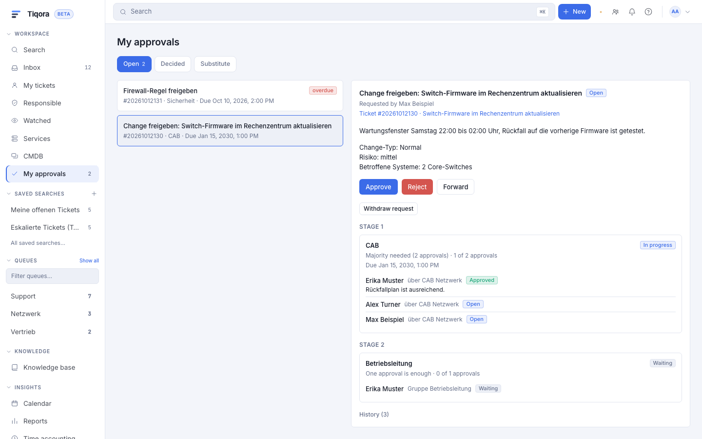
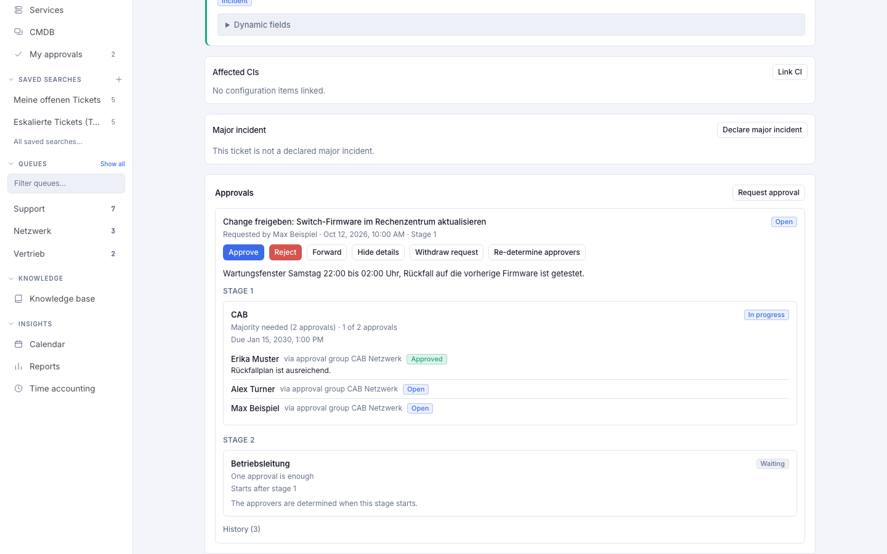
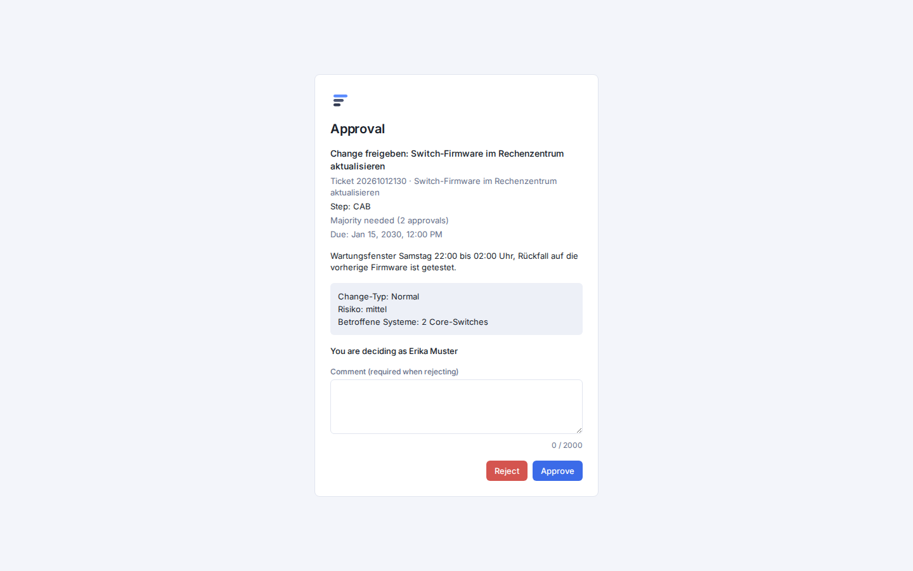
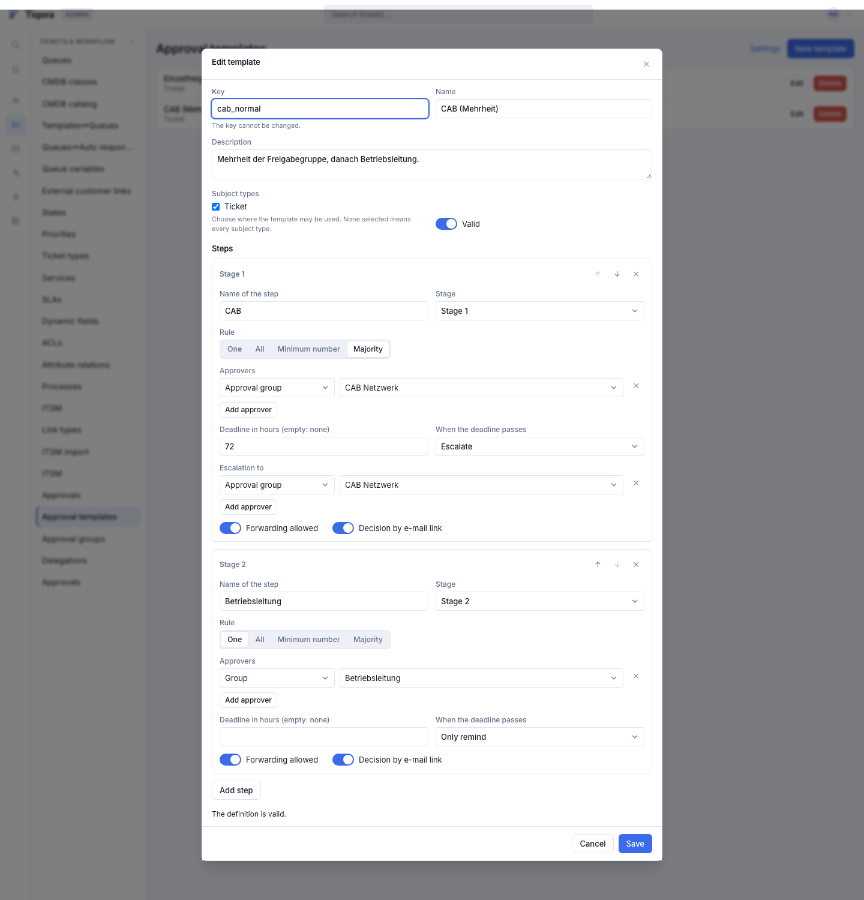

# Freigaben in Tiqora

> **English summary.** Tiqora has one shared approval engine ("Freigaben", package
> `tiqora.approvals`). An approval is a request on a **ticket** that one or more people must decide:
> *Freigeben* (approve) or *Ablehnen* (reject). A request is made of **stages** that run one after
> another; the **steps** inside a stage run in parallel. Each step has a rule (**one**, **all**,
> **at least n**, **majority**), a list of approvers (agents, Znuny groups, roles, approval groups
> such as a CAB, customer users, or dynamic sources such as "the ticket's customer"), an optional
> deadline and an action when the deadline passes (remind, escalate, reject, approve). Approvers
> are frozen as a snapshot when a step starts; "Freigeber neu ermitteln" refreshes it. People
> decide in **Meine Freigaben**, in the ticket, through a **single-use e-mail link** (random 256-bit
> token, stored only as a SHA-256 hash, opened in a confirm page that decides nothing until you
> click), in the customer portal (customers only if an admin allows it), through the REST API, or
> through the MCP tool `approval_decide` (off by default, see chapter 4). Approvers can have a
> standing **substitute** (Vertretung) and can forward an open request to another agent. The
> engine writes an audit trail, optional `Misc` ticket history lines and an optional internal note;
> Znuny sees nothing else (approvals are a Tiqora-only feature, no Znuny equivalent). Today
> ad-hoc requests on a ticket and approvals created by other Tiqora features can use the engine;
> process steps and catalogue request approvals are **not available yet** (chapter 10). The
> developer chapter (9) describes the service API, subject types, resolvers, events and jobs for
> features that build on it. UI labels below are the German defaults.

Dieses Dokument beschreibt die Freigaben von Tiqora: wie eine Freigabe aufgebaut ist, wer
entscheidet, wie Fristen und Vertretungen wirken, was die Administration einstellt und wie andere
Funktionen die Freigabe-Engine nutzen.

## 1 Überblick

Eine **Freigabe** ist eine Anfrage an Menschen, über etwas zu entscheiden: *Freigeben* oder
*Ablehnen*. Jede Freigabe gehört zu **genau einem Ticket**. Das ist Absicht: Berechtigungen, Ticketverlauf,
Webhooks und Echtzeit-Meldungen hängen in Tiqora am Ticket und gelten damit auch für Freigaben.

Wofür Tiqora Freigaben nutzt:

| Einsatz | Stand |
|---|---|
| **Ad hoc am Ticket**: Ein Agent mit Schreibrecht klickt im Ticket auf „Freigabe anfordern“, wählt eine Vorlage oder nennt die Freigeber selbst. | verfügbar |
| **Changes und CAB**: Die ITSM-Änderungsverwaltung baut auf dieser Engine auf (Freigabegruppe als CAB, Regel „Mehrheit“). | folgt mit der Änderungsverwaltung, siehe [itsm.md](itsm.md) |
| **Service-Anfragen** (Katalog) | noch nicht verfügbar, Kapitel 10 |
| **Prozessschritte** (Prozessaktion „ApprovalRequest“) | noch nicht verfügbar, Kapitel 10 |

Jede Anfrage hat einen **Gegenstandstyp** (wofür die Freigabe ist). Der eingebaute Typ heißt
„Ticket“; andere Funktionen melden eigene Typen an (Kapitel 9). Zusätzlich trägt eine Anfrage einen
**Freigabeschlüssel** (`approval_key`, Vorgabe `default`): Fordert jemand für dasselbe Ticket und
denselben Schlüssel erneut an, während die ältere Anfrage noch offen ist, wird die ältere
**ersetzt** (Status „Zurückgezogen“, Grund „durch neuere Anfrage ersetzt“).

Eine Anfrage hat einen von vier Status:

| Status | Bedeutung |
|---|---|
| Offen (`pending`) | Es wird noch entschieden. |
| Freigegeben (`approved`) | Alle Stufen sind freigegeben. |
| Abgelehnt (`rejected`) | Mindestens ein Schritt ist abgelehnt. |
| Zurückgezogen (`cancelled`) | Die Anfrage wurde zurückgezogen, ersetzt oder ihr Ticket wurde gelöscht. |

Einen Status „abgelaufen“ gibt es nicht: Läuft eine Frist ab und der Schritt ist so eingestellt,
dass er dann entscheidet, endet die Anfrage als „Freigegeben“ oder „Abgelehnt“ mit dem Grund
„Frist“ (`reason = timeout`).



## 2 Freigabestufen und Regeln

### Stufen und Schritte

Eine Anfrage besteht aus **Schritten**. Jeder Schritt hat eine **Stufennummer** (1, 2, 3 …, lückenlos).

- **Stufen laufen nacheinander.** Stufe 2 beginnt erst, wenn alle Schritte von Stufe 1 freigegeben sind.
  Erst dann werden die Freigeber von Stufe 2 ermittelt und benachrichtigt.
- **Schritte derselben Stufe laufen parallel.** Alle starten gleichzeitig und müssen alle
  freigegeben werden.
- **Eine Ablehnung beendet alles.** Wird ein Schritt abgelehnt, ist die ganze Anfrage abgelehnt;
  die übrigen offenen Schritte werden geschlossen.
- Grenzen: höchstens 10 Schritte je Anfrage, höchstens 50 Freigeber (Einträge) je Schritt, Schrittnamen
  sind innerhalb einer Anfrage eindeutig.

Beispiel „Firewall-Regel“: Stufe 1 hat zwei parallele Schritte „Sicherheit“ und „Netzwerk“,
Stufe 2 den Schritt „Betriebsleitung“. Die Betriebsleitung wird erst gefragt, wenn Sicherheit und
Netzwerk zugestimmt haben.

### Regeln

Die Regel eines Schritts bestimmt, wann der Schritt entschieden ist. Gezählt werden **Personen**:
Eine Gruppe mit fünf Mitgliedern sind fünf Freigeber.

| Regel | Oberfläche | Der Schritt ist freigegeben, wenn … | Der Schritt ist abgelehnt, wenn … |
|---|---|---|---|
| `any` | „Einer“ | die **erste** Entscheidung eine Freigabe ist | die **erste** Entscheidung eine Ablehnung ist |
| `all` | „Alle“ | alle Freigeber zugestimmt haben | irgendein Freigeber ablehnt |
| `quorum` | „Mindestanzahl“ | mindestens *n* Freigeber zugestimmt haben | *n* Zustimmungen nicht mehr erreichbar sind |
| `majority` | „Mehrheit“ | mehr als die Hälfte der Freigeber zugestimmt hat (*n* = Anzahl ÷ 2, abgerundet, plus 1) | die Mehrheit nicht mehr erreichbar ist |

Bei „Einer“ gilt: **Die erste Entscheidung zählt**, ob Freigabe oder Ablehnung. Soll dagegen eine
einzelne Zustimmung genügen und eine Ablehnung nur dann zählen, wenn niemand mehr zustimmen kann,
wählen Sie „Mindestanzahl“ mit dem Wert 1.

Beispiele für ein CAB mit fünf Mitgliedern:

| Regel | Nötige Freigaben | Ergebnis nach 2 Zustimmungen und 2 Ablehnungen | Ergebnis nach 3 Zustimmungen |
|---|---|---|---|
| Mehrheit | 3 (5 ÷ 2 = 2, plus 1) | noch offen: die fünfte Stimme entscheidet | freigegeben |
| Mindestanzahl 2 | 2 | freigegeben (schon nach der zweiten Zustimmung) | freigegeben |
| Mindestanzahl 4 | 4 | abgelehnt (mit 2 Ablehnungen sind höchstens 3 Zustimmungen möglich) | noch offen |
| Alle | 5 | abgelehnt (schon bei der ersten Ablehnung) | noch offen |

Bei „Mindestanzahl“ prüft Tiqora beim Speichern, dass die Zahl nicht größer ist als die Zahl der
Freigeber, sofern der Schritt nur einzelne Agenten und Kunden nennt. Bei Gruppen, Rollen,
Freigabegruppen und Regeln steht die Zahl der Mitglieder erst später fest; wird die Mindestanzahl dann unerreichbar, gilt „keine Freigeber“ (siehe unten).

**Jede Person stimmt je Schritt nur einmal ab.** Auch wer als Vertretung (Kapitel 6) für eine
andere Person mitentscheiden könnte, gibt in einem Schritt nur eine Stimme ab. Damit ist eine
Mehrheit tatsächlich eine Mehrheit von Menschen. Eine abgegebene Stimme ist endgültig; eine
falsche Stimme korrigieren Sie, indem Sie die Anfrage zurückziehen und neu anfordern.

### „Keine Freigeber“

Findet Tiqora für einen Schritt beim Start **keinen** gültigen Freigeber (alle Mitglieder
ausgeschieden, Gruppe gelöscht, nur der Antragsteller selbst war genannt) oder ist die Mindestanzahl
nicht erreichbar, entscheidet die Einstellung des Schritts **bei keinem Freigeber**:

- **Ablehnen** (Vorgabe): Der Schritt ist abgelehnt, Grund `no_approvers`.
- **Freigeben**: nur für Vorlagen von Administratoren und für Funktionen, die die Engine nutzen
  (automatische Abläufe). Ad hoc im Ticket ist das nicht erlaubt; die Anfrage wird mit
  `invalid_definition` abgewiesen.

Nicht auffindbare Einträge (zum Beispiel eine gelöschte Gruppe) halten die Anfrage nicht an: Sie
werden im Verlauf als „Freigeber ausgeschlossen“ festgehalten.

### Selbstfreigabe

Der **Antragsteller** und der Agent, der die Anfrage **angelegt** hat, können ihre eigene Anfrage
nicht freigeben. Sie werden gar nicht erst in die Freigeber aufgenommen (im Verlauf
„Freigeber ausgeschlossen“, Grund `self`), und auch als Vertretung eines Freigebers kann niemand
für sie entscheiden. Nur Funktionen, die die Engine nutzen, dürfen Selbstfreigabe erlauben
(`allow_self_approval`); im Dialog „Freigabe anfordern“ und in der API gibt es das nicht.
Der Systembenutzer (Benutzer 1, `root@localhost`) ist nie Freigeber.

## 3 Wer freigibt

Ein Schritt nennt seine Freigeber als Liste von **Einträgen**. Jeder Eintrag hat eine Art:

| Art in der Oberfläche | Wer entscheidet |
|---|---|
| **Agent** | genau dieser gültige Agent |
| **Gruppe** | **jeder gültige Agent mit Schreibrecht (`rw`) auf die Znuny-Gruppe**, direkt oder über eine Rolle. Es sind einzelne Freigeber, keine Gruppe als Ganzes. |
| **Rolle** | jedes gültige Mitglied der Znuny-Rolle |
| **Freigabegruppe** | die Mitglieder einer von Tiqora gepflegten Liste, zum Beispiel ein CAB (Administration, Kapitel 8). Mitglieder sind gültige Agenten; ein Schreibrecht auf eine Znuny-Gruppe ist nicht nötig. |
| **Kunde** | ein bestimmter Kundenbenutzer (nur wenn Kunden Freigeber sein dürfen) |
| **Regel** (dynamisch) | wird erst beim Start des Schritts aus dem Ticket ermittelt, siehe unten |

Mehrere Einträge in einem Schritt ergeben zusammen die Freigeber des Schritts; wer mehrfach genannt
wird, zählt nur einmal („der erste Eintrag gewinnt“ als Herkunft).

**Dynamische Freigeber** (Art „Regel“). Eingebaut sind:

- „Kunde des Tickets“ (`ticket.customer_user`): der Kundenbenutzer, der am Ticket steht
  (nur bei erlaubten Kunden-Freigebern),
- „Besitzer des Tickets“ (`ticket.owner`) und
- „Verantwortlicher des Tickets“ (`ticket.responsible`).

Andere Funktionen können weitere Regeln melden (zum Beispiel „Dienstverantwortlicher“, Kapitel 9).

**Kunden als Freigeber.** Standardmäßig aus (Einstellung „Kunden als Freigeber“). Ist die
Einstellung an, gilt für Kunden zusätzlich: Sie müssen zur **Firma des Tickets** gehören
(`customer_user.customer_id` oder ein Eintrag in `customer_user_customer`), das wird beim Start
und bei jeder Entscheidung geprüft, und der Gegenstandstyp muss Kunden erlauben (der Typ „Ticket“ tut es).

### Momentaufnahme und „Freigeber neu ermitteln“

Wer freigibt, wird **beim Start des Schritts** festgehalten (Momentaufnahme). Wenn danach jemand in
eine Gruppe, Rolle oder Freigabegruppe aufgenommen wird oder sie verlässt, ändert das einen
laufenden Schritt **nicht**. Die Ausnahme ist das gezielte Aktualisieren:

- Ein Agent mit Schreibrecht auf das Ticket (oder ein Administrator) klickt im Ticket bei der
  Freigabe auf **„Freigeber neu ermitteln“**. Tiqora wertet die Einträge der offenen Schritte erneut
  aus: Neue Mitglieder kommen hinzu, ausgeschiedene Freigeber, die noch nicht abgestimmt haben, werden
  entfernt. Wer schon abgestimmt hat, bleibt. Weitergeleitete und eskalierte Freigeber bleiben
  ebenfalls. Bleibt dadurch keiner übrig, greift „bei keinem Freigeber“.
- Zusätzlich entfernt der Hintergrunddienst (Kapitel 5) **ungültig gewordene** Freigeber
  automatisch: Agenten oder Kunden, die gelöscht oder auf „ungültig“ gesetzt wurden.

## 4 Entscheiden

Es gibt sechs Wege. Alle laufen durch dieselbe Engine und prüfen dieselben Regeln.

### Meine Freigaben

Der Eintrag **Meine Freigaben** in der Seitenleiste (mit Zähler) zeigt, was auf Sie wartet. Drei Reiter:

- **Offen**: Ihre offenen Zeilen und die von Agenten, für die Sie als Vertretung eingetragen sind
  („in Vertretung für …“). Überfällige Schritte sind markiert.
- **Erledigt**: Anfragen, bei denen Sie abgestimmt haben (auch in Vertretung).
- **Vertretung**: Ihre Vertretungen verwalten (Kapitel 6).

Rechts steht die Anfrage mit Beschreibung, den Stufen, den Freigebern, den Stimmen und dem Verlauf.
Die Schaltflächen **Freigeben**, **Ablehnen** und **Weiterleiten** erscheinen nur, wenn Sie
abstimmen dürfen. Ist die Stimme nicht mehr möglich (Sie haben im Schritt schon abgestimmt, es ist
Ihre eigene Anfrage), steht dort „nicht möglich (bereits abgestimmt)“ beziehungsweise
„nicht möglich (eigene Anfrage)“. Der Zähler zählt nur Zeilen, über die Sie noch abstimmen können.
**Die Oberfläche verlangt bei „Ablehnen“ eine Begründung**; die API verlangt sie nicht.
Ein Kommentar darf höchstens 2000 Zeichen lang sein.

### Im Ticket

Im Ticket zeigt der Bereich **Freigaben** alle Anfragen des Tickets,
die jüngste zuerst. Mit **Freigabe anfordern** (Schreibrecht auf das Ticket nötig) legen Sie eine
neue Anfrage an: aus einer **Vorlage** oder mit **eigenen Freigebern** (Schritte, Regeln, Fristen).
Ihre eigene Definition darf nicht automatisch freigeben (kein „Freigeben, wenn niemand da ist“ und
kein „Freigeben bei Fristablauf“). **Zurückziehen** und **Freigeber neu ermitteln** stehen hier ebenfalls.



### E-Mail-Link mit Bestätigungsseite

Freigeber bekommen eine E-Mail mit dem Titel der Anfrage, der Beschreibung, der Regel, der Frist und
einem **Entscheidungslink**. Der Link öffnet eine **Bestätigungsseite** (`/approve`), auf der Sie
Freigeben oder Ablehnen wählen und optional kommentieren. Ein Login ist nicht nötig.



Weil der Link wie ein Passwort wirkt, gelten diese Sicherungen:

- **Einmalig und nur für eine Person.** Der Link gehört zu genau einer Freigeber-Zeile. Er
  gilt weder für andere Zeilen derselben Person noch für Vertretungen. Sobald diese Zeile entschieden,
  weitergeleitet oder nicht mehr nötig ist (auf irgendeinem Weg) oder die Anfrage endet, ist der
  Link ungültig. Ein verbrauchter Link antwortet „bereits benutzt“ (`link_used`).
- **Zufälliger Token, nur als Hash gespeichert.** Der Token ist 256 Bit lang und zufällig. In der
  Datenbank steht nur sein SHA-256-Wert; auch ein Datenbankauszug enthält keinen verwendbaren Link.
  Warum kein signierter Link: Kapitel 10, Abweichung D9.
- **Ablauf.** Ein Link gilt höchstens **168 Stunden** (Einstellung „Gültigkeit der Links“),
  aber nicht länger als die Frist des Schritts plus 24 Stunden. Eine Frist, die schon mehr als
  24 Stunden zurückliegt, ergibt gar keinen Link (die E-Mail verweist dann nur auf „Meine
  Freigaben“). Je Freigeber sind höchstens 5 Links gleichzeitig gültig (Einstellung „Aktive Links
  je Freigeber“); ältere werden dann ungültig.
- **Fragment statt Adresszeile.** Der Link hat die Form `https://tickets.example.org/approve#t=<token>`.
  Alles hinter `#` sendet der Browser nie an einen Server: Der Token steht in keinem Zugriffsprotokoll
  und in keinem Referer. Die Seite liest ihn aus dem Fragment, entfernt ihn aus der Adresszeile
  und schickt ihn nur im Body einer POST-Anfrage.
- **Keine Entscheidung durch bloßes Öffnen.** Das Öffnen des Links (auch durch Vorschau-Funktionen
  von Mailprogrammen oder Virenscanner, die Links abrufen) entscheidet nichts: Die Seite zeigt nur
  die Anfrage. Erst Ihr Klick auf „Freigeben“ oder „Ablehnen“ sendet eine Entscheidung. Es gibt keinen
  Entscheidungsweg per GET.
- **Sparsame Auskunft.** Die Bestätigungsseite zeigt nur, was Sie für Ihre Entscheidung brauchen:
  Titel, Beschreibung, Ticketnummer und -titel, Schritt, Regel, Frist und Ihren Namen. Nicht
  angezeigt werden der Antragsteller, andere Freigeber und fremde Kommentare.
- **Bremse gegen Raten.** Tiqora sperrt eine Client-Adresse zeitweise, wenn sie viele ungültige
  Links ausprobiert (Einstellungen `TIQORA_APPROVAL_LINK_*`, Kapitel 8), und begrenzt auch die
  Anfragen je Link. Die Antwort ist dann „zu viele Anfragen“ (HTTP 429) mit einer Wartezeit.
- **Links einzeln abschaltbar.** Die Einstellung „Entscheidungslinks in E-Mails“ schaltet alle Links
  ab, auch schon versendete; die E-Mails verweisen dann nur auf „Meine Freigaben“. Auch ein
  Schritt kann E-Mail-Entscheidungen ausschließen („Entscheidung per E-Mail-Link“ aus).
- **Kein Link in Kopien.** Die Kopie an eine Vertretung („in Vertretung“) enthält nie einen Link, nur
  einen Verweis auf „Meine Freigaben“. So kann niemand mit der Mail eines anderen entscheiden.
- **Ohne Basisadresse kein Link.** Ist `public_base_url` nicht gesetzt, versendet Tiqora keine
  Links (Protokollmeldung `approval_mail_no_base_url`).

### Kundenportal

Sind **Kunden als Freigeber** und **Freigaben im Portal** an und ist das Kundenportal aktiv, finden
Kunden im Portal unter **Freigaben** ihre offenen und erledigten Anfragen und entscheiden dort. Sie
sehen nur Anfragen, bei denen sie selbst Freigeber sind, und nur, solange sie zur Firma des Tickets
gehören. Für alles andere antwortet das Portal „nicht gefunden“ (404) mit derselben Antwort wie für
eine nicht vorhandene Anfrage. Wer eine Zeile hat, aber nicht mehr zur Firma gehört, bekommt beim
Abstimmen 403 `customer_approver_outside_company`. Sind Kunden-Freigeber oder Freigaben im Portal abgeschaltet, oder ist
das Portal selbst abgeschaltet, ist die ganze Freigabe-Oberfläche des Portals 404 (nur wer genau in
dem Moment abstimmt, in dem der Administrator Kunden-Freigeber abschaltet, bekommt 403 `forbidden`). Kunden sehen nie andere Freigeber oder fremde Kommentare.

### REST-API

Agenten entscheiden mit `POST /api/v1/approvals/{id}/decision` (Kanal `api`). API-Schlüssel brauchen den
Bereich `tickets`. Die Entscheidung über einen E-Mail-Link ist ein eigener, öffentlicher Weg
(`/api/v1/approval-links/*`, ohne Anmeldung, ohne Schlüssel). Alle Routen: [api/rest-v1.md](api/rest-v1.md#approvals).

### MCP

Der MCP-Server bietet drei Werkzeuge ([api/mcp.md](api/mcp.md#approvals)): `approval_list_mine`,
`approval_get` (beide nur lesend) und `approval_decide`.

**`approval_decide` ist standardmäßig aus.** Es gibt eine **verbindliche Stimme im Namen des
Schlüsselinhabers** ab. Weil ein KI-Client Texte aus Tickets, Mails und Werkzeugergebnissen liest,
darf eine einzige eingeschleuste Zeile nie genügen, um etwa ein CAB-Votum abzugeben. Deshalb müssen
**alle drei** Bedingungen erfüllt sein:

1. Die Berechtigungen des API-Schlüssels nennen **ausdrücklich** `tool:approval_decide` (oder `*`).
   Ein Schlüssel ohne eingetragene Berechtigungen reicht nicht.
2. Der Schlüssel darf schreiben (`mcp:rw`).
3. Ein Administrator hat in den Einstellungen **„Abstimmen über MCP erlauben“** eingeschaltet
   (`approvals.mcp_decide_enabled`, Vorgabe aus).

Sonst antwortet das Werkzeug `{"error": "tool_not_allowed"}`, `write_scope_required` oder
`mcp_decide_disabled`. Die Beschreibung des Werkzeugs sagt dem Client ausdrücklich, dass es eine
verbindliche Stimme ist, die nur auf ausdrückliche Anweisung des Schlüsselinhabers erfolgen darf.
Es gelten dieselben Regeln wie für Menschen (keine Selbstfreigabe, eine Stimme je Schritt,
Berechtigungen des Schlüsselinhabers).

## 5 Fristen, Erinnerungen, Eskalation

Jeder Schritt kann eine **Frist** in Stunden haben. Ohne Angabe gilt die **Standardfrist** der
Einstellungen (Vorgabe 0 = keine Frist), „0“ im Schritt heißt ausdrücklich keine Frist. Die Frist
beginnt, wenn der Schritt startet, und zählt **Wanduhrstunden**, nicht Arbeitszeit: Ein Schritt mit
48 Stunden ist nach 48 Stunden fällig, auch über ein Wochenende. Der Kalender der Queue wird
nicht berücksichtigt.

Ein Hintergrunddienst, der Dienst **„Freigaben“** (Kapitel 8), prüft rund einmal je Minute:

1. **Fristablauf.** Was geschieht, bestimmt die Einstellung **„Wenn die Frist abläuft“**
   (`on_timeout`) des Schritts:

   | Einstellung | Wirkung |
   |---|---|
   | **Nur erinnern** (Vorgabe, `notify`) | Der Schritt bleibt offen. Die offenen Freigeber und der Antragsteller bekommen einen Hinweis „Frist überschritten“; in der Oberfläche steht „überfällig“. |
   | **Eskalieren** (`escalate`) | Die Eskalationsempfänger werden Freigeber des Schritts und **jeder von ihnen kann den Schritt allein entscheiden**. Sie bekommen eine E-Mail. Die bisherigen Freigeber bleiben. Findet sich niemand, verhält sich der Schritt wie „Nur erinnern“. |
   | **Ablehnen** (`reject`) | Der Schritt ist abgelehnt, Grund „Frist“. |
   | **Freigeben** (`approve`, „stillschweigende Zustimmung“) | Der Schritt ist freigegeben, Grund „Frist“. Nur in Vorlagen von Administratoren und in Definitionen von Funktionen, nie ad hoc. |

   Bei „Eskalieren“ gilt: Gehört ein schon genannter Freigeber auch zu den Eskalationsempfängern, kann er
   ebenfalls allein entscheiden, zählt aber weiter in der normalen Regel des Schritts mit. Wer in
   diesem Schritt bereits abgestimmt hat, wird nicht noch einmal aufgenommen.
2. **Erinnerungen.** Alle **„Erinnerung alle (Stunden)“** (Vorgabe 24, 0 = aus) erhält jeder Freigeber
   mit offener Zeile eine Erinnerung, höchstens **„Höchstzahl der Erinnerungen“** (Vorgabe 3) je Schritt.
3. **Ungültige Freigeber** entfernen, wie in Kapitel 3 beschrieben.
4. **Gelöschte Tickets.** Wird ein Ticket in Znuny gelöscht, zieht der Dienst seine offenen Freigaben
   zurück (Grund „Ticket gelöscht“).
5. **Aufräumen.** Benutzte, widerrufene und abgelaufene Entscheidungslinks werden 30 Tage danach aus
   der Datenbank gelöscht.

Ist der Dienst ausgeschaltet, passiert nichts davon: Fristen laufen ab, aber niemand wird erinnert und
kein Schritt wird entschieden.

## 6 Vertretung und Weiterleiten

**Vertretung (Standing Substitute).** Unter *Meine Freigaben*, Reiter *Vertretung*, nennt ein Agent
eine andere Person, die für einen Zeitraum an seiner Stelle entscheiden darf (Beginn optional,
Ende optional; ohne Ende gilt die Vertretung, bis sie beendet wird). Die Vertretung sieht die offenen
Zeilen des Vertretenen und kann sie entscheiden; die erste Entscheidung zählt. Eine Stimme wird mit dem
Vermerk „in Vertretung“ gespeichert. Regeln:

- Es gibt **nur einen Schritt weit**: Die eigenen Vertretungen einer Vertretung gelten nicht für die
  Zeilen des Vertretenen.
- Pro Person und Schritt zählt nur **eine** Stimme (Kapitel 2). Hat die Vertretung im Schritt schon
  abgestimmt, sieht sie die übrigen Zeilen dort als „nicht möglich (bereits abgestimmt)“.
- Die Vertretung darf nicht über Anfragen entscheiden, die der Vertretene selbst gestellt hat.
- Der Schritt muss **Weiterleiten erlauben** (`allow_delegation`, Vorgabe an).
- Die Vertretung bekommt eine Kopie der Mail „in Vertretung“, **ohne** Entscheidungslink.
- Beenden: „Jetzt beenden“. Eine Vertretung, die sich zeitlich mit einer anderen derselben Person
  überschneidet, wird mit 409 `delegation_overlap` abgewiesen; die Person selbst kann nicht ihre eigene
  Vertretung sein. Ein Administrator kann Vertretungen für jeden eintragen und beenden (Kapitel 8).
- Tiqora liest die Abwesenheitseinstellung („OutOfOffice“) von Znuny **nicht**; Vertretungen
  gibt es nur hier.

**Weiterleiten.** Mit **Weiterleiten** übergibt ein Freigeber seine eigene offene Zeile an einen
anderen Agenten. Die alte Zeile endet („weitergeleitet“, ihr Link wird ungültig), der neue Freigeber
bekommt eine E-Mail mit eigenem Link und entscheidet an der Stelle des alten (ist der alte
Freigeber allein entscheidend, ist es auch der neue). Weitergeleitet wird **einmal**: eine
weitergeleitete Zeile kann nicht erneut weitergeleitet werden. Nicht möglich ist es für Kunden, für
Vertretungen, bei Schritten ohne „Weiterleiten erlaubt“, an Personen, die im Schritt schon
abgestimmt haben, und an den Antragsteller oder Ersteller der Anfrage. Einen Kommentar speichert
Tiqora beim Weiterleiten nicht.

## 7 Verlauf und Nachvollziehbarkeit

**Audit-Verlauf.** Jede Anfrage führt einen Verlauf (am Ende der Detailansicht, „Verlauf (n)“) mit
Zeit, Handelndem und Aktion: angefordert, Schritt gestartet, Freigeber hinzugefügt oder ausgeschlossen
oder entfernt, benachrichtigt, erinnert, Link erstellt, abgestimmt, weitergeleitet, Schritt entschieden,
überfällig, eskaliert, wegen Frist entschieden, Freigeber aktualisiert, entschieden, automatisch
entschieden, zurückgezogen, ersetzt, Ergebnis übergeben (oder fehlgeschlagen) und „Ticketnotiz
übersprungen“. Der Verlauf enthält **nur Kennungen, Schlüssel und Status**, nie Namen, E-Mail-Adressen,
Titel oder Freitext. Kommentare stehen allein an der Stimme.

**Ticketverlauf (`Misc`).** Mit der Einstellung „Einträge im Ticketverlauf“ (Vorgabe an) schreibt
Tiqora für Anforderung, Stimme und Entscheidung je eine Zeile vom Typ `Misc` in die Ticket-Historie:

```
Approval #42 (default): requested
Approval #42: voted approved
Approval #42: decided rejected (timeout)
Approval #42: cancelled
```

Die Zeilen enthalten nur die Kennung, den Schlüssel und den Status. Das ist **alles, was Znuny
von Freigaben sieht**, außer der optionalen Notiz:

**Interne Notiz.** Mit der Einstellung „Interne Notiz bei Entscheidung“ (Vorgabe aus) schreibt Tiqora
nach der endgültigen Entscheidung eine **interne** Notiz (Absender „System“, nicht für Kunden
sichtbar) mit Status, Grund und dem Stand der Stufen. Die Notiz löst weder eine KI-Antwort
noch eine Kundenbenachrichtigung aus. Ein Plugin kann sie über den Hook `article.create` verhindern;
dann steht im Verlauf „Ticketnotiz übersprungen“ und die Entscheidung bleibt gültig.
Fehlt das Ticket inzwischen, entfällt Verlaufszeile und Notiz ohne Fehlermeldung.

**Echtzeit und Webhooks.** Jede Anfrage, Stimme, Entscheidung, Zurückziehung und Eskalation schreibt ein
Ereignis in den Outbox (Kapitel 9), das Webhooks erhalten. Die Oberfläche aktualisiert sich über
eine Echtzeit-Meldung `approval_changed`, die nur an die betroffenen Agenten geht.

## 8 Administration

Alle Admin-Seiten liegen unter **Admin, Freigaben** und brauchen Administratorrechte
(API-Schlüssel: Bereich `admin`).

### Übersicht

**Admin, Freigaben** listet jede Anfrage im System, die neueste zuerst, filterbar nach Status,
Ticket, Gegenstandstyp und „nur überfällige“. Ein Administrator sieht jede Anfrage und kann sie
zurückziehen.

### Freigabevorlagen

**Admin, Freigabevorlagen**: wiederverwendbare Definitionen („Standard-Change“, „Firewall-Regel“).
Eine Vorlage hat einen **Schlüssel** (nach dem Speichern nicht mehr änderbar, daran finden andere
Funktionen sie), Name, Beschreibung, die **Gegenstandstypen**, für die sie gilt (leer = für alle),
und die Schritte. Der Editor prüft die Definition schon beim Bearbeiten („Prüfen“: Struktur, Regelnamen,
Verweise auf Agenten, Gruppen, Rollen, Freigabegruppen und Kunden); eine fehlerhafte Definition
lässt sich nicht speichern. Verschwindet später etwas, auf das die Vorlage verweist (eine Gruppe wird
gelöscht), zeigt die Vorlage einen Hinweis, und eine Anforderung mit ihr wird mit 422
`invalid_definition` abgewiesen, bis Sie die Vorlage korrigieren. Eine Vorlage mit dem Schalter
„Ungültig“ wird nirgends angeboten. **Löschen** einer Vorlage ändert laufende Anfragen nicht (sie tragen ihre eigene
Kopie der Schritte). Vorlagen, die eine Funktion selbst angelegt hat, zeigen „Von … angelegt“ und
werden von Updates nie überschrieben, damit Ihre Änderungen erhalten bleiben. Eine Vorlage mit
Gegenstandstypen kann nur für diese Typen verwendet werden.

Nur in Vorlagen (nicht ad hoc) sind die Optionen „Freigeben, wenn niemand freigeben kann“ und
„Automatisch freigeben bei Fristablauf“ möglich.



### Freigabegruppen

**Admin, Freigabegruppen**: benannte Listen von Agenten, zum Beispiel „CAB Netzwerk“. Eine Liste ist
ein Freigeber-Eintrag der Art „Freigabegruppe“. Mitglieder müssen gültige Agenten sein. Eine Gruppe,
die noch in einer Vorlage genannt wird, lässt sich nicht löschen (409 `list_in_use`); Namen sind
eindeutig (409 `list_name_taken`).

### Vertretungen

**Admin, Vertretungen**: alle Vertretungen aller Agenten, laufende, geplante und (auf Wunsch)
beendete. Ein Administrator trägt Vertretungen für jeden ein, etwa bei Krankheit, und beendet jede.

### Einstellungen

**Admin, Einstellungen, Freigaben** (erreichbar über „Einstellungen“ auf jeder Freigabe-Seite).
Alle Werte werden als `approvals.<Feld>` gespeichert.

| Feld (Oberfläche) | Schlüssel | Vorgabe | Bedeutung |
|---|---|---|---|
| Standardfrist (Stunden) | `default_due_hours` | 0 | Frist für Schritte ohne eigene Frist; 0 = keine Frist. Bereich 0 bis 8760. |
| Erinnerung alle (Stunden) | `reminder_interval_hours` | 24 | 0 schaltet Erinnerungen aus. Bereich 0 bis 720. |
| Höchstzahl der Erinnerungen | `reminder_max` | 3 | Erinnerungen je Schritt, 0 bis 20. |
| Entscheidungslinks in E-Mails | `email_links_enabled` | an | Aus: keine Links, auch bereits versendete werden ungültig. |
| Gültigkeit der Links (Stunden) | `link_ttl_hours` | 168 | 1 bis 2160. Zusätzlich höchstens Frist plus 24 Stunden. |
| Aktive Links je Freigeber | `max_links_per_approver` | 5 | 1 bis 20. Ältere werden ungültig. |
| Kunden als Freigeber | `customer_approvers_enabled` | aus | Erlaubt Kunden als Freigeber (Gegenstandstyp muss es auch erlauben). |
| Freigaben im Portal | `portal_approvals_enabled` | an | Zeigt Kunden ihre Freigaben im Portal. Wirkt nur mit Kunden-Freigebern und aktivem Portal. |
| Einträge im Ticketverlauf | `history_entries` | an | `Misc`-Zeilen im Ticketverlauf. |
| Interne Notiz bei Entscheidung | `decision_note` | aus | Interne Notiz nach der endgültigen Entscheidung. |
| Antragsteller informieren | `mail_requester_on_decision` | an | E-Mail an den Antragsteller bei endgültiger Entscheidung. |
| Abstimmen über MCP erlauben | `mcp_decide_enabled` | aus | Erlaubt dem MCP-Werkzeug `approval_decide` verbindliche Stimmen (Kapitel 4). |

Technische Grenzen für die Link-Bremse stehen in den Umgebungsvariablen (Neustart nötig):
`TIQORA_APPROVAL_LINK_FAIL_MAX` (Vorgabe 20 ungültige Links je Client-Adresse),
`TIQORA_APPROVAL_LINK_FAIL_WINDOW` (600 Sekunden) und `TIQORA_APPROVAL_LINK_LOCKOUT`
(900 Sekunden Sperre). Sie wirken nur mit eingeschalteter Anmelde-Drosselung (`auth_rate_limit_enabled`).

### Dienst „Freigaben“

Auf der Seite **Admin, Dienste** gibt es den Dienst **„Freigaben“** (Schalter
`daemon.approvals.enabled`, Vorgabe **an**). Er führt die Prüfungen aus Kapitel 5 aus. Das Intervall
(Vorgabe 60 Sekunden, 15 bis 3600) setzt `TIQORA_APPROVALS_SWEEP_INTERVAL`. Der Dienst läuft im
`tiqora-worker`. Zwei Aufgabenarten laufen außerdem im Hintergrund und erscheinen in der
Aufgabenliste: **„Freigabe-Benachrichtigungen“** (`core.approval_mail`) und
**„Freigabe-Nachbearbeitung“** (`core.approval_hook`).

### Rechte und API-Schlüssel

Die Routen unter `/api/v1/approvals` gehören für API-Schlüssel zum Bereich `tickets`; die Admin-Routen
`/api/v1/admin/approvals` zum Bereich `admin`; die öffentlichen Link-Routen
`/api/v1/approval-links` brauchen keinen Schlüssel und lassen auch einen mitgesendeten Schlüssel
unbeachtet.

## 9 Für Entwickler

> **Hinweis.** Die Erweiterungspunkte (Gegenstandstypen, Freigeber-Regeln) sind **noch nicht
> SDK-stabil** (`sdk_stable=False`): Sie sind für Funktionen im Tiqora-Kern gedacht, nicht für
> Plugins von außen. **Die Namen der Ereignisse, die Werte der Spalte `action` und die Namen der
> Spalten der Tabellen `tiqora_approval*` werden ab jetzt nur noch erweitert, nie umbenannt oder
> entfernt**: Berichte (etwa die ITSM-Statistik) lesen diese Tabellen lesend.

### Aufbau

Das Paket `tiqora.approvals` hängt von keinem Fachpaket ab (`tiqora.process`, `tiqora.itsm`,
`tiqora.cmdb`, `tiqora.api` dürfen dort nicht importiert werden; ein Test prüft das). Umgekehrt
importieren Funktionen nur `tiqora.approvals.contract` und `tiqora.approvals.service`.

### Service-API

Alle Funktionen in `tiqora.approvals.service` nehmen eine `AsyncSession`, **flushen und
committen nie**: Der Aufrufer committet. Sie zeigen Fehler als `ApprovalError(code, http_status)`
(Codes in `contract.ERROR_STATUS`).

| Funktion | Zweck |
|---|---|
| `request_approval(session, *, ticket_id, subject_type, title, actor, ...)` | Legt eine Anfrage an und startet Stufe 1. Optional `definition` oder `template_key`, `subject_ref`, `approval_key`, `description`, `requester`, `allow_self_approval`, `supersede` (Vorgabe an). Gibt `ApprovalInfo` zurück. |
| `record_auto_decision(session, *, ..., status, reason)` | Hält eine bereits entschiedene Anfrage ohne Schritte fest (zum Beispiel einen vorab genehmigten Standard-Change). Keine E-Mails. |
| `cancel_approval(session, approval_id, *, actor, reason, check_permission)` | Zieht eine offene Anfrage zurück (`cancelled`, `superseded` oder `ticket_deleted`). Eine Notiz wird nicht gespeichert; wer eine braucht, schreibt eine eigene Ticketnotiz. |
| `decide(session, approval_id, *, actor, decision, channel, ...)` | Gibt eine Stimme ab. Aufrufer aus Routen rufen zuvor `await session.rollback()` (Sperrreihenfolge, unten). |
| `forward(session, approver_id, *, actor, to_user_id)` | Leitet eine Zeile weiter. |
| `refresh_approvers(session, approval_id, *, actor)` | „Freigeber neu ermitteln“. |
| `get_info`, `approval_status(session, ticket_id=, approval_key=)`, `approval_statuses(session, ticket_id=)`, `list_for_ticket` | Lesen. `approval_status` liefert den Status der **jüngsten** Anfrage zum Schlüssel (oder `None`); damit können etwa Prozessbedingungen den Stand abfragen. |
| `templates.ensure_template(session, key=, name=, definition=, origin=, subject_types=)` | Legt eine Vorlage einmal an. Existiert der Schlüssel, bleibt die Zeile unverändert (Admin-Änderungen überleben Updates). |

`Actor` und `Principal` (`contract.py`) beschreiben, wer handelt: Agent, Kunde oder `Actor.system()`.
Principal-Schlüssel haben die Form `agent:<id>` und `customer:<login>`.

**Sperrreihenfolge.** Jede Funktion, die den Zustand ändert, sperrt zuerst `tiqora_approval`
(`SELECT … FOR UPDATE`) und liest danach Schritte, Freigeber und Token mit Sperre. Die Reihenfolge
ist überall: eigene Zeile des Verbrauchers (zum Beispiel die Änderung) → `tiqora_approval` →
Freigeber und Token. Routen (Agent, Portal, Link, MCP) rufen vor `decide` und `redeem_link`
`await session.rollback()` auf, damit die Sperre die erste Anweisung der Transaktion ist.
Verbraucher dagegen rufen `request_approval`, `cancel_approval` und `record_auto_decision` innerhalb
ihrer **eigenen** Transaktion auf, nachdem sie ihre eigene Zeile gesperrt haben (kein `rollback`). Tests dafür: `tests/approvals_consumer_kit.py`
(`approve_all`, `reject_first`, `run_hook_now`, `assert_subject_registered`).

**Gleichzeitige Anfragen.** Legen zwei Transaktionen zugleich eine Anfrage für dasselbe neue
`(Ticket, Schlüssel)` an, verhalten sich die Datenbanken verschieden: Unter PostgreSQL können beide
`pending` werden (es gibt keine Lückensperren), unter MariaDB bricht eine mit einem Deadlock
(Fehler 1213) ab. `approval_status` meldet in jedem Fall die jüngste. Verbraucher sollten daher,
wie im Sperrkonzept oben, vorher ihre eigene Zeile sperren; dann kommt es nicht dazu.

### Gegenstandstypen und `on_decided`

Ein Verbraucher meldet in seinem Block von `register_core` einen `ApprovalSubjectType`
(`contract.APPROVAL_SUBJECT_TYPES`):

| Feld | Bedeutung |
|---|---|
| `key` | z. B. `ticket` (eingebaut), `itsm.change` |
| `title_key` | i18n-Schlüssel für das Abzeichen; erscheint auch in der Auswahl der Admin-Seiten |
| `allow_customer_approvers` | Kunden dürfen für diesen Typ freigeben |
| `agent_requestable` | ad hoc im Ticket anforderbar (nur `ticket`) |
| `describe` | optionale Zusatzzeilen (reiner Text) für Freigeber und E-Mails |
| `on_decided` | Rückruf nach der endgültigen Entscheidung |

`on_decided(session, outcome: ApprovalOutcome)` läuft im Job **`core.approval_hook` nach dem
Commit der Entscheidung**. Die Entscheidungstransaktion schreibt nur die Jobzeile
(`max_attempts=5`, Schlüssel `approval:<id>:<status>`). Dadurch kann ein Fehler im Verbraucher nie eine
Stimme zurückrollen. Der Rückruf muss **idempotent** sein, weil der Job wiederholt wird, und darf
**nicht selbst committen oder zurückrollen**: Der Job committet Rückruf, optionale Notiz und die
Audit-Zeile `hook_done` gemeinsam. Er läuft einmal je Endstatus (`approved`, `rejected`, `cancelled`).
Das Ergebnis `ApprovalOutcome` hat `approval_id`, `ticket_id`, `subject_type`, `subject_ref`,
`approval_key`, `status`, `reason`, `decided_at` und `comment` (Kommentar der letzten, entscheidenden
Stimme; sonst `None`). **Eine Fristüberschreitung** kommt als `rejected` oder `approved` mit
`reason == "timeout"`; einen Status „expired“ gibt es nicht.

### Freigeber-Regeln (Resolver)

Ein `ApproverResolver` (`contract.APPROVER_RESOLVERS`) liefert beim Start eines Schritts eine Liste
von `Principal`: `key` (`<Besitzer>.<Name>`, z. B. `itsm.service_owner`), `title_key`, `resolve(session, ctx)`
und `yields_customers`. Eingebaut sind `ticket.customer_user`, `ticket.owner` und
`ticket.responsible`. Ein unbekannter Schlüssel in einer Definition wird beim Speichern abgewiesen
(`unknown_resolver`).

### Ereignisse

Jede Änderung schreibt ein Ereignis in `tiqora_event_outbox` (`ticket_id` = Ticket der Anfrage).
Webhooks (Aufbau in [ai-integration.md](ai-integration.md#webhook-events-of-approvals)) und
Echtzeit-Meldungen laufen darüber:

| Ereignis | Wann |
|---|---|
| `TiqoraApprovalRequested` | Anfrage angelegt |
| `TiqoraApprovalVoted` | eine Stimme abgegeben |
| `TiqoraApprovalDecided` | endgültig freigegeben oder abgelehnt (`status`) |
| `TiqoraApprovalCancelled` | zurückgezogen oder ersetzt |
| `TiqoraApprovalEscalated` | Schritt eskaliert |

Die Namen tragen nie das Präfix „Notification“ und lösen keine Znuny-Benachrichtigungen aus.

### Tabellen und Audit-Aktionen

Zehn Tabellen (Migration `20261010_0083`): `tiqora_approval`, `_step`, `_approver`, `_vote`, `_token`,
`_event` (Audit), `_delegation`, `_list`, `_list_member` und `_template`. Kein Fremdschlüssel zeigt auf
Znuny-Tabellen (Ticket, Benutzer, Gruppen werden als Werte gespeichert); Zeitstempel sind naive UTC.
`tiqora_approval_event.action` kennt: `requested`, `step_activated`, `approver_added`, `approver_excluded`,
`approver_removed`, `notified`, `reminded`, `link_issued`, `voted`, `forwarded`, `step_decided`,
`overdue`, `escalated`, `timeout_decided`, `refreshed`, `decided`, `auto_decided`, `cancelled`,
`superseded`, `hook_done`, `hook_failed`, `note_skipped`. Lesende Verbraucher dürfen diese Werte
erwarten; neue Werte kommen nur hinzu. **Verknüpfen Sie `tiqora_approval*` nie per `JOIN` mit
Znuny-Tabellen** (unterschiedliche Collations in MariaDB, Fehler 1267): laden Sie die Schlüssel
und fragen Sie mit einer `IN`-Liste ab.

### Job-Arten und Dienst

| Art | Zweck |
|---|---|
| `core.approval_mail` | versendet je Benachrichtigung (`request`, `reminder`, `escalation`, `overdue`, `decided`, `cancelled`, `forwarded`) eine Textmail an Freigeber, Vertretungen und Antragsteller; Wiederholung ohne Doppelversand |
| `core.approval_hook` | optionale Notiz, `on_decided`, Audit `hook_done` / `hook_failed` |

Der Dienst `approvals` (`worker/approvals_sweep.py`, `approvals/sweep.py`) macht die Prüfungen aus
Kapitel 5.

### Erweitern

Neue Funktionen melden ihren Gegenstandstyp und ihre Regeln im **eigenen** Block von
`register_core` (`extensions/core.py`), legen Vorlagen mit `ensure_template` an und rufen den
Service auf. Sie brauchen für Testdaten ein eigenes ID-Band; Freigaben belegen 970000 bis 971999.

## 10 Annahmen und Grenzen

Die folgenden Festlegungen gelten, solange nichts anderes beschlossen wird.

1. **Jede Freigabe gehört zu einem Ticket.** Es gibt keine Freigaben ohne Ticket.
2. **„Einer“ heißt: die erste Entscheidung zählt**, Freigabe oder Ablehnung.
3. **Eine Gruppe zählt Personen** (alle gültigen Agenten mit `rw`), „einer aus der Gruppe“ ist ein
   eigener Schritt mit der Regel „Einer“.
4. **Momentaufnahme.** Freigeber werden beim Start des Schritts festgehalten; spätere Gruppenänderungen
   wirken nur über „Freigeber neu ermitteln“ und den automatischen Abgleich ungültiger Benutzer.
5. **Keine Selbstfreigabe** für Antragsteller und Ersteller; nur Funktionen dürfen sie erlauben.
6. **Keine Freigeber = Ablehnung**, es sei denn, eine Vorlage oder Funktion sagt ausdrücklich „Freigeben“.
7. **Fristen zählen Wanduhrstunden**, nicht Arbeitszeit. Fristablauf erinnert nur, wenn der
   Schritt nichts anderes sagt.
8. **Vertretung gibt es nur in Tiqora.** Die Abwesenheitseinstellung von Znuny wird nicht gelesen.
   Weiterleiten ist einmal möglich.
9. **Kunden als Freigeber sind aus** und nur für Gegenstandstypen möglich, die es erlauben;
   sie müssen zur Firma des Tickets gehören.
10. **Was ein Freigeber ohne Ticketzugriff sieht**: Titel und Beschreibung der Anfrage, Ticketnummer
    und -titel, die Stufen mit Freigebern und Stimmen. Keine Artikel. Den Ticket-Link sieht nur, wer
    das Ticket lesen darf (`ro`). Die Bestätigungsseite eines E-Mail-Links zeigt noch weniger
    (Kapitel 4).
11. **E-Mail-Links** liegen im Fragment, bestätigen erst auf Klick, gelten 7 Tage (höchstens Frist
    plus 24 Stunden), funktionieren ohne Anmeldung und lassen sich abschalten.
12. **Stimmen sind endgültig.** Korrigieren heißt zurückziehen und neu anfordern.
13. **Znuny sieht** nur `Misc`-Zeilen im Ticketverlauf und auf Wunsch eine interne Notiz.
14. **API-Schlüssel**: `/api/v1/approvals` zählt zum Bereich `tickets`; eine Entscheidung per API-Schlüssel
    hat den Kanal `api`.
15. **Wer ad hoc anfordert**: Agenten mit Schreibrecht auf das Ticket, nur für den Gegenstandstyp
    „Ticket“. Änderungen, Katalog und Prozess legen ihre Anfragen selbst an.

**Nicht verfügbar** (nicht Teil dieses Funktionsumfangs):

- Die **Prozessaktion „ApprovalRequest“** und die Prozessbedingung „Approval_<Schlüssel>“ gibt es noch
  nicht; die Engine bietet mit `approval_status` die Abfrage, die sie später nutzen.
- **Freigaben für Service-Anfragen** im Katalog gibt es noch nicht.
- Der **Kanal „Chat“** (Entscheidung in Slack, Teams) ist reserviert und nicht gebaut.
- Es gibt **keinen Zeitplan nach Arbeitszeit** (Wanduhrstunden), keine Wiedereröffnung einer
  entschiedenen Anfrage und keinen Stimmenwechsel.

**Abweichungen vom ursprünglichen Entwurf** (kurz begründet):

- **D1: mehr Tabellen.** Schritte, Freigeber-Momentaufnahme, Vertretung, Token und Audit brauchen eigene
  Tabellen (zehn statt zwei).
- **D2: „Mehrheit“ ist eine eigene Regel**, gerechnet über die aktuelle Zahl der Freigeber, damit
  Eskalation und Aktualisieren stimmen.
- **D3: Kanal „Chat“ reserviert**, nicht gebaut.
- **D4: Vertretung nur in Tiqora.**
- **D5: Kunden als Freigeber** über die Regel „Kunde des Tickets“ oder einzelne Kundenbenutzer, nur
  auf Wunsch.
- **D6: Prozessaktion und Bedingung später.**
- **D7: Wanduhrstunden**, nicht Arbeitszeit.
- **D8: keine Vergleichstests mit Znuny.** Freigaben sind eine reine Tiqora-Funktion; Znuny-seitig
  sichtbar sind nur die `Misc`-Zeilen und die optionale Notiz.
- **D9: zufälliger 256-Bit-Token, als SHA-256-Wert gespeichert, statt eines signierten Links.** Ein
  signierter Link (Nutzdaten plus Signatur) braucht einen Schlüssel, der bei Verlust alle Links
  zugleich entwertet oder preisgibt, lässt sich nicht einzeln widerrufen und nicht als „einmalig“
  verbrauchen, ohne trotzdem eine Datenbankzeile zu führen. Der zufällige Token ist genau dieser
  Datenbankzeile zugeordnet: einzeln widerrufbar, genau einmal verwendbar, und die Datenbank enthält nur
  den Hash, der sich nicht zurückrechnen lässt.

**Datenschutz.** Löscht oder anonymisiert ein Administrator einen Kunden, wirkt das auch auf
Freigaben, siehe [gdpr.md](gdpr.md#approvals).
