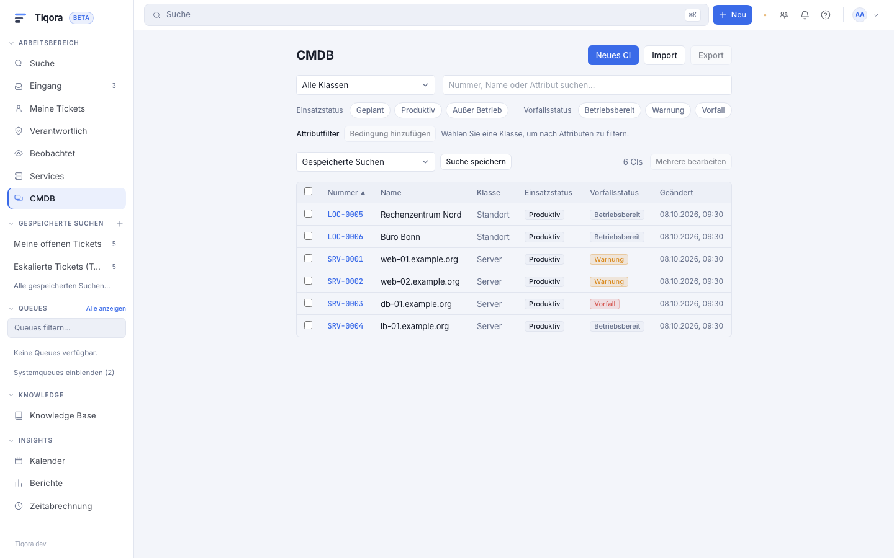
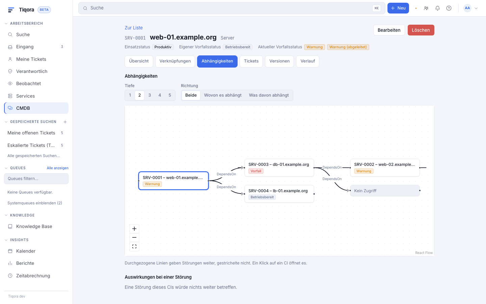
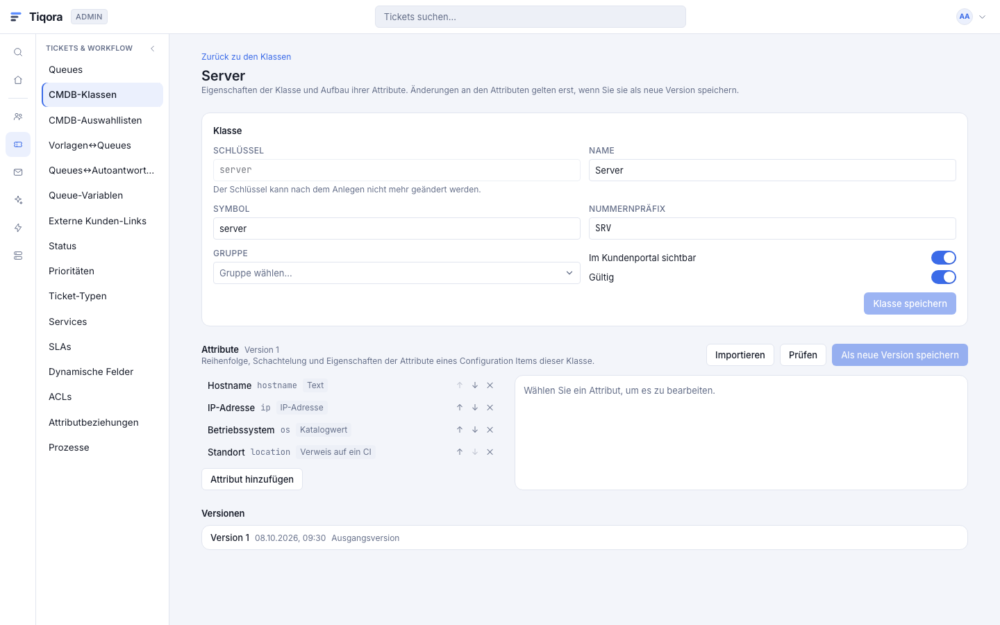

# CMDB: Konfigurationsdatenbank

> **English summary.** Tiqora ships its own CMDB ("Mode B" of the ITSM modes, see
> [itsm.md](itsm.md)): CI classes with a typed, versioned attribute definition (nested groups,
> counts, catalog values, references to other CIs, customers, services and more), CIs with a full
> version history, deployment and incident states, links between CIs and to tickets, services,
> customers and KB articles, a cycle-safe propagation of incidents along the links, an impact
> graph, CSV/XLSX import and export as background jobs, bulk edit, attachments, saved searches and
> a customer-portal view ("Meine Geräte und Systeme"). Access follows a Znuny group per class
> (`ro` reads, `rw` writes). Everything lives in `tiqora_*` tables; the CMDB answers only in
> Mode B (`itsm.mode = tiqora`). Two SQL views (`tiqora_v1_itsm_ci`, `tiqora_v1_itsm_ci_links`)
> serve the Znuny add-on. REST: `/api/v1/cmdb` and `/api/v1/admin/cmdb` (API-key area `cmdb`),
> portal: `/api/portal/config-items`. Read-only AI tools for the MCP server (`cmdb_search`,
> `cmdb_get`, `cmdb_impact`) are described in "KI-Werkzeuge (MCP)" below.
>
> **API-key scopes in short.** `cmdb:ro` / `cmdb:rw` cover `/api/v1/cmdb` and the mode-agnostic
> `/api/v1/itsm`; the admin endpoints (`/api/v1/admin/cmdb`) need the `admin` area; the MCP tools
> need `mcp:ro` (or higher) and optionally a `tool:<name>` allowlist.
>
> **Not included (wave 5):** reporting and statistics over CIs, change management and workorders.

## Was die CMDB ist

Die CMDB verwaltet **Configuration Items** (CIs): Geräte, Server, Software, Standorte,
Netzwerke und alles, was Sie in Tickets, Services und Störungsmeldungen wiederfinden möchten.
Jedes CI gehört zu einer **Klasse**. Die Klasse legt fest, welche Attribute ein CI hat, wer es
sehen darf und ob Kunden es im Portal sehen.

Alle Daten stehen in Tiqora-eigenen Tabellen (`tiqora_cmdb_*`, `tiqora_itsm_link`). Die CMDB
schreibt nie in die Tabellen von Znuny und verknüpft sie nie per SQL-JOIN mit ihnen (die
Prod-Datenbank mischt Zeichensatz-Vergleichsregeln; Schlüssel werden geladen und dann als
IN-Liste abgefragt).







## Modi

Tiqora kennt drei ITSM-Modi: Znuny führt das ITSM (Modus A), Tiqora führt es (Modus B) oder das
ITSM ist aus. Die CMDB gibt es nur in **Modus B**. In Modus A antworten alle CMDB-Endpunkte mit
`409 cmdb_in_znuny`, bei ausgeschaltetem ITSM mit `404`; der Menüpunkt „CMDB“ erscheint dann nicht.
Wie der Modus gewählt wird und wie eine Znuny-Installation mit vorhandener CMDB umzieht (nur über
den Import, nie durch einfaches Umschalten), steht in [itsm.md](itsm.md), Kapitel 1 und 7.
Solange kein Modus gespeichert ist, erkennt Tiqora Znunys ITSM-Tabellen (`general_catalog`,
`cip_allocate`) und bleibt dann in Modus A.

## Klassen und der Klassen-Designer

Unter **Admin → CMDB-Klassen** legen Sie Klassen an: Schlüssel (Buchstaben, Ziffern, `_`),
Name, Symbol, Nummernpräfix (zum Beispiel `SRV-`, ergibt `SRV-000001`), die Znuny-Gruppe und ob
die Klasse im Kundenportal sichtbar ist. CI-Nummern sind über alle Klassen eindeutig.

Der **Designer** bearbeitet die Attributdefinition als Baum. Jede Änderung wird als **neue
Definitionsversion** gespeichert, mit Kommentar; die Versionsliste zeigt, was sich gegenüber der
Vorversion geändert hat. Ältere CI-Versionen behalten ihre Definition.

Je Attribut stellen Sie ein: Schlüssel, Name, Typ, Pflichtfeld, **durchsuchbar**, **Portal**
(das Attribut erscheint im Kundenportal), Anzahl (`min`, `max`, Vorgabe) und typabhängige
Optionen. Gruppen (Unterattribute) sind bis zu 5 Ebenen tief, ein Attribut kann bis zu 100-mal
vorkommen.

| Typ | Inhalt und Besonderheiten |
|---|---|
| `text`, `textarea` | Freitext; Länge einstellbar (Vorgabe 255 / 20000), „mehrzeilig“ nur für die Anzeige |
| `integer`, `decimal`, `money` | Zahlen mit optionalem `min`/`max`; `money` mit Währung (ISO 4217). Dezimalzahlen werden kanonisch gespeichert („16.5“ und „16.50“ sind derselbe Wert und erzeugen keine neue Version) |
| `date`, `datetime` | Datum bzw. Zeitpunkt |
| `catalog` | Wert aus einer Katalogklasse (zum Beispiel Betriebssystem) |
| `ci_ref` | Verweis auf ein anderes CI, optional auf bestimmte Klassen beschränkt |
| `customer_user`, `customer_company` | Kundenkontakt bzw. Firma |
| `agent`, `group`, `queue`, `service`, `sla`, `priority`, `ticket_type`, `state` | Verweise auf Objekte von Znuny |
| `url`, `email` | Prüft das Format. Links werden nur für `http` und `https` als Link dargestellt, alles andere (`javascript:` …) erscheint als Text |
| `ip`, `mac` | Adressen werden normalisiert gespeichert |
| `attachment` | Datei am CI (siehe Anhänge) |

Aus Znuny übernehmen Sie eine vorhandene Klassendefinition mit **Definition importieren**
(YAML aus Znuny 6.5 oder 7.3, auch aus der Datenbank kopiert, oder das ältere Perl-Format; was
Tiqora nicht abbilden kann, wird als Hinweis aufgelistet). Gelesen wird die Definition mit
demselben Parser wie im Modus A und im ITSM-Import, also nach Znunys eigenen Regeln: fehlt
`CountMin`, gilt 1; Schlüssel mit Leerzeichen oder Umlauten lehnt schon Znuny ab, ebenso hier.
`CountMin` ist in Znuny die Zahl der angezeigten Eingabezeilen, Pflicht ist ein Wert nur mit
`Required`; Tiqora übernimmt `CountMin` daher nur für Pflichtattribute als Mindestzahl der
Werte, alle anderen Attribute bleiben optional und zeigen trotzdem die Zeilen wie in Znuny.
Verweise auf andere CIs (`CI`, `CISimple`) übernehmen die Klasse aus `CIClassName`. Der Umfang
ist begrenzt (1 MiB, 64 Ebenen, keine YAML-Aliase), damit eine manipulierte Datei nichts
anrichten kann.

### Vorlagen

**Aus Vorlage** legt eine Klasse mit sinnvollen Attributen an. Mitgeliefert sind
**Computer**, **Hardware**, **Netzwerk**, **Software** und **Standort**. Die Vorlage legt die
Klasse samt erster Definition an; die Gruppe wählen Sie beim Anlegen.

### Kataloge und Grundausstattung

Einsatzstatus (`planned`, `pilot`, `production`, `retired`, …), Vorfallstatus (`operational`, `warning`,
`incident`) und Auswahllisten wie das Betriebssystem sind **Katalogwerte** (**Admin → CMDB-Katalog**). Die Funktion eines Vorfallstatus (`operational`, `warning`, `incident`) steuert die
Weitergabe. **Standardwerte anlegen** (`POST /api/v1/admin/cmdb/seed-defaults`) erzeugt die
Kataloge (Einsatz- und Vorfallstatus, Ja/Nein) und die Standard-Linktypen des ITSM-Kerns; der Aufruf ist wiederholbar.

## CIs und Versionen

Ein CI hat Nummer, Name, Klasse, Einsatzstatus, **eigenen** Vorfallstatus und den daraus
**abgeleiteten aktuellen** Vorfallstatus. Jede Änderung der Attribute, des Namens oder der
Status erzeugt eine **neue Version** mit Änderungsnotiz; unveränderte Speicherungen erzeugen
keine. Die Detailseite zeigt Übersicht, Verknüpfungen, Abhängigkeiten, Tickets, Versionen
(zwei Versionen markieren und vergleichen) und den Verlauf.

Gleichzeitiges Bearbeiten wird über eine Sperrversion erkannt: Wer mit veralteten Daten
speichert, bekommt `409` und überschreibt die neuere Fassung nicht.

### Unbekannte Werte nach Definitionsänderungen

Entfernen Sie ein Attribut aus der Definition, bleiben die gespeicherten Werte in den CIs
erhalten. Beim **interaktiven Speichern** eines ganzen CIs (Formular oder API mit vollständiger
Attributliste) meldet Tiqora solche Werte als „unbekannt“ und lässt Sie wählen: behalten oder
verwerfen. Teil-Änderungen (`attributes_patch`), reine Statuswechsel, Massenbearbeitung, Import
und Prozess-Aktionen reichen unbekannte Werte unverändert durch und erzeugen deswegen keine
Version. So bricht eine Klassenänderung keine Automatik. Ein `PUT /api/v1/cmdb/cis/{id}` ohne
`attributes` (oder mit `null`) lässt die Attributwerte unverändert und ändert nur Name und Status.

## Suche und gespeicherte Suchen

Die CMDB-Liste filtert nach Klasse, Einsatz- und Vorfallstatus und Freitext. Freitext sucht in
Nummer, Name und allen als **durchsuchbar** markierten Attributen (Präfix-Treffer, Groß- und
Kleinschreibung egal). Zusätzlich lassen sich **Attributfilter** einer Klasse kombinieren
(Operatoren je Attributtyp: gleich, ungleich, enthält, beginnt mit, Bereiche, leer / nicht leer,
Ja / Nein). Nur durchsuchbare Attribute
werden indiziert; schalten Sie ein Attribut auf „durchsuchbar“, baut ein Hintergrundjob den
Index der Klasse in Stapeln von 1000 CIs neu auf (die Suche findet die alten CIs nach dem Lauf).
Die Trefferzahl wird ab 10 000 als „mehr als 10 000 CIs“ angezeigt.

**Gespeicherte Suchen** sind privat oder geteilt; nur der Besitzer ändert sie.

## Verknüpfungen und Linktypen

Ein CI lässt sich verknüpfen mit anderen CIs, Tickets, Services, Kunden, Firmen und
KB-Artikeln. Die Verknüpfungen stehen in der gemeinsamen Tabelle `tiqora_itsm_link`; die
**Linktypen** (`DependsOn`, `ConnectedTo`, `RelevantTo`, …) gehören zum ITSM-Kern und werden
dort gepflegt (siehe [itsm.md](itsm.md), Kapitel 4). Die CMDB liest sie nur
(`GET /api/v1/cmdb/link-types`, gefiltert nach CI↔CI, CI↔Service und Ticket↔CI).

Berechtigung: Eine Verknüpfung mit einem Ticket braucht `rw` auf der Queue des Tickets und
`ro` auf der Klasse des CIs; jede andere Verknüpfung braucht `rw` auf der Klasse jedes beteiligten CIs. Die Verknüpfungen
eines Tickets sieht nur, wer das Ticket lesen darf.

### Weitergabe von Störungen (Propagation)

Jeder Linktyp hat eine **Weitergabe**: `none`, `source`, `target` oder `both`. `source` heißt:
Das **Quell**-CI der Verknüpfung bekommt die Warnung, wenn das **Ziel**-CI in Störung ist.
Ungerichtete Linktypen (Quell- und Zielname gleich, etwa `ConnectedTo`) haben keine Quelle und
kein Ziel; hier gilt wie in Znuny: Mit `source` oder `both` bekommt jeder Nachbar die Warnung,
mit `target` keiner.

*Beispiel.* `web-01.example.org` **hängt ab von** `db-01.example.org` (Linktyp `DependsOn`,
Quelle ist `web-01`). Setzen Sie `db-01` auf den Vorfallstatus
„Vorfall“ (`incident`), wechselt `web-01` automatisch in den abgeleiteten Status „Warnung“
(`warning`) – und jedes CI, das wiederum von `web-01` abhängt, ebenfalls. Der eigene Status von
`web-01` bleibt unberührt; die Detailseite zeigt beide („Eigener“ und „Aktueller
Vorfallstatus“, abgeleitete Warnungen mit Hinweis). Hat `db-01` keine Störung mehr, fällt die
Warnung wieder weg.

Die Berechnung ist zyklensicher und begrenzt: Pro Speicherung wird nur der Bereich neu
berechnet, den die Änderung betrifft (der Rest bleibt unberührt, auch wenn anderswo
Störungen laufen). Überschreitet der Bereich die Obergrenze (`propagation_node_cap`, Vorgabe
5000) oder die Tiefe 50, schreibt Tiqora nichts halb und stößt stattdessen den Job
`core.cmdb_propagation` an. Ändert ein Admin unter *Admin → ITSM → Linktypen* die
Weitergabe, die Richtung oder die Gültigkeit eines Linktyps (auch über „Aus Znuny
aktualisieren“), stößt Tiqora in Modus B denselben Job von selbst an. Läuft der Job dabei
schon, prüft er am Ende, ob sich Linktypen oder Vorfallstatus geändert haben, und rechnet dann
noch einmal (höchstens drei Durchläufe). Von Hand rechnet ein
Admin alle Zustände mit `POST /api/v1/admin/cmdb/propagation/recompute` neu (Job
`core.cmdb_propagation`, Abfrage über `/api/v1/jobs`) – in der Oberfläche über
**Vorfallstatus neu berechnen** auf der Seite *Admin → CMDB-Klassen*. Ändert ein Admin im Katalog
die Funktion oder Gültigkeit eines Vorfallstatus, startet diese Neuberechnung von selbst. Den
letzten gültigen Vorfallstatus mit der Funktion `warning` lässt Tiqora nicht entfernen (`409`
`last_warning_state`): ohne ihn ließe sich kein abgeleiteter Zustand mehr berechnen.

**Services** bekommen aus den CIs, die sie tragen, einen Vorfallstatus – nach derselben Regel
wie in Modus A (Znunys Verhalten, siehe [itsm.md](itsm.md), Kapitel 3): Es zählen nur
Verknüpfungen, deren Linktyp zum Service hin weitergibt, und nur CIs mit produktivem
Einsatzstatus (z. B. „Production“, „Repair“; ein CI in „Planned“ zählt nicht); der schlimmste
Status gewinnt, einschließlich `incident`. Ist der Service danach `operational`, macht ihn ein
gültiger Kind-Service (`Eltern::Kind`), der nicht `operational` ist, zu `warning`. Ein Service
ohne verknüpftes CI und ohne solchen Kind-Service hat keinen Status.

`DependsOn` gibt wie in Znuny (`ITSM::Core::IncidentLinkTypeDirection`, Vorgabe
`{DependsOn: Both}`) in **beide** Richtungen weiter: Im Beispiel oben bekommt auch `db-01` die
Warnung, wenn `web-01` in Störung ist. Wer nur eine Richtung will, stellt die Weitergabe des
Linktyps unter *Admin → ITSM → Linktypen* auf `source` oder `target`.

## Abhängigkeiten und „Auswirkungen“

Der Reiter **Abhängigkeiten** zeigt den Graphen (Tiefe 1 bis 5, Richtung „wovon es abhängt“,
„was davon abhängt“ oder beide; durchgezogene Linien geben Störungen weiter, gestrichelte
nicht). CIs, die Sie nicht sehen dürfen, erscheinen als „Kein Zugriff“, ohne Namen, werden aber
durchlaufen, weil die Störung wirklich durch sie hindurch geht. **Auswirkungen bei einer
Störung** nennt die betroffenen CIs, Services, Kunden und offenen Tickets
(`GET /api/v1/cmdb/cis/{id}/affected`). Die Obergrenze des Graphen ist
`impact_graph_node_cap` (Vorgabe 300).

## Import und Export

**Import** (`/agent/cmdb/import`, vier Schritte: Datei, Zuordnung, Probelauf, Import) liest
CSV oder XLSX und läuft als **Hintergrundjob** mit Fortschritt (nginx erlaubt synchron nur
rund 90 Sekunden). Die Datei darf höchstens **25 MB** groß sein (`import_max_mb`, Obergrenze 25;
größere Dateien teilen Sie auf).

**Ziele der Zuordnung:** `number`, `name`, `deployment_state`, `incident_state`, `ignore` und
`attr:<Pfad>`. Der Pfad folgt der Attributdefinition, Positionen zählen ab 1 und `[1]` darf
fehlen: `attr:hostname`, `attr:NIC[2].IPAddress[1]`. Eine mit der CMDB exportierte Datei hat
solche Kopfzeilen und lässt sich ohne Zuordnung wieder importieren.

**Optionen:** Trennzeichen (`;`, `,`, Tab, `|`), Kodierung (`utf-8`, `cp1252`), Kopfzeile ja/nein,
Tabellenblatt (XLSX), **Kennung** (bis zu fünf Alternativen, die erste nichtleere Zelle
identifiziert die Zeile: `number`, `name` oder ein durchsuchbares Attribut), leere Zellen
(behalten oder löschen), bei Fehlern (abbrechen oder fehlerhafte Zeilen überspringen) und
„fehlende anlegen“. Neue CIs starten mit Einsatzstatus `production` und Vorfallstatus
`operational`.

Der **Probelauf** schreibt nichts und liefert Zähler (neu, geändert, unverändert, fehlerhaft)
und einen Bericht je Zeile zum Herunterladen. Der echte Import bleibt gesperrt, bis ein Probelauf
mit **derselben Datei und derselben Zuordnung** durchlief; bei „abbrechen“ auch fehlerfrei.
Zuordnungen speichern Sie als **Vorlage** und laden sie später wieder.

**Export** (CSV oder XLSX, Hintergrundjob) schreibt die Spalten in genau dieser Syntax. Zellen,
die mit `=`, `+`, `-`, `@` oder Tab beginnen, werden gegen Formelausführung in Tabellenkalkulation
geschützt; der Import entfernt diesen Schutz wieder, damit ein Export-Import-Zyklus unverändert
bleibt.

## Massenbearbeitung

In der Liste wählen Sie bis zu 5000 CIs und setzen Einsatzstatus, Vorfallstatus und/oder eine
Verknüpfung für alle (Job `core.cmdb_bulk`, mit Fortschritt und Bericht). Attribute lassen sich
so nicht ändern; unbekannte Werte bleiben, wie oben, unberührt.

## Anhänge

Attribute vom Typ `attachment` nehmen Dateien auf. Der Upload geschieht zuerst als
„vorgemerkte“ Datei und wird erst mit dem Speichern des CIs an die Version gebunden; Abbrechen
hinterlässt nichts.

## Kundenportal

Im Portal sehen Kunden unter **Meine Geräte und Systeme** (`/portal/config-items`) die CIs, die
mit ihrem Login oder einer ihrer Firmen verknüpft sind, sofern die Klasse portalsichtbar ist.
Gezeigt werden nur Attribute mit dem Portal-Kennzeichen, ohne Verweise in die Agentenoberfläche;
alles andere antwortet „nicht gefunden“. Beim Anlegen eines Tickets wählen Kunden bis zu zehn
Systeme aus (`?ci=<id>` wählt eines vor); die Verknüpfungen entstehen in derselben Transaktion
wie das Ticket. Kundenattribute mit dem Portal-Kennzeichen können den Namen eines anderen
Ansprechpartners derselben Firma zeigen; markieren Sie sie bewusst.

## Berechtigungen

Der Zugriff folgt der **Znuny-Gruppe der Klasse**: `ro` liest, `rw` ändert und legt an, Admins
dürfen alles. Mit der optionalen Einstellung `access_group` (leer = aus) braucht ein
Nicht-Admin zusätzlich `rw` in dieser Gruppe, etwa um nach einem Import den bisherigen Znuny-Zugriff
(`itsm-configitem`) beizubehalten. Ein CI einer Klasse ohne Leserecht gilt als nicht vorhanden.

## Einstellungen

Bereich **cmdb** unter Admin → Einstellungen:

| Schlüssel | Vorgabe | Bedeutung |
|---|---|---|
| `propagation_node_cap` | 5000 | Obergrenze der Knoten je Weitergabe-Berechnung (100 bis 50 000) |
| `impact_graph_node_cap` | 300 | Obergrenze der Knoten im Abhängigkeitsgraphen (50 bis 1000) |
| `import_max_mb` | 25 | Größe einer Importdatei (1 bis 25) |
| `version_archive_enabled` | aus | Altversionen archivieren |
| `version_archive_keep` | 50 | so viele neueste Versionen je CI bleiben immer aktiv (5 bis 1000) |
| `version_archive_min_age_days` | 365 | nur Versionen, die älter sind, werden archiviert (30 bis 3650) |
| `access_group` | leer | optionale Znuny-Gruppe als zusätzliches Tor |

## Größenhinweise

Die CMDB ist für **100 000 CIs** ausgelegt; `backend/tests/test_cmdb_perf.py`
(`TIQORA_PERF_TESTS=1`, beide Datenbanken) prüft Freitext- und Attributsuche (unter 2 s), Sortierung
tief in der Liste (unter 2 s), Nachschlagen (unter 1 s) und die Versionsliste (unter 0,2 s). Die
Freitextsuche nutzt den Index `ix_tiqora_cmdb_ci_attr_value`. Wird eine Klasse sehr groß, hilft
das **Versionsarchiv**: Ein täglicher Dienst (03:20) verschiebt alte Versionen in
`tiqora_cmdb_ci_version_archive`, behält die Versions-IDs und lässt sie weiter lesbar. Die aktuelle
Version wandert nie.

## Ansichten für die Znuny-Erweiterung

Die Migration legt zwei Ansichten an, aus denen die Znuny-Erweiterung (und andere Leser) lesen:

- `tiqora_v1_itsm_ci`: `ci_id`, `number`, `name`, `class_id`, `class_key`, `class_name`,
  `class_group_id`, `deployment_state`, `deployment_functionality`, `incident_state`,
  `incident_functionality`, `changed`, `class_portal_visible`.
- `tiqora_v1_itsm_ci_links`: `ci_id`, `object_kind`, `object_key`, `link_type`, `direction`,
  `created`; CI↔CI-Verknüpfungen erscheinen von beiden Seiten.

`CREATE VIEW` setzt ein Recht voraus, das die Datenbankrolle haben muss:

```sql
-- MariaDB
GRANT CREATE VIEW ON tiqora.* TO 'tiqora'@'%';
-- PostgreSQL (Schema-Recht)
GRANT CREATE ON SCHEMA public TO tiqora;
```

Fehlt das Recht, bricht die Migration nicht ab: Die Anweisung läuft in einem SAVEPOINT, wird
zurückgerollt und es erscheint die Meldung „CREATE VIEW-Recht fehlt“; **Admin → CMDB-Klassen** warnt in diesem Fall
(`views_present` ist falsch), und **Standardwerte anlegen** versucht es erneut.
Prüfen Sie vor einem Release auf der Prod-MariaDB mit `SHOW GRANTS`. Spätere Migrationen, die
Spalten von `tiqora_cmdb_ci`, `tiqora_cmdb_class`, `tiqora_cmdb_catalog` oder `tiqora_itsm_link`
ändern, müssen beide Ansichten vorher löschen und danach neu anlegen.

## KI-Werkzeuge (MCP)

Der MCP-Server von Tiqora (siehe [ai-integration.md](ai-integration.md), Abschnitt 2) bietet drei
**reine Lesewerkzeuge** für Konfigurationsobjekte. Sie ändern nichts (`readOnlyHint`) und
brauchen deshalb keinen Schreibzugriff (`mcp:rw`) auf dem Schlüssel.

| Werkzeug | Zweck | Parameter |
|---|---|---|
| `cmdb_search` | CIs nach Nummer oder Name suchen | `query` (Text zu Nummer und Name, leer = kein Textfilter), `class_key`, `deployment_state` (Statusschlüssel, z. B. `production`), `incident_state` (z. B. `operational`), `limit` (Vorgabe 20, 1 bis 100) |
| `cmdb_get` | ein CI mit Status, aktueller Version, Attributen und Verknüpfungen holen | `ci_id` oder `number` (eines von beiden; `number` wird exakt gesucht) |
| `cmdb_impact` | Auswirkungsanalyse eines CI | `ci_id`, `max_depth` (Vorgabe 4, 1 bis 5) |

**Antworten.**

- `cmdb_search` liefert je Treffer `ci_id`, `number`, `name`, `class` (Anzeigename),
  `deployment_state` und `incident_state` (Namen).
- `cmdb_get` liefert dieselben Felder plus `version_id`, `changed`, `attributes` und `links`.
  Attribute erscheinen mit dem Bezeichner aus der Klassendefinition, Katalogwerte als Namen;
  Gruppen werden mit ` / ` zusammengesetzt, mehrere Werte als Liste. Es werden höchstens
  200 Werte ausgegeben, darüber hinaus steht `"truncated": true` in der Antwort. `links` nennt
  je Verknüpfung `kind`, `key`, `link_type` und `direction`; verdeckte Enden (Objekte ohne
  Leserecht) fehlen. In Modus A gibt es keine `links`.
- `cmdb_impact` liefert `ci`, `services`, `customers`, `open_tickets`, `cis` (die abhängigen
  CIs, ohne das Start-CI selbst) und `truncated`. Aufgeführt wird nur, was über lesbare CIs und
  lesbare Queues erreicht wird.

**Verhalten je ITSM-Modus** (siehe [itsm.md](itsm.md), Kapitel 1):

| Modus | `cmdb_search`, `cmdb_get` | `cmdb_impact` |
|---|---|---|
| B (`tiqora`) | aus der Tiqora-CMDB | aus der Tiqora-CMDB |
| A (`znuny_readthrough`) | über den schreibgeschützten Znuny-Durchgriff | Fehler: die Analyse braucht die Tiqora-CMDB, verwenden Sie `cmdb_search` und `cmdb_get` |
| aus (`off`) | Fehler „ITSM is switched off on this site“ | Fehler, wie links |

**Rechte.** Die Sichtbarkeit folgt der Znuny-Gruppe der Klasse (siehe „Berechtigungen“): Der
Agent, dem der API-Schlüssel gehört, sieht nur Klassen mit Leserecht. Ein CI einer nicht
lesbaren Klasse wird wie ein unbekanntes CI beantwortet („CI not found (or not readable for this
API key's user)“), auch bei `cmdb_get` per Nummer und bei `cmdb_impact`; so lässt sich über
MCP nicht erkennen, ob es das CI gibt.

**API-Schlüssel.** Der Schlüssel braucht den Bereich `mcp` (mindestens `mcp:ro`; der ältere
Token `mcp` genügt). Der Bereich `cmdb` ist für MCP nicht nötig. Enthält der Schlüssel
`tool:<name>`-Einträge, laufen nur die genannten Werkzeuge; für die CMDB also
`tool:cmdb_search`, `tool:cmdb_get`, `tool:cmdb_impact`, sonst antwortet das Werkzeug mit
einem Zugriffsfehler. Schlüssel ohne `tool:`-Eintrag dürfen alle Werkzeuge.

## API

- Agent: `/api/v1/cmdb` (Klassen, Kataloge, CIs, Suche, Versionen, Diff, Verlauf, Impact,
  Affected, Tickets, Links, Anhänge, gespeicherte Suchen, `import-jobs`, `export-jobs`,
  `bulk-jobs`, `status`). Admin: `/api/v1/admin/cmdb` (Klassen, Definitionen, Vorlagen, Kataloge,
  Definitionsimport, `seed-defaults`, `propagation/recompute`). Portal: `/api/portal/config-items`.
- Maschinenzugang über **API-Schlüssel** mit dem Bereich `cmdb` (`ro`/`rw`; die klassischen
  Bereiche `read`/`write` gelten mit). Der Bereich `cmdb` umfasst `/api/v1/cmdb` und die
  modusunabhängige `/api/v1/itsm`; die Admin-Endpunkte unter `/api/v1/admin/cmdb` verlangen den
  bestehenden Bereich `admin`, Ticket-Unterressourcen (`/tickets/{id}/cis`) den Bereich `tickets`. Bekannte Folge: `POST /cmdb/cis/search` braucht `cmdb:rw`,
  und ein reiner `cmdb`-Schlüssel kann `/api/v1/jobs` nicht abfragen, braucht dafür also
  zusätzlich `tickets:ro`.
- Die OpenAPI-Beschreibung steht in `docs/api/openapi.json`.
- Die Prozess-Aktion `ConfigItemUpdate` gehört zum Znuny-Import
  (siehe [itsm.md](itsm.md), Kapitel 7); sie ändert CIs über `CiService` (als handelnder
  Benutzer, ohne Klassenrechte-Prüfung) und wirkt nur im Modus `tiqora`. Für den Import
  liefert die CMDB die Schnittstelle `tiqora.cmdb.importer_api`.

## Nicht enthalten (Welle 5)

Berichte und Statistiken über CIs (Reporting-Quelle) sind für Welle 5 vorgesehen; im
Reporting gibt es derzeit keine CMDB-Quelle. Nicht
übernommen werden außerdem Änderungsmanagement (Change) und Workorders.

Beispieldaten in diesem Dokument verwenden ausschließlich `example.org`.
