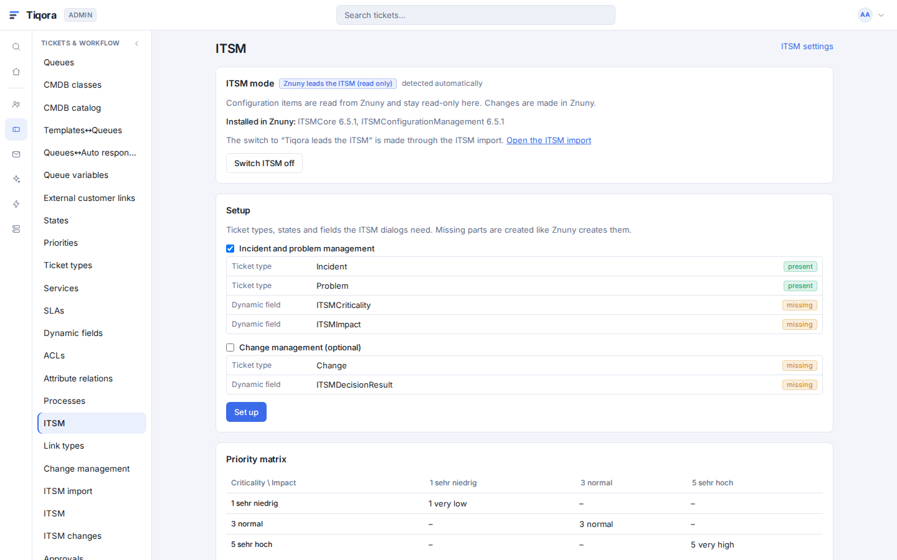
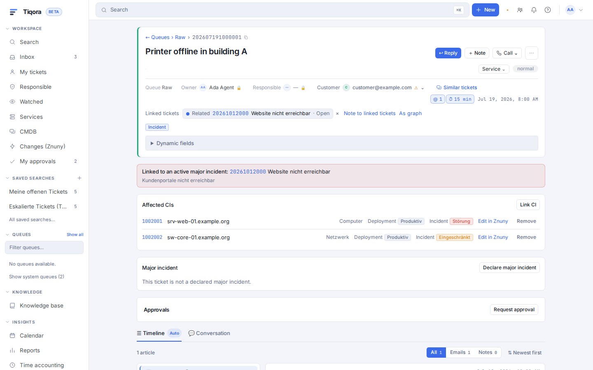
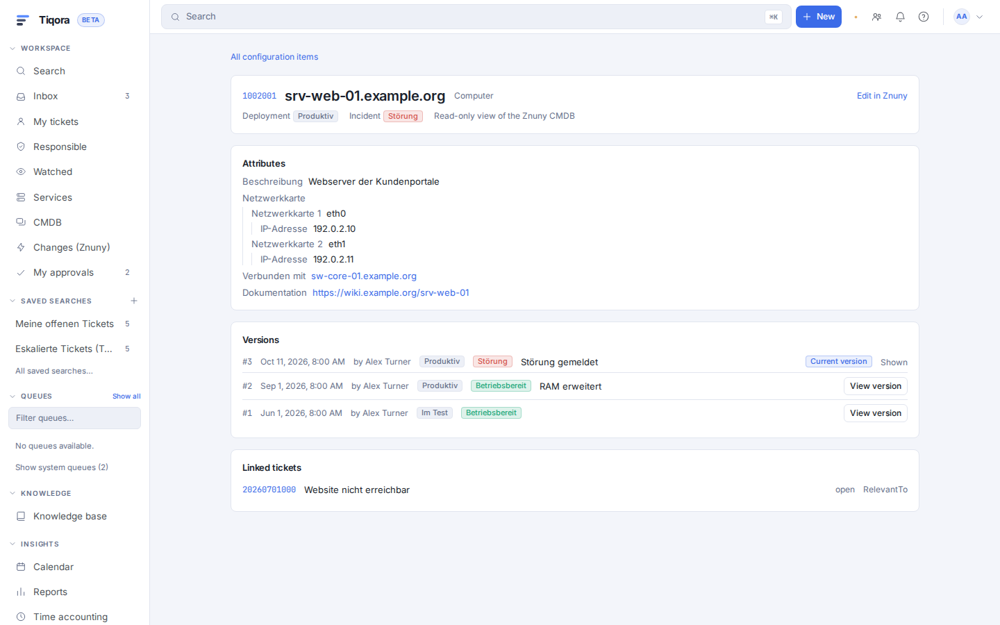
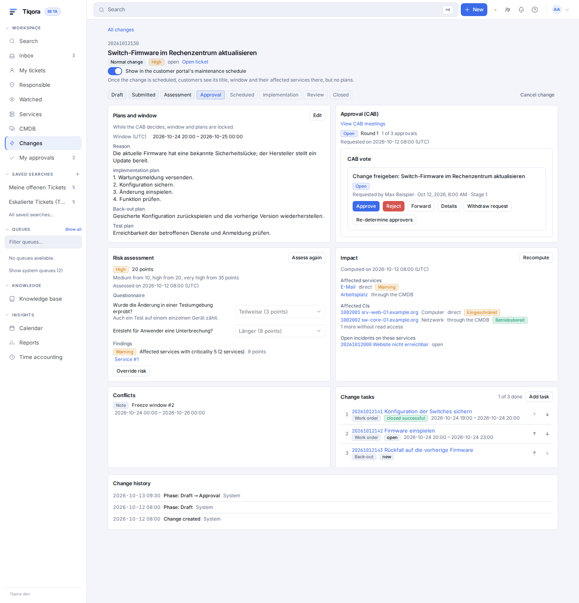
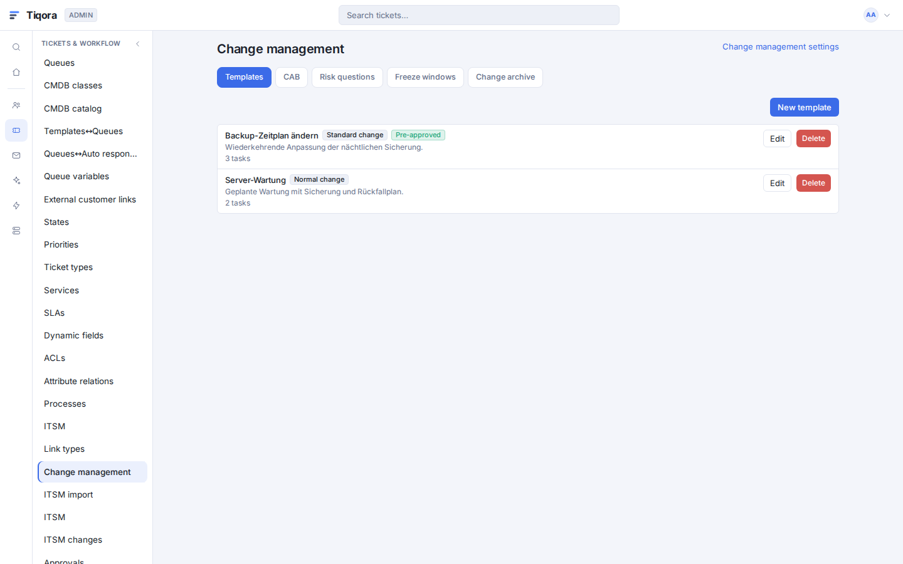
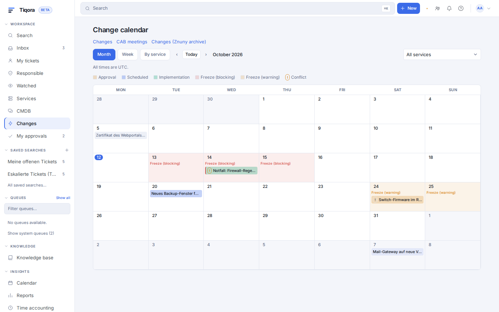
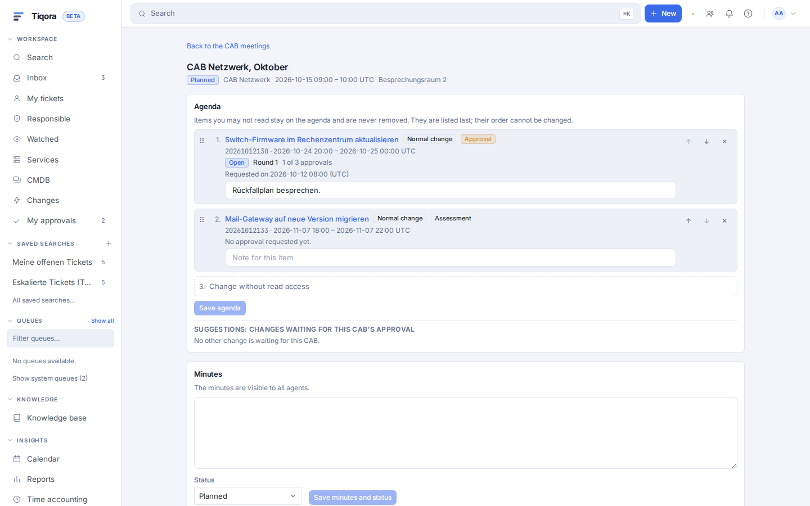

# ITSM in Tiqora

> **English summary.** Tiqora's ITSM covers incident and problem handling in the ticket (criticality,
> impact, priority matrix, known-error KB article, major-incident declaration with a timeline and
> updates), services with ITSM data and a derived incident state, ticket links (types, delete, note to
> linked tickets, link graph) and a CMDB. One setting, `itsm.mode`, selects who owns the configuration
> items (CIs): **off**; **`znuny_readthrough`** (Mode A: Znuny's ITSM tables are read, never written; CIs
> are edited in Znuny); **`tiqora`** (Mode B: the Tiqora CMDB, see [cmdb.md](cmdb.md)). On first start
> Tiqora detects Znuny's ITSM tables (`general_catalog` and `cip_allocate` both present means Mode A,
> otherwise Mode B) and stores the result once. A -> B is possible only through the ITSM import
> (chapter 7, [itsm-import.md](itsm-import.md)). The process action `LinkAdd` with a CI end follows
> the mode (Mode B: CMDB link service with the same rights as the API; Mode A: Znuny link; off:
> skipped as `itsm_off`), and a refused link or a plugin veto never aborts the process transition. In
> Mode B, when off and on a plugin veto the action is reported in `skipped_actions`; in Mode A a link
> that Znuny's rules refuse is only logged, as in Znuny. API-key area: `cmdb` for `/api/v1/itsm`, `tickets` for the
> ticket sub-routes, `admin` for `/api/v1/admin/itsm`. UI labels below are the German defaults.
> Chapter 8 covers change management (Mode B only): a change is a ticket of type `Change` plus
> Tiqora's change record (type, fixed phase machine, plans, window, rule-based risk, CMDB impact,
> freeze windows, tasks as `Change::Task` child tickets, change calendar, CAB decisions through the
> shared approval engine, opt-in portal schedule); every change route is API-key area `tickets`, not
> `cmdb`. Znuny's ITSMChangeManagement data is never written: Mode A shows it live and read-only,
> Mode B keeps a read-only change archive filled by the ITSM import or the archive job.
> Chapter 9 covers the ITSM reports: first-level solution rate and solution time on tickets (every
> mode but off), and reports on CIs and changes (Mode B only), plus the import of Znuny's ITSM
> statistics; the figures of changes archived from Znuny are not included.

Dieses Dokument beschreibt die ITSM-Funktionen von Tiqora: Incident und Problem, Services und
Prioritätsmatrix, Verknüpfungen, die CMDB und den Betrieb neben Znuny.

## 1 Überblick und Modi

Das ITSM von Tiqora besteht aus fünf Teilen: Incident- und Problem-Management im Ticket,
Services mit Prioritätsmatrix, Verknüpfungen (Tickets, Konfigurationselemente, Services), der
CMDB und dem Change-Management (Kapitel 8). Welche Teile sichtbar sind, bestimmt der
**ITSM-Modus** (Admin, Seite „ITSM“, Abschnitt „ITSM-Modus“, Einstellung `itsm.mode`).

| Modus | Oberfläche | Wer führt die Konfigurationselemente (CIs)? |
|---|---|---|
| **Aus** | Keine CIs, keine ITSM-Dialoge, keine Prioritätsmatrix, keine Problem- und Großstörungs-Felder. Verknüpfen, Löschen von Verknüpfungen, Verknüpfungstypen, Notiz an verknüpfte Tickets und Verknüpfungsgrafik bleiben, denn sie sind allgemeine Ticket-Funktionen. | niemand |
| **Znuny führt das ITSM (nur lesen)**, Modus A | CIs werden aus Znuny gelesen und in Tiqora angezeigt und mit Tickets verknüpft; geändert wird in Znuny („In Znuny bearbeiten“). | Znuny |
| **Tiqora führt das ITSM**, Modus B | Tiqora hält die CMDB selbst (Kapitel 6). | Tiqora |

**Empfehlung: Modus B ist das Ziel.** Modus A ist die Brücke für Standorte, die heute Znuny ITSM
nutzen: Sie arbeiten sofort in Tiqora, ohne dass Daten kopiert werden müssen, und stellen später
über den ITSM-Import (Kapitel 7) auf Modus B um. Wer neu beginnt, ohne Znuny ITSM, startet in Modus B.

### Wie der Modus gewählt wird

Beim ersten Start nach der Migration erkennt Tiqora, ob in Znuny das ITSM-Paket installiert ist
(Tabellen `general_catalog` und `cip_allocate` vorhanden). Ist es installiert, ist der Modus
**Znuny führt das ITSM**, sonst **Tiqora führt das ITSM**. Das Ergebnis wird einmal gespeichert
(Quelle „automatisch erkannt“) und danach nicht mehr neu ermittelt: Wer Znuny ITSM später
installiert, bekommt nicht plötzlich Modus A.

Erlaubte Wechsel:

- Jeder Modus lässt sich auf **Aus** stellen. Aus kehrt in den vorherigen Modus zurück, nicht in
  eine neu erkannte Vorgabe; nur wenn kein vorheriger Modus gespeichert ist, in die aktuell erkannte
  Vorgabe. Wurde per Import auf Tiqora umgestellt, führt Aus nur zurück zu
  Tiqora.
- **Tiqora führt → Znuny führt** ist nur möglich, solange die Tiqora-CMDB leer ist und Znuny ITSM
  erkannt wird (sonst Fehler `mode_transition_not_allowed`).
- **Znuny führt → Tiqora führt** gibt es nur über den ITSM-Import (Kapitel 7). Der Import ist der
  einzige Weg, damit nie zwei CMDBs nebeneinander gepflegt werden. Der Weg zurück (Rücknahme einer
  Umstellung) läuft ebenfalls über den Import.
- Ist die installierte Znuny-ITSM-Version unbekannt (`unsupported_znuny_itsm_version`), zeigt Tiqora
  keine CI-Daten an. Der Import bietet dann „Umstellen ohne CI-Daten“ an.

### Einstellungen

Admin, Einstellungen, Abschnitt „ITSM“ (von der Seite „ITSM“ über „ITSM-Einstellungen“ erreichbar;
gespeichert als `itsm.<Schlüssel>`). Die Vorgaben entsprechen den Namen, die Znunys ITSM-Pakete anlegen.

| Schlüssel | Vorgabe | Bedeutung |
|---|---|---|
| `incident_type` | `Incident` | Ticket-Typ Störung |
| `major_incident_type` | `Incident::Major` | Ticket-Typ Großstörung (Major Incident) |
| `service_request_type` | `ServiceRequest` | Ticket-Typ Serviceanfrage |
| `problem_type` | `Problem` | Ticket-Typ Problem |
| `change_type`, `change_task_type` | `Change`, `Change::Task` | Ticket-Typen Change und Change-Aufgabe (Change-Management in Modus B, Kapitel 8; die eigenen Einstellungen stehen dort) |
| `workaround_state` | `closed with workaround` | Status „Geschlossen mit Workaround“ |
| `criticality_field`, `impact_field` | `ITSMCriticality`, `ITSMImpact` | Dynamische Felder für Kritikalität und Auswirkung |
| `priority_matrix_enabled` | an | Prioritätsmatrix anwenden |
| `ci_ticket_link_type` | `RelevantTo` | Verknüpfungstyp für „Betroffene CIs“ |
| `problem_link_type` | `ParentChild` | Verknüpfungstyp zwischen Problem und Störung |
| `known_error_kb_category_id` | 0 | Kategorie der Wissensdatenbank für bekannte Fehler; 0 = nicht eingestellt, die Schaltfläche ist aus |
| `min_minutes_between_incidents` | 0 | Vorgabe für die Störungsflut-Warnung (0 bis 10080); 0 = aus |
| `linked_articles_max_tickets` | 200 | Höchstzahl Tickets je Notiz an verknüpfte Tickets (1 bis 1000) |
| `major_incident_customer_reply` | aus | erlaubt den Antwortmodus („Antwort an Kunden“) bei Großstörungen |
| `znuny_agent_url` | leer | Adresse des Znuny-Agentenbereichs für „In Znuny bearbeiten“; leer = aus HttpType/FQDN/ScriptAlias der SysConfig abgeleitet, sonst `http(s)://` |

Den Modus selbst ändern Sie nicht hier, sondern auf der Seite „ITSM“ (Abschnitt „ITSM-Modus“):
Schaltflächen „ITSM ausschalten“, „Znuny führen lassen (nur lesen)“ und „Tiqora führen lassen“
erscheinen nur für erlaubte Wechsel; die Seite zeigt außerdem die in Znuny gefundenen Pakete („In
Znuny installiert“) und die Quelle der Entscheidung („automatisch erkannt“, „vom Administrator“,
„durch den Import“).



### Berechtigungen und API

Die ITSM-Routen unter `/api/v1/itsm` gehören zum API-Schlüsselbereich **cmdb**, die Verwaltung unter
`/api/v1/admin/itsm` und `/api/v1/admin/itsm/import` zum Bereich **admin**. Die ticketbezogenen
Routen (`/api/v1/tickets/{id}/cis`, `/itsm`, `/problem`, `/major-incident`, `/link-graph`) gehören
zum Bereich **tickets**, ebenso alle Routen des Change-Managements, auch die unter `/api/v1/itsm`
(Kapitel 8, „Change-Rechte und API“). Ein Ticket ist für eine Rolle nur sichtbar, wenn der Agent
mindestens `ro` darauf hat: Ohne `ro` antworten alle diese Routen 404, und verknüpfte Tickets ohne
Leserecht erscheinen weder in der Verknüpfungsgrafik noch in Banner oder Listen.

## 2 Incident und Problem

### Einrichtung

Admin, Seite „ITSM“, Abschnitt „Einrichtung“, zeigt vor dem Anlegen, was vorhanden ist und was
fehlt, und legt es mit „Einrichten“ so an, wie Znuny es anlegen würde: die Ticket-Typen `Incident`,
`Incident::Major`, `ServiceRequest` und `Problem`, den Status „closed with workaround“ und die acht
Dynamischen Felder `ITSMCriticality`, `ITSMImpact`, `ITSMReviewRequired`, `ITSMDecisionResult`,
`ITSMDecisionDate`, `ITSMRepairStartTime`, `ITSMRecoveryStartTime` und `ITSMDueDate`. Die Typen
`Change` und `Change::Task` und die Felder `ITSMChangeType` und `ITSMChangePhase` bilden eine
eigene, vorab nicht angehakte Gruppe „Change-Management (optional)“ (Kapitel 8). Es wird nie
automatisch angelegt; ein Standort mit Znuny ITSM findet alles vor und behält seine Daten, beide
Oberflächen zeigen dieselben Felder.

### Incident im Ticket

- Chips für Rolle (Incident, Major Incident, Problem …), Kritikalität, Auswirkung und die
  Priorität, die die Matrix vorschlägt („Matrix: …“, wenn sie von der gesetzten abweicht).
- Block „Betroffene CIs“: CIs verknüpfen und entfernen (Kapitel 5 für die Regeln).
- Dialoge „ITSM-Felder“ (Reparaturbeginn, Wiederherstellung, Fälligkeit) und „Entscheidung“; sie
  schreiben über den normalen Ticket-Schreibdienst, wie die Znuny-Masken `AgentTicketAddtlITSMField`
  und `AgentTicketDecision`. Sind die Znuny-Einstellungen für diese Masken nicht vorhanden (kein
  Znuny ITSM), gelten die Vorgaben aus den Znuny-Paketen.
- Warnung vor einer Störungsflut: Gab es für den Service innerhalb der eingestellten Minuten schon
  eine Störung, bietet Tiqora an, das neue Ticket damit zu verknüpfen. Die Warnung blockiert nie.
  Der Wert gilt je Service (Dialog „ITSM-Daten“ am Service), sonst die Vorgabe aus den
  Einstellungen; 0 schaltet sie aus. In Modus A wird Znunys Wert je SLA nur angezeigt.

### Problem

Ein Ticket vom Typ Problem hat die Felder **Ursache** und **Workaround**. Sie liegen in
`tiqora_itsm_problem` und sind in Znuny nicht sichtbar. Störungen werden mit dem Problem verknüpft
(Typ `ParentChild`, das Problem ist die Quelle; höchstens 50 Tickets pro Aufruf, das Verknüpfen
läuft sofort). Über „Als bekannten Fehler veröffentlichen“ entsteht ein Wissensartikel im Status
„Zur Prüfung“ in der eingestellten Kategorie; die Wissensdatenbank veröffentlicht ihn nach der
Prüfung. Ist keine Kategorie eingestellt, ist die Schaltfläche aus und nennt den Grund.
„Verknüpfte Incidents mit Workaround schließen“ setzt den Status „closed with workaround“ und hängt
eine Notiz an jede noch offene verknüpfte Störung, als Hintergrundauftrag (Abschnitt „Notizen an
verknüpfte Tickets“ in Kapitel 4).

### Großstörung (Major Incident)

Im Ticket zeigt der Block „Major Incident“ die Schaltfläche „Major Incident ausrufen“ (Dialog mit
optionaler „Zusammenfassung“, höchstens 500 Zeichen; sie wird mit „Major Incident:“ davor zum Betreff
der Kundenantworten, ohne Zusammenfassung steht dort der Ticket-Titel). Sie setzt den
Ticket-Typ auf `Incident::Major` und legt einen Eintrag mit Zeitleiste („Ausgerufen“, „Update“,
„Beendet“) an. Jedes verknüpfte Ticket, das der Agent lesen darf, zeigt ein Banner „Mit einem aktiven
Major Incident verknüpft:“. „Update senden“ (Dialog „Update an alle Betroffenen“, Feld „Zustellung“)
hat drei Arten:

- **Nur intern**: Notiz nur am Großstörungs-Ticket.
- **Notiz an verknüpfte Tickets**: zusätzlich interne Notiz an jedem verknüpften Ticket
  (Hintergrundauftrag).
- **Antwort an Kunden**: zusätzlich E-Mail an die Kunden der verknüpften Tickets. Das ist nur möglich, wenn
  die Einstellung „Kundenantwort bei Großstörungen“ eingeschaltet ist, und sie ist **aus** (bewusste
  Abweichung vom Entwurf, damit keine Kundenpost versehentlich ausgeht).

Der Text der Aktualisierung wird beim Speichern bereinigt (wie Artikeltext) und darf nicht leer sein
(422 `empty_body`); ist der Antwortmodus ausgeschaltet, lehnt die Schnittstelle ihn mit 409
`customer_reply_disabled` ab, bei beendeter Großstörung mit 409 `not_active`. „Major Incident
beenden“ trägt das Ende in die Zeitleiste ein; der Ticket-Typ bleibt, denn Znuny kennt kein
„Beenden“.

**Einschränkung (kanalgebundene Antwort).** Der Antwortmodus bei Großstörungen sendet **für jedes
verknüpfte Ticket eine E-Mail**, auch wenn das Ticket über einen Plugin-Kanal (zum Beispiel Chat
oder Messenger) läuft. Eine kanalbewusste Antwort gibt es in
Wave 4 nicht; sie ist ein späterer Punkt. Wer Plugin-Kanäle einsetzt, sollte den Antwortmodus
ausgeschaltet lassen und den Notizmodus verwenden.



## 3 Service und Prioritätsmatrix

### Prioritätsmatrix

Die Matrix ordnet Kritikalität × Auswirkung einer Priorität zu (Admin, „ITSM“, „Prioritätsmatrix“).
Die Werte stammen aus den Auswahlwerten der Dynamischen Felder `ITSMCriticality` und `ITSMImpact`
(`1 very low` bis `5 very high`). Znuny liefert 25 Zellen mit; in Modus A zeigt Tiqora Znunys
`cip_allocate` schreibgeschützt („Diese Matrix gehört Znuny“), in Modus B ist sie bearbeitbar.

Wann die Priorität gesetzt wird: nur bei Änderungen in Tiqora (Ticket ändern, ITSM-Dialoge, neues
Ticket), nur wenn sich Kritikalität oder Auswirkung in dieser Änderung ändern, und nie, wenn dieselbe
Änderung die Priorität ausdrücklich setzt (das ist die Entscheidung des Agenten). Ein unbekanntes Paar
lässt die Priorität unverändert. Wie in Znuny prüft diese automatische Änderung das Prioritätsrecht
nicht. Änderungen aus Znuny, aus dem Generic Interface oder aus Prozessen löst Tiqora nicht aus; auch
Znuny erzwingt die Matrix nur in seinen Masken. Znuny kopiert beim Anlegen oder
beim Service-Wechsel in seinen Masken die Kritikalität des Services in das Ticketfeld; Tiqora tut das
nicht, die Kritikalität des Tickets wird von Hand gesetzt.

### Service-ITSM-Daten

Der Dialog „ITSM-Daten“ am Service (Admin, Services) hält Typ, Kritikalität, Beschreibung,
Verantwortliche/n, Sichtbarkeit im Portal und „Minuten zwischen Incidents“. Der Service-Typ ist
Freitext mit Vorschlägen. In Modus A kommen Typ und Kritikalität aus Znuny und sind
schreibgeschützt (Fehler `read_only`).

### Vorfallstatus des Services

Der Vorfallstatus (operational, warning, incident) wird aus den verknüpften CIs berechnet wie in
Znuny, in Modus A aus Znunys CIs und in Modus B aus der Tiqora-CMDB mit derselben Regel: Es zählen nur Verknüpfungstypen mit Weitergabe, nur CIs mit produktivem Einsatzstatus, die
schlechteste Funktionalität gewinnt (incident vor warning vor operational), ein Kind-Service in
Warnung macht den Eltern-Service höchstens zu warning. Die Anzeige erscheint am Ticket und in der
Service-Ansicht.

## 4 Verknüpfungen

### Verknüpfungen löschen und Typen

Verknüpfungen lassen sich im Ticket löschen (rw auf beiden Tickets nötig). Das Löschen ist wie in
Znuny `LinkDelete`: Es entfernt den Typ in beiden gespeicherten Richtungen unabhängig vom Zustand;
ein fehlender Link ist kein Fehler. Auf beiden Tickets entsteht der Historieneintrag
`TicketLinkDelete`, für CIs `CILinkDelete`; temporäre Verknüpfungen schreiben keine Historie. Beim
Anlegen gelten Znunys Regeln: nicht doppelt anlegbar, Gegenrichtung und Typgruppen werden geprüft,
Typen außerhalb von `PossibleLink` werden abgelehnt, Historie `TicketLinkAdd` auf beiden Tickets.
Danach wird der Znuny-Cache `LinkObject` geleert (Znuny sieht die Änderung mit dem nächsten Lauf des
TiqoraSync-Add-ons).

**Verknüpfungstypen** (Admin, ITSM, „Verknüpfungstypen“) sind Überschreibungen: Ein Znuny-Typ
(SysConfig `LinkObject::Type###*` mit `PossibleLink`) wird angeboten, auch wenn er keine Zeile hat;
eine Zeile kann ihn nur ausblenden oder umbenennen. Znuny-Typen lassen sich nicht neu anlegen,
denn Znuny definiert sie in SysConfig, und die schreibt Tiqora nicht. Sie ändern bei „aus Znuny“
nur Bezeichnungen, Angebot (Ticket-Ticket, Ticket-CI, CI-CI, CI-Service) und Gültigkeit. Eigene
Tiqora-Typen (Vorgaben `DependsOn`, `Includes`, `ConnectedTo`, `AlternativeTo`, `RelevantTo`) und die
Weitergabe des Incident-Status (keine, Quelle, Ziel, beide) gelten für Modus B. „Aus Znuny
aktualisieren“ gleicht die Zeilen mit der SysConfig ab; Ticket-Ticket-Verknüpfungen können nur Typen
nutzen, die Znuny speichern kann. Die Zeilen entstehen beim ersten Start, nicht durch eine Migration;
solange die Tabelle leer ist, legen API und Worker sie bei jedem Start erneut an. Ein gelöschter
Tiqora-Typ bleibt gelöscht. Ändert sich in Modus B die Weitergabe, die Richtung oder die
Gültigkeit eines Typs (im Editor oder durch „Aus Znuny aktualisieren“), berechnet die CMDB alle
abgeleiteten Vorfallstatus im Hintergrund neu (Job `core.cmdb_propagation`, siehe
[cmdb.md](cmdb.md)).

**Prozesse.** Die Prozess-Aktion `LinkAdd` legt Verknüpfungen ebenfalls an. Sobald ein Ende ein CI
(`ITSMConfigItem`) ist, richtet sie sich nach dem ITSM-Modus: In Modus B läuft sie über den
CMDB-Link-Dienst mit denselben Rechten wie die API, in Modus A über die Znuny-Verknüpfung, bei „Aus“
wird sie übersprungen (`itsm_off`). Eine abgelehnte Verknüpfung oder ein Veto eines Plugins bricht den
Prozessübergang nicht ab. In Modus B, bei „Aus“ und bei einem Veto steht die Aktion in `skipped_actions`;
in Modus A wird eine nach Znunys Regeln abgelehnte Verknüpfung wie in Znuny nur protokolliert (Einzelheiten im Abschnitt „Prozess-Aktion
LinkAdd und der ITSM-Modus“ in Kapitel 7).

### Notizen an verknüpfte Tickets

„Notiz an verknüpfte Tickets“ ersetzt `AgentTicketNoteToLinkedTicket`. Der Auftrag läuft im
Hintergrund mit Fortschritt; je Ticket in einer eigenen Transaktion. Voraussetzungen: `rw` auf dem
Quellticket, die Ziele müssen weiterhin verknüpft sein (sonst 422, ohne die Ids zu nennen). Pro Ziel
wird nochmals geprüft: ohne Schreibrecht wird übersprungen („keine Schreibberechtigung“), ebenso bei
fehlender Verknüpfung oder Kundenadresse. Lehnt eine Erweiterung (Sync-Hook für Artikel oder
Statuswechsel, siehe [plugins.md](plugins.md)) ein Ziel ab, wird nur dieses Ticket übersprungen („von
einer Erweiterung abgelehnt“, mit dem Text der Erweiterung); der Statuswechsel wird vor dem Artikel
geprüft, damit keine Antwort hinausgeht, deren Ticket dann nicht geschrieben wird. Eine abgelehnte
Notiz bei der Aktualisierung einer Großstörung beantwortet die Schnittstelle mit 422 und dem Text der
Erweiterung. Höchstens so viele Tickets, wie die Einstellung erlaubt
(Vorgabe 200). Ein Neustart nach dem Schreiben sendet nichts doppelt: Der Fortschritt je Ziel wird in
derselben Transaktion wie der Artikel gespeichert (`tiqora_itsm_bulk_target`).

Dieser Auftrag schreibt nur interne Notizen; die Schnittstelle nimmt keinen Antwortmodus an (422).
E-Mail an die Kunden aller verknüpften Tickets gibt es nur als Aktualisierung einer Großstörung,
und nur mit der Einstellung „Kundenantwort bei Großstörungen“ (Kapitel 2). Die Notiz an verknüpfte
Tickets ist eine allgemeine Ticket-Funktion und steht in jedem ITSM-Modus zur Verfügung, auch bei
„Aus“.

### Verknüpfungsgrafik

„Als Grafik“ zeigt die Verknüpfungen eines Tickets bis Tiefe 2 (die Schnittstelle erlaubt 1 bis 3) mit
höchstens 60 Knoten: Tickets (nur lesbare) und CIs, Kanten mit Typ und Richtung. Gekürzte Grafiken
sind mit „Weitere Verknüpfungen ausgeblendet“ gekennzeichnet.

## 5 Znuny führt das ITSM (Modus A)

In Modus A bleibt Znuny die Quelle der CMDB; Tiqora liest dessen Tabellen und schreibt in keine
ITSM-Tabelle von Znuny (`configitem*`, `general_catalog`, `cip_allocate`, `service`-Spalten). Der
Adapter ist auf die Linien 6.5 (ITSMCore 6.5.5, ITSMConfigurationManagement 6.5.4) und 7.3 (7.3.3 /
7.3.5) vermessen (`docs/itsm-import.md`, Abschnitte „Schema je Version“ und „Behaviour“); beide
Linien verhalten sich gleich. Paketversionen außerhalb dieser Linien (jede 6.5.x- und 7.3.x-Version
wird angenommen) zeigen „Diese Znuny-ITSM-Version wird nicht unterstützt (…)“.

In Modus A zeigt die CI-Seite (Menü „CMDB“ in der Seitenleiste) Liste, Suche
(Nummer und Name, Attributwerte ab 3 Zeichen), Detail mit Attributen, Versionen und verknüpften Tickets,
den Hinweis „Nur-Lese-Ansicht der Znuny-CMDB“ und den Verweis „In Znuny bearbeiten“.



### Was Znuny-Nutzer in jedem Modus sehen

| Funktion | Modus A (Znuny führt) | Modus B (Tiqora führt) | Aus |
|---|---|---|---|
| CIs ansehen (Suche, Detail, Versionen, Attribute) | ja, schreibgeschützt aus Znuny | ja, Tiqora-CMDB (Kapitel 6) | nein |
| CIs ändern, anlegen, löschen | nur in Znuny („In Znuny bearbeiten“) | in Tiqora | nein |
| CI-Anhänge | nur in Znuny | in Tiqora | nein |
| Ticket mit CI verknüpfen / lösen | ja | ja | nein |
| Verknüpfungstypen (Admin) | Bezeichnung, Angebot, Gültigkeit | zusätzlich eigene Typen, Weitergabe | ja |
| Prioritätsmatrix | Znunys Matrix, schreibgeschützt | bearbeitbar | nein |
| Service: Typ, Kritikalität | aus Znuny, schreibgeschützt | bearbeitbar | nein |
| Vorfallstatus des Services | aus Znunys CIs berechnet | aus der Tiqora-CMDB | nein |
| Problem, bekannter Fehler, Großstörung | ja (Daten in `tiqora_*`) | ja | nein |
| Znuny-Changes und Arbeitsaufträge | live aus Znuny, nur lesen („Changes (Znuny)“, „In Znuny bearbeiten“) | aus dem Change-Archiv, nur lesen | nein |
| Tiqora-Change-Management (Kapitel 8) | nein (Changes werden in Znuny geführt) | ja | nein |
| Notiz an verknüpfte Tickets, Verknüpfung löschen, Grafik | ja | ja | ja |

### Wer welche CIs sieht

Ein Agent sieht ein Znuny-CI nur mit `ro` auf der Berechtigungsgruppe seiner Klasse
(Klassenvorgabe `Permission` im Allgemeinen Katalog), so wie Znunys `ItemClassGroupCheck`. Eine
Klasse ohne diese Vorgabe sieht niemand. Die Gruppe `itsm-configitem` prüft Tiqora nicht: Sie
schützt in Znuny nur Anlegen, Bearbeiten und Löschen, nicht Ansicht, Suche und Verknüpfen
(`docs/itsm-import.md`, Vermessung Punkt 6). Das weicht vom Plan ab, der beide Prüfungen vorsah.
Ein Ticket mit einem CI verknüpfen oder die Verknüpfung lösen verlangt `rw` auf dem Ticket und
`ro` auf dem CI. Das ist **bewusst strenger als Znuny** (dort `ro` auf beiden Seiten), weil Tiqora
schon für Ticket-Ticket-Verknüpfungen `rw` auf beiden verlangt und die Verknüpfung in die
Ticket-Historie schreibt.

### Was den Tiqora-Verknüpfungen gegenüber Znuny fehlt

Tiqora schreibt bei einer Ticket-CI-Verknüpfung nur die Zeile in `link_relation`, die Ticket-Historie
(`CILinkAdd` / `CILinkDelete`) und leert den Znuny-Cache. Gegenüber Znunys Backend
`LinkObject::ITSMConfigItem` fehlen (jeweils im Golden-Test festgenagelt):

- **CI-Historie.** Znuny schreibt `LinkAdd` / `LinkDelete` in `configitem_history`; Tiqora schreibt in
  Modus A keine ITSM-Tabelle. Die Historie des CIs in Znuny zeigt in Tiqora gemachte Verknüpfungen nicht
  (Abweichung D3).
- **`CurInciStateRecalc`.** Znuny berechnet den gespeicherten Vorfallstatus des CIs neu. Für
  Ticket-CI-Verknüpfungen ist das wirkungslos, denn nur CI-CI-Verknüpfungen speisen den Status; Tiqora
  berechnet den Service-Vorfallstatus beim Lesen.
- **`TicketStatusLink`.** Das Znuny-Ereignismodul rechnet Vorfallstände neu, wenn sich der
  Ticket-Status ändert. Tiqora tut das nicht; es gibt keine gespeicherte Neuberechnung.
- **Ereignis `LinkObjectLinkAdd` / `LinkObjectLinkDelete`** (Generic-Interface-Invoker) löst Tiqora
  für diese Verknüpfungen nicht aus.

Znuny sieht Verknüpfungen aus Tiqora erst, wenn das TiqoraSync-Add-on den Cache geleert hat.

### Weitere bewusste Abweichungen

Ticket-Typ `RfC` legt Tiqora nicht an (stattdessen `Change` / `Change::Task`); die Gruppen `itsm-*`
und die Historientypen legen nur die Znuny-Pakete an. Zum Mindestabstand zwischen Störungen (D5) gilt
Abschnitt 2.

**Changes in Modus A.** Tiqora zeigt Znunys Changes und Arbeitsaufträge live und schreibgeschützt
unter „Changes (Znuny)“; angelegt und bearbeitet wird in Znuny. Siehe Kapitel 8, „Changes aus Znuny
(ITSMChangeManagement)“.

### Umstellung

Die Umstellung auf Modus B erfolgt ausschließlich über den ITSM-Import (Kapitel 7). Die Seite
„ITSM“ führt dorthin („ITSM-Import öffnen“).

## 6 CMDB (Modus B)

In Modus B führt Tiqora die Konfigurationsdatenbank selbst. Klassen mit versionierter
Attributdefinition (Designer, Vorlagen, Import von Znuny-Definitionen), CIs mit Versionsverlauf,
Einsatz- und Vorfallstatus, Verknüpfungen zu CIs, Tickets, Services, Kunden und KB-Artikeln,
zyklensichere Weitergabe von Störungen entlang der Linktypen, Abhängigkeitsgraph mit
„Auswirkungen“, CSV/XLSX-Import und -Export als Hintergrundjobs, Massenbearbeitung, Anhänge,
gespeicherte Suchen und die Kundenportal-Seite „Meine Geräte und Systeme“ gehören dazu. Der
Zugriff folgt der Znuny-Gruppe der Klasse. In Modus A (Znuny führt das ITSM) antworten die
CMDB-Endpunkte mit `409 cmdb_in_znuny`, bei ausgeschaltetem ITSM mit `404`; die Linktypen und
die Verknüpfungstabelle `tiqora_itsm_link` teilt sich die CMDB mit dem ITSM-Kern (Kapitel 4).
Zwei Ansichten (`tiqora_v1_itsm_ci`, `tiqora_v1_itsm_ci_links`) bedienen die Znuny-Erweiterung.

Alle Einzelheiten, Einstellungen und Grenzen stehen in [cmdb.md](cmdb.md).

## 7 Parallelbetrieb und Umstieg

Dieses Kapitel beschreibt, wie Tiqora und Znuny beim ITSM nebeneinander arbeiten und wie Sie die
ITSM-Daten von Znuny nach Tiqora übernehmen. Es hat drei Teile: „Koexistenz mit Znuny“ (die Modi und
der Umstieg), „ITSM-Daten aus Znuny übernehmen“ (die Admin-Seite und die Befehlszeile) und
„Znuny-Erweiterung TiqoraITSM“ (das Paket, das in Znuny läuft). Die technische Seite des Importers
(Zuordnung, Meldungscodes, Golden-Abgleich) steht in [itsm-import.md](itsm-import.md).

## Koexistenz mit Znuny

### Die drei Modi

| Modus | Wer pflegt CIs | Was Agenten in Tiqora sehen | Was Agenten in Znuny sehen | Was Kunden sehen |
|---|---|---|---|---|
| ITSM ausgeschaltet | niemand in Tiqora; Znuny nach seinen eigenen Regeln | keine ITSM-Funktionen | alles wie bisher | nichts von Tiqora-ITSM |
| Znuny führt das ITSM (Modus A) | Znuny; Tiqora liest die CIs nur | CIs schreibgeschützt aus Znuny („In Znuny bearbeiten“), Verknüpfungen mit Tickets, Incident, Problem, Großstörung | alles wie bisher, die CMDB ist unverändert bearbeitbar | in Znuny wie bisher; die Tiqora-Seite „Meine Geräte und Systeme“ ist nicht verfügbar |
| Tiqora führt das ITSM (Modus B) | Tiqora (die Tiqora-CMDB, Kapitel 6) | CIs bearbeiten, anlegen, löschen, Anhänge, Importe, Auswirkungen | CI-Ansichten lesbar; Bildschirme, die CIs ändern, sind gesperrt, das Ticket zeigt „Betroffene CIs (Tiqora)“ | „Meine Geräte und Systeme“ im Kundenportal; in Znuny auf Wunsch die Seite „Konfigurationselemente“ |

Die Vorgabe wird beim ersten Start automatisch gewählt: Wird Znuny ITSM in der Datenbank gefunden,
ist es **Modus A**, sonst **Modus B**. Die **Empfehlung ist Modus B**: Er ist das Ziel, Modus A ist die
Brücke, bis Sie die Daten übernommen haben. Den Modus wechseln Sie nicht von Hand von A nach B; dieser
Weg läuft ausschließlich über den Import (siehe oben, Kapitel 1).

### Was Sie in welchem Modus sehen

**Modus A.** In Tiqora zeigt das Ticket die verknüpften CIs aus den Tabellen von Znuny, die
CMDB-Seiten antworten mit „Die CMDB wird in Znuny geführt“ (`409 cmdb_in_znuny`). Nichts von dem, was
Sie importieren, ist sichtbar, bevor Sie umgestellt haben; auch das übernommene Zwischenergebnis bleibt
verborgen. In Znuny ändert sich nichts. Die Erweiterung TiqoraITSM ist inaktiv und zeigt nichts an.
Admin, „ITSM-Import“ (Seite „ITSM-Daten aus Znuny übernehmen“) ist die Seite, von der aus Sie umstellen.

**Modus B.**

- In Tiqora: die vollständige CMDB (Kapitel 6), der Ticket-Bereich „Betroffene CIs“, die Seite
  „Meine Geräte und Systeme“ im Kundenportal.
- In Znuny (mit TiqoraITSM): im Ticket-Zoom das Feld **Betroffene CIs (Tiqora)** mit Einsatz- und
  Vorfallstatus und einem Link nach Tiqora; die Znuny-Bildschirme zum Anlegen, Bearbeiten, Löschen und
  für Massenaktionen antworten mit der Seite „Die CMDB wird jetzt in Tiqora gepflegt.“ samt Link;
  Übersicht, Zoom, Suche, Historie und Druck der CIs bleiben lesbar (sie zeigen den Stand zum
  Zeitpunkt der Umstellung).
- Für Kunden in Znuny, wenn Sie es einschalten: die Seite „Konfigurationselemente“ mit Nummer, Name,
  Klasse und Zuständen. Sie zeigt nur CIs, deren Klasse im Kundenportal sichtbar ist, und keine
  Attribute.

**Ausgeschaltet.** Die ITSM-Funktionen von Tiqora sind weg; Znuny arbeitet unverändert weiter.

**Ereignisse für Webhooks.** Verknüpft oder trennt Tiqora ein Ticket und ein CI, steht im Ausgang
(Outbox) des Tickets ein Ereignis `LinkAdd` oder `LinkDelete` mit `target_object: "ITSMConfigItem"`, in
beiden Modi. `target_key` ist in Modus A die CI-ID von Znuny (`configitem.id`) und in Modus B die CI-ID
von Tiqora. Nach einer Umstellung zeigen dieselben Schlüssel also auf andere Tabellen; ein Empfänger,
der CI-IDs speichert, ordnet sie über die Zuordnung des Imports (Znuny-ID zu Tiqora-ID) um.

### Umstellung auf Tiqora (Ablauf)

Die Umstellung braucht keinen Stillstand. Bis zum letzten Schritt können Sie wiederholen und
abbrechen, Znuny bleibt führend.

1. **Probelauf, Bericht lesen.** Admin, „ITSM-Import“ (Seite „ITSM-Daten aus Znuny übernehmen“),
   Schaltfläche „Probelauf“. Er liest und
   zählt, schreibt aber nichts. Lesen Sie den Bericht (Abschnitt „ITSM-Daten aus Znuny übernehmen“) und
   beheben Sie, was in Znuny zu korrigieren ist (z. B. Attribut-Schlüssel mit Leerzeichen).
2. **Übernehmen, beliebig oft wiederholen.** „Übernehmen“ kopiert Katalog, Klassen, CIs mit allen
   Versionen, Verknüpfungen, Anhänge, Prioritätsmatrix und Service-Angaben, dazu die Znuny-Changes
   ins Change-Archiv. Jeder weitere Lauf holt nur Neues nach. Solange Znuny führt, sehen Ihre Agenten
   weiter die Daten aus Znuny.
3. **TiqoraITSM in Znuny installieren** (Anleitung: `packages/znuny-addon/TiqoraITSM/install/README.md`)
   und `TiqoraITSM::BaseURL` auf die Adresse Ihrer Tiqora-Installation setzen. Das Paket schreibt nie in
   die Datenbank und bleibt bis zur Umstellung inaktiv.
4. **Znuny-Webservices mit `ConfigItem*`-Operationen auf Tiqora umstellen.** Die Generic Interface von
   Znuny lässt sich nicht sperren: Ein Webservice, der `ConfigItemCreate`, `-Update` oder `-Delete`
   aufruft, würde nach der Umstellung weiter in Znuny schreiben, und Tiqora sähe das nicht. Richten Sie
   diese Aufrufer auf die Kompatibilitätsschicht von Tiqora (`/znuny-compat`, siehe
   [compatibility.md](compatibility.md)) um. Das Gleiche gilt für Skripte der Konsole und für
   Import/Export-Aufträge in Znuny.
5. **„Auf Tiqora umstellen“.** Der Dialog fragt, ob TiqoraITSM installiert ist oder ob in Znuny keine
   CIs mehr bearbeitet werden; ist beides nicht der Fall, startet die Umstellung nicht. Danach läuft sie als
   Hintergrundauftrag: Znuny wird für CI-Bearbeitung gesperrt, ein letzter Import holt die letzten
   Änderungen, dann stellt Tiqora den Modus um. Schlägt sie fehl oder wird sie abgebrochen, wird die Sperre
   in Znuny wieder aufgehoben; die Seite zeigt andernfalls die Schaltfläche „Sperre aufheben“.
6. **Prüfen.** Ein Ticket mit verknüpften CIs zeigt in Znuny das Feld „Betroffene CIs (Tiqora)“; der
   Bildschirm „CI bearbeiten“ in Znuny zeigt die Sperrseite; in Tiqora steht oben „Tiqora führt das
   ITSM seit …“, und der Drift-Hinweis („Seit der Umstellung wurden in Znuny … CIs oder
   CI-Verknüpfungen geändert“) erscheint nicht.

**Change-Archiv beim Umstieg.** Jeder Import kopiert die Changes aus Znunys Change-Verwaltung lesend
ins Change-Archiv; nach der Umstellung legen Sie neue Changes im Change-Management von Tiqora an, und
der Archiv-Lauf (Admin, „Change-Management“, „Change-Archiv“) holt nach, was in Znuny noch dazukommt.
Siehe Kapitel 8.

Gibt es in Znuny nur ITSMCore ohne das CMDB-Paket, läuft der normale Ablauf: Der Import übernimmt Katalog,
Prioritätsmatrix und Service-Angaben (es gibt keine Klassen und CIs), danach stellen Sie wie oben um.

Sonderfall „Umstellen ohne CI-Daten“: Ist die installierte Znuny-ITSM-Version für den Import unbekannt,
kann Tiqora keine ITSM-Daten aus Znuny lesen, auch Katalog, Prioritätsmatrix und Service-Angaben nicht.
Der Dialog bietet dann eine Umstellung an, die nichts aus Znuny übernimmt; Sie müssen ausdrücklich
bestätigen, dass die CI-Daten aus Znuny nicht übernommen werden. Kann Tiqora die Version lesen, lehnt
Tiqora diesen Weg ab (`409`), denn dann gilt der Ablauf mit Import.

### Was bleibt, was entfällt (je Znuny-Bildschirm)

| Znuny-Bildschirm | Nach der Umstellung |
|---|---|
| CI-Übersicht und Suche | bleibt (nur lesen); in Tiqora: CMDB, Suche |
| CI-Zoom (Ansicht, Versionen, Historie) | bleibt (nur lesen); in Tiqora: CMDB, CI öffnen |
| CI bearbeiten / anlegen | gesperrt durch TiqoraITSM; in Tiqora: CMDB, „Neues CI“ und „Bearbeiten“ |
| CI löschen | gesperrt durch TiqoraITSM; in Tiqora: CMDB, „Löschen“ |
| Massenaktion | gesperrt durch TiqoraITSM; in Tiqora: CMDB, Massenbearbeitung |
| CI mit Ticket verknüpfen (Verknüpfen-Maske) | gesperrt, soweit ein CI beteiligt ist; in Tiqora am Ticket („Betroffene CIs“) oder, wenn eingeschaltet, über die Verknüpfungsaktion der Erweiterung |
| Klassen-Definition (Admin) | Ansicht bleibt (nur lesen); Ändern gesperrt; in Tiqora: CMDB, Klassen, Designer |
| Import/Export von CIs | bleibt, wird aber nicht gesperrt (siehe Bekannte Lücken); in Tiqora: CMDB, Import und Export |
| Change- und Arbeitsauftrag-Masken | bleiben unverändert in Znuny (sie kennen keine Tiqora-Changes); in Tiqora: neue Changes im Change-Management, die alten lesend im Change-Archiv (Kapitel 8) |
| Kundenansicht der CIs in Znuny | bleibt (nur lesen); in Tiqora: Kundenportal, „Meine Geräte und Systeme“; optional die Seite der Erweiterung |
| Service-Zoom | bleibt unverändert (wird nicht gesperrt); in Tiqora: Services, ITSM-Angaben |
| ITSM-Statistiken (CI, Change, First-Level-Lösungsquote, Lösungszeit) | bleiben in Znuny erhalten; in Tiqora: Berichte, Kategorie „ITSM“ (16 Standardberichte), und „Statistiken aus Znuny übernehmen“ (Kapitel [9](#9-itsm-berichte)). Die Berichte über CIs und Changes zeigen Daten erst in Modus B |

### Zurück zu Modus A

Auf der Seite „ITSM-Daten aus Znuny übernehmen“ führt „Zurück zu Znuny (Modus A)“ zum alten Zustand: Znuny ist wieder
führend, die Sperre der CI-Bildschirme ist aufgehoben, Tiqora liest die CIs wieder aus Znuny. Sie müssen das
Wort im Dialog zur Bestätigung eingeben („ZURÜCK“, ersatzweise „ZURUECK“; beim Umstellen „UMSTELLEN“).

**Was verloren geht:** Alles, was Sie seit der Umstellung in Tiqora an CIs geändert haben, ist in Znuny nicht
sichtbar. Tiqora löscht es aber nicht; die übernommenen und geänderten Zeilen bleiben in den Tiqora-Tabellen
liegen und sind in Modus A verborgen (`409 cmdb_in_znuny`). Haben Sie in der Zwischenzeit auch in Znuny
Änderungen vorgenommen, existieren zwei Stände nebeneinander; Sie müssen sie von Hand zusammenführen.

**Danach erneut übernehmen:** Ein neuer Import ist wieder möglich. Er erkennt die bereits übernommenen CIs
über ihre Znuny-Kennung und lässt CIs unangetastet, deren neueste Version in Tiqora entstanden ist (Meldung
`changed_in_tiqora`); was Sie in Tiqora geändert haben, behält also den Vorrang. Wollen Sie den Znuny-Stand
vollständig nach Tiqora holen, löschen Sie die betroffenen CIs in Tiqora vor dem Import.

### Bekannte Lücken

- **Generic Interface, Konsole und Import/Export von Znuny werden nicht gesperrt.** Ein Webservice, ein
  Konsolenbefehl oder ein Import/Export-Auftrag kann nach der Umstellung weiter in die Znuny-Tabellen
  schreiben. Tiqora zählt geänderte CIs und neu angelegte Verknüpfungen mit einem CI (Drift-Hinweis),
  übernimmt sie aber nicht. Eine in Znuny gelöschte Verknüpfung hinterlässt keine Zeile und wird nicht
  gezählt; in der Verknüpfen-Maske von Znuny sperrt TiqoraITSM auch das Löschen, über Webservice oder
  Konsole bleibt es unbemerkt. Stellen Sie die Aufrufer vor der Umstellung um (Schritt 4).
- **Changes und Arbeitsaufträge** von Znuny übernimmt der Import in ein Change-Archiv (nur lesen);
  Change-Vorlagen, Bedingungen und Benachrichtigungsregeln werden nur gezählt (Meldung `not_archived`).
  Was nach der Umstellung noch in Znuny an Changes entsteht, holt der Archiv-Lauf nach (Kapitel 8).
- **CI-Anhänge im Dateisystem** (Speicher „FS“ statt Datenbank) kann der Importer nicht lesen; sie
  erscheinen als `attachment_in_filesystem` im Bericht und müssen von Hand kopiert werden.
- **ITSM-Statistiken** von Znuny (Paket ITSMServiceLevelManagement) übernimmt der Import der ITSM-Daten
  nicht; sie kommen über „Statistiken aus Znuny übernehmen“ auf der Berichtsseite (Kapitel
  [9](#9-itsm-berichte)). Die Berichte über CIs und Changes zeigen erst Daten, wenn Tiqora das ITSM
  führt (Modus B); in Modus A bleiben Znunys eigene Statistiken über seine CIs und Changes die Quelle.

## ITSM-Daten aus Znuny übernehmen

Die Seite finden Sie unter Admin, „ITSM-Import“ (Seite „ITSM-Daten aus Znuny übernehmen“; auch über
„ITSM-Import öffnen“ auf der Seite „ITSM“).
Sie zeigt den Modus, die gefundene Znuny-ITSM-Version, die Zahl der CIs, Klassen, Changes und
Arbeitsaufträge in Znuny, den letzten Lauf und die Läufe als Liste mit ihrem Bericht.

| Lauf | Was er tut |
|---|---|
| Probelauf | Liest und zählt alles, schreibt nichts. Der Bericht zeigt, was ein echter Lauf täte, und die Meldungen dazu |
| Übernahme | Schreibt Katalog, Klassen, CIs, Verknüpfungen, Anhänge, Prioritätsmatrix und Service-Angaben nach Tiqora und die Znuny-Changes ins Change-Archiv; wiederholbar, nichts wird doppelt angelegt |
| Umstellung | Sperrt Znuny, importiert ein letztes Mal und stellt auf Modus B um (siehe „Umstellung auf Tiqora“) |
| Zurück | Führt zu Modus A zurück |

Es läuft immer nur ein Auftrag; nach der Umstellung ist ein weiterer Import nicht mehr möglich („Die
ITSM-Daten werden bereits in Tiqora geführt.“). Der Fortschritt erscheint auf der Seite. Den Bericht lesen
Sie als Übersicht je Schritt (neu, aktualisiert, unverändert, übersprungen, Probleme) oder als CSV-Datei;
die Bedeutung der Meldungen steht in [itsm-import.md](itsm-import.md), Abschnitt „Importer: Zuordnung und
Bericht“.

Auf der Befehlszeile gilt:

```sh
tiqora itsm import --dry-run   # Probelauf, gibt die Zähler aus
tiqora itsm import             # echte Übernahme
tiqora itsm import --page-size 200 --json
tiqora itsm status             # Modus und letzter Lauf (mit --json maschinenlesbar)
```

`tiqora itsm import` startet den Auftrag und wartet auf den Worker; der Worker muss laufen. Die
Befehlszeile prüft vorab nur Umstellung und aktiven Lauf; Modus und hängende Sperre prüft nur die
Seite beziehungsweise die API. Fehlt Znuny ITSM oder ist die Version nicht unterstützt, scheitert der
Lauf erst im Worker (mit der Meldung im Lauf). Alle Unterbefehle und Optionen (`--dry-run`, `--page-size`,
`--json`) stehen in [itsm-import.md](itsm-import.md), Abschnitt „Befehlszeile und Schnittstelle“. Die
Umstellung auf Modus B und der Rückweg gibt es nur auf der Seite beziehungsweise über die
Admin-API, nicht in der Befehlszeile.

## Znuny-Erweiterung TiqoraITSM

TiqoraITSM ist ein kleines Paket für Znuny und OTRS (Installation:
`packages/znuny-addon/TiqoraITSM/install/README.md`). Es schreibt nie in die Datenbank, außer dass die
optionale Verknüpfungsaktion die Tiqora-API aufruft. Es zeigt und tut Folgendes:

- **Betroffene CIs (Tiqora).** Ein Feld im Ticket-Zoom, nur im Modus B. Es zeigt die mit dem Ticket
  verknüpften CIs mit Einsatz- und Vorfallstatus und einem Link nach Tiqora. Ein Agent sieht nur CIs, deren
  Klasse er in Znuny mindestens mit `ro` lesen darf.
- **Sperre der CI-Bildschirme.** Nach der Umstellung antworten die Znuny-Bildschirme, die CIs ändern, mit
  „Die CMDB wird jetzt in Tiqora gepflegt.“ und einem Link nach Tiqora.
- **Kundenseite (optional).** „Konfigurationselemente“ im Kundenbereich von Znuny, einzuschalten über zwei
  Systemkonfigurationen; sie zeigt CIs des Kunden, seiner Firma und der zugeordneten Kunden
  (`customer_user_customer`), nur Klassen mit Sichtbarkeit im Kundenportal, nur Kopfdaten.
- **Verknüpfen aus Znuny (optional).** Ein kleines Formular im Feld, um ein Ticket mit einem CI zu
  verknüpfen.

| Einstellung | Vorgabe | Bedeutung |
|---|---|---|
| `TiqoraITSM::BaseURL` | `https://tiqora.example.org` | Adresse von Tiqora (nur `http(s)`); setzen Sie sie auf Ihre Installation |
| `TiqoraITSM::AgentCIPath` | `/agent/cmdb/` | Pfad eines CIs in Tiqora; die CI-Nummer wird angehängt |
| `TiqoraITSM::CustomerCIPath` | `/portal/config-items/` | Pfad eines CIs im Kundenportal |
| `TiqoraITSM::ReadOnly::Force` | `0` | Die CMDB auch ohne Tiqoras Markierung als schreibgeschützt behandeln |
| `TiqoraITSM::ReadOnly::Actions` | Liste der Bildschirme (Anlegen, Bearbeiten, Löschen, Massenaktion, Definition ändern) | Aktionen (oder `Aktion::Unteraktion`), die bei Sperre abgelehnt werden |
| `PreApplicationModule###TiqoraITSMReadOnly` | gültig | Das Sperrmodul selbst |
| `TiqoraITSM::Linking::Enabled` | `0` | Verknüpfen von Tickets mit CIs aus Znuny erlauben |
| `TiqoraITSM::APIKey` | leer | API-Schlüssel eines eigenen Tiqora-Benutzers (Bereich `cmdb:rw`) |

**Verknüpfen und Berechtigungen.** Das Verknüpfen ist aus. Schalten Sie `TiqoraITSM::Linking::Enabled` ein
und setzen Sie `TiqoraITSM::APIKey`, dann ruft Znuny `POST /api/v1/cmdb/links` mit dem Schlüssel auf. Tiqora
prüft die Rechte des Schlüssel-Benutzers: `rw` auf dem Ticket und `ro` auf dem CI. Legen Sie dafür einen
eigenen Benutzer an, der nur den Bereich `cmdb:rw` hat und dessen Gruppenrechte auf die CMDB-Klassen und die
Queues beschränkt sind, deren Tickets verknüpft werden. Der Znuny-Agent wird nicht an Tiqora übermittelt;
Tiqoras Historie zeigt den Schlüssel-Benutzer. Der Schlüssel steht in der Systemkonfiguration von Znuny und
damit in Support-Paketen: Tauschen Sie ihn aus (Tiqora-Admin, API-Schlüssel, neu anlegen, eintragen,
alten löschen), wenn ein Support-Paket die Firma verlassen hat.

**Kundenseite.** Schalten Sie sie ein, indem Sie `CustomerFrontend::Module###CustomerTiqoraITSM` und
`CustomerFrontend::Navigation###CustomerTiqoraITSM###002-TiqoraITSM` gültig setzen. Ohne Daten in Tiqora
bleibt die Seite leer.

### Prozess-Aktion LinkAdd und der ITSM-Modus

Die Prozess-Aktion `LinkAdd` richtet sich nach dem ITSM-Modus, sobald ein Ende `ITSMConfigItem` ist:

| Modus | Verhalten |
|---|---|
| `tiqora` | Die Verknüpfung läuft über den CMDB-Link-Dienst, mit denselben Rechten wie die API: `rw` auf der Queue des Tickets und `ro` auf der CI-Klasse; jede andere Verknüpfung (etwa CI zu CI) verlangt `rw` auf der Klasse jedes CI-Endes; geprüft für den Prozess-Benutzer (`UserID` der Aktion, sonst der Agent). |
| `znuny_readthrough` | Wie bisher: Znuny-Verknüpfung (`link_relation`). Lehnt Znunys Regel die Verknüpfung ab, wird das wie in Znuny nur protokolliert; die Aktion steht nicht in `skipped_actions`. |
| `off` | Die Aktion wird übersprungen (Grund `itsm_off`), Ticket-zu-Ticket-Verknüpfungen funktionieren weiter. |

Eine abgelehnte Verknüpfung (unbekanntes CI oder Typ, fehlende Rechte) bricht den Prozessübergang nicht ab. In Modus B
und bei „Aus“ steht die Aktion dann in `skipped_actions` der Antwort (`module`, `reason`, `detail`). Dasselbe gilt für Schreibzugriffe von
Erweiterungs-Aktionen, die ein Plugin per Hook ablehnt (Grund `vetoed`, `detail` ist der Text des Plugins). Die
Aktion hinterlässt dann nichts in der Datenbank. Im Kundenportal enthält `skipped_actions` nur `module` und
`reason`; `detail` bleibt leer, weil Veto-Texte und interne Gründe für Agenten geschrieben sind.

**Prozesse aus dem Kundenportal.** Dort läuft der Prozess als Benutzer 1 (der Systembenutzer, mit dem das Portal
Tickets anlegt). Ein `LinkAdd` mit CI-Ende prüft in Modus B die Rechte dieses Benutzers: `rw` auf der Queue des
Tickets, ohne Admin-Abkürzung. Hat Benutzer 1 dieses Recht in der Queue nicht, wird die Aktion übersprungen
(Grund `link_refused`) und der Übergang läuft weiter. Znunys `LinkAdd` prüft keine Rechte; wer CIs aus
Portal-Prozessen verknüpfen will, gibt Benutzer 1 `rw` auf den betroffenen Queues oder setzt `UserID` in der
Aktion auf einen Agenten mit diesen Rechten.

## 8 Change-Management

Ein **Change** ist in Tiqora ein Ticket vom Ticket-Typ für Changes (Einstellung `itsm.change_type`,
Vorgabe `Change`) plus die **Change-Daten**, die Tiqora dazu führt: Art (Standard, Normal, Notfall),
Phase, Pläne, geplantes und tatsächliches Zeitfenster, Risiko, Auswirkung, CAB und Nachbetrachtung.
Aufgaben eines Changes sind eigene Tickets vom Typ `Change::Task`. Alles, was ein Ticket kann (Queue,
Besitzer, Status, Artikel, Benachrichtigungen, SLA, Suche, Berichte), gilt deshalb auch für Changes.

Change-Management gibt es nur in **Modus B** (Tiqora führt das ITSM). In Modus A zeigt Tiqora die
Changes aus Znunys Change-Verwaltung (ITSMChangeManagement) nur lesend an, bei „Aus“ gar nichts:

| Modus | Changes in Tiqora | Znuny-Changes (ITSMChangeManagement) |
|---|---|---|
| Aus | keine | nicht sichtbar |
| Modus A (Znuny führt) | keine (Hinweis „Change-Management ist im Modus A nicht verfügbar“) | live aus Znuny, nur lesen („Changes (Znuny)“, „In Znuny bearbeiten“) |
| Modus B (Tiqora führt) | vollständig, dieses Kapitel | aus dem Change-Archiv, nur lesen (nach dem ITSM-Import oder dem Archiv-Lauf) |

Wo Sie was finden:

- **Seitenleiste „Changes“** (`/agent/itsm/changes`, nach „CMDB“): Liste mit den Reitern „Alle“, „Meine
  Changes“, „Meine Aufgaben“ und „Freigabe“, Filter nach Phase, Art, Service und Zeitfenster,
  „Change anlegen“ und „Kalender“. In Modus A heißt der Eintrag „Changes (Znuny)“ und führt zur
  Liste der Znuny-Changes.
- **Change-Seite** (`/agent/itsm/changes/<Ticket-ID>`): Phasenleiste, Schaltflächen für den nächsten
  Schritt, „Pläne und Zeitfenster“, „Freigabe (CAB)“ mit der Abstimmung, „Risikobewertung“,
  „Auswirkung“, „Konflikte“, „Change-Aufgaben“, „Im Kundenportal bei den Wartungsfenstern anzeigen“ und
  „Verlauf des Changes“.
- **Ticket-Zoom**: Block „Change“ mit denselben Abschnitten in schmaler Form (ohne Verlauf; die
  Abstimmung steht dort im Block „Freigaben“ des Tickets) und „Change-Seite öffnen“. Ein Ticket vom
  Change-Typ ohne Change-Daten zeigt „Als Change führen“; ein Aufgaben-Ticket zeigt „Change-Aufgabe“
  mit dem übergeordneten Change.
- **Change-Kalender**, **CAB-Sitzungen** und **Changes (Znuny)** unter `/agent/itsm/…`.
- **Admin, „Change-Management“** (`/admin/itsm/change`, auch als Karte auf der Seite „ITSM“): Reiter
  „Vorlagen“, „CAB“, „Risikofragen“, „Sperrzeiträume“ und „Change-Archiv“ sowie der Verweis
  „Einstellungen Change-Management“.



### Einrichtung des Change-Managements

1. **Einrichten.** Admin, Seite „ITSM“, Abschnitt „Einrichtung“: Haken bei der Gruppe
   **„Change-Management (optional)“** setzen und „Einrichten“. Die Gruppe legt an, was fehlt: die
   Ticket-Typen `Change` und `Change::Task` (die Namen kommen aus `itsm.change_type` und
   `itsm.change_task_type`) und zwei Dynamische Felder für Tickets, die Tiqora selbst befüllt:

   | Feld | Typ | Werte |
   |---|---|---|
   | `ITSMChangeType` („Change Type“) | Auswahl | `standard`, `normal`, `emergency` (Standard, Normal, Emergency) |
   | `ITSMChangePhase` („Change Phase“) | Auswahl | die zehn Phasen-Codes unten (Draft bis Cancelled) |

   Vorhandene Zeilen werden nie geändert; ein gleichnamiges Feld anderen Typs ist ein Konflikt, den
   die Seite meldet. Solange die Gruppe unvollständig ist, antwortet das Change-Management mit
   `409 change_setup_missing` („Die Einrichtung ist unvollständig …“).
2. **Ticket-Status prüfen.** Die Status aus den Einstellungen `state_*` müssen in Znuny existieren.
   Fehlt einer, scheitert erst der Schritt, der ihn braucht (`409 change_state_not_found` mit dem
   Namen der Einstellung).
3. **Change-Manager festlegen.** Einstellung `manager_group`: Agenten mit `rw` in dieser
   Znuny-Gruppe sind Change-Manager (leer: nur Administratoren). Change-Manager übergehen
   blockierende Sperrzeiträume, übersteuern das Risiko, erzwingen Schritte mit offenen Aufgaben und
   planen CAB-Sitzungen.
4. **CAB anlegen** (Admin, „Change-Management“, Reiter „CAB“) und als `default_cab_id` eintragen,
   sonst muss jeder Change sein CAB selbst wählen. Optional ein Notfall-CAB (`emergency_cab_id`),
   Risikofragen, Sperrzeiträume und Vorlagen.
5. **Dienst prüfen.** Der Worker-Dienst „Change-Auswirkung aktualisieren“ (`itsm_change`, Admin,
   Dienste) frischt die Auswirkung aktiver Changes auf; Intervall `TIQORA_ITSM_CHANGE_INTERVAL`
   (siehe [deployment.md](deployment.md#itsm-change-management)).



### Change-Einstellungen

Admin, Einstellungen, Abschnitt „ITSM-Changes“ (von Admin, „Change-Management“ über „Einstellungen
Change-Management“ erreichbar; gespeichert als `itsm_change.<Schlüssel>`).

| Schlüssel | Vorgabe | Bedeutung |
|---|---|---|
| `change_queue_id` | 0 | Queue neuer Changes; 0 = die Queue wird beim Anlegen gewählt |
| `task_queue_id` | 0 | Queue der Change-Aufgaben; 0 = Queue des Changes |
| `manager_group` | leer | Znuny-Gruppe der Change-Manager (`rw`); leer = nur Administratoren |
| `default_cab_id` | 0 | Standard-CAB; 0 = das CAB muss am Change gewählt werden |
| `emergency_cab_id` | 0 | CAB für Notfall-Changes; 0 = Standard-CAB |
| `emergency_post_approval` | aus | Notfall-Changes dürfen vor der Entscheidung des CAB umgesetzt werden („Sofort umsetzen“) |
| `auto_approve_low_risk` | aus | Normale Changes mit niedrigem Risiko ohne CAB einplanen |
| `standard_requires_review` | aus | Standard-Changes durchlaufen vor dem Abschluss die Nachbetrachtung |
| `approval_due_hours` | 72 | Frist des CAB in Stunden (1 bis 2160) |
| `approval_timeout` | `notify` | Nach Ablauf der Frist: `notify` = nur erinnern, `reject` = Change ablehnen |
| `cab_allow_self_approval` | aus | Besitzer und Antragsteller dürfen im CAB über den eigenen Change mitstimmen |
| `state_open` | `open` | Ticket-Status beim Verlassen des Entwurfs |
| `state_closed_successful` | `closed successful` | Ticket-Status bei „Abgeschlossen“ mit Ergebnis „Erfolgreich“ |
| `state_closed_failed` | `closed unsuccessful` | Ticket-Status bei „Abgeschlossen“ mit „Fehlgeschlagen“ oder „Zurückgerollt“ |
| `state_closed_cancelled` | `closed unsuccessful` | Ticket-Status bei „Abgebrochen“ |
| `related_link_type` | `Normal` | Verknüpfungstyp zwischen Change und Incident oder Problem |
| `task_link_type` | `ParentChild` | Verknüpfungstyp zwischen Change (übergeordnet) und Aufgabe |
| `risk_medium_from`, `risk_high_from`, `risk_very_high_from` | 10, 20, 35 | Punktzahl, ab der das Risiko mittel, hoch, sehr hoch ist (1 bis 1000, aufsteigend) |
| `weight_service_criticality` | 3 | Punkte je Kritikalitätsstufe über 2 eines betroffenen Services (0 bis 50) |
| `weight_ci_incident` | 5 | Punkte, wenn ein betroffenes CI eine Störung oder Warnung hat |
| `weight_open_incidents` | 4 | Punkte für offene Incidents auf den betroffenen Services |
| `weight_overlap` | 4 | Punkte für andere Changes im selben Zeitfenster |
| `weight_freeze` | 10 | Punkte, wenn das Zeitfenster einen Sperrzeitraum berührt |
| `weight_failed_history` | 3 | Punkte für fehlgeschlagene Changes an denselben CIs oder Services |
| `weight_emergency` | 5 | Punkte für jeden Notfall-Change |
| `weight_missing_backout` | 3 | Punkte, wenn der Rückfallplan fehlt |
| `incident_lookback_days` | 7 | Rückblick für offene Incidents in Tagen (1 bis 90) |
| `failed_change_lookback_days` | 180 | Rückblick für fehlgeschlagene Changes in Tagen (1 bis 1095) |
| `impact_refresh_hours` | 24 | Die Auswirkung aktiver Changes wird nach so vielen Stunden neu berechnet (1 bis 720) |
| `max_tasks` | 50 | Höchstzahl Aufgaben je Change, auch in Vorlagen (1 bis 200) |
| `calendar_id` | 0 | Znuny-Kalender, der je geplantem Change einen Termin erhält; 0 = aus |
| `portal_schedule_enabled` | aus | Seite „Wartungsfenster“ im Kundenportal |
| `legacy_change_group` | `itsm-change` | Mitglieder mit `ro` lesen die Znuny-Changes; gibt es die Gruppe nicht, Change-Manager und Administratoren |

### Change-Arten und Phasen

| Art | Bedeutung |
|---|---|
| **Standard-Change** | vorab genehmigt; entsteht nur aus einer gültigen Standard-Vorlage und braucht keine Bewertung und kein CAB |
| **Normaler Change** | wird eingereicht, bewertet (Fragebogen, Auswirkung, Risiko) und vom CAB freigegeben |
| **Notfall-Change** | ohne Bewertung, mit beschleunigter Freigabe durch das Notfall-CAB, auf Wunsch nachträglich |

Phasen: **Entwurf** (`draft`), **Eingereicht** (`submitted`), **Bewertung** (`assessment`),
**Freigabe** (`approval`), **Geplant** (`scheduled`), **Umsetzung** (`implementing`),
**Nachbetrachtung** (`review`), **Abgeschlossen** (`closed`), **Abgelehnt** (`rejected`),
**Abgebrochen** (`cancelled`). Endgültig sind nur Abgeschlossen und Abgebrochen; ein abgelehnter
Change lässt sich überarbeiten. Ein neuer Change beginnt im Entwurf.

Die Phase ändert sich nur über die Schritte dieser Tabelle; weder das Bearbeiten des Changes noch
ein Statuswechsel des Tickets noch ein Dynamisches Feld setzt sie. Die Spalte „Bedingungen“ nennt,
was vor dem Schritt erfüllt sein muss; fehlt etwas, nennt der Dialog alles auf einmal
(`409 transition_refused` mit den Codes in `failures`).

| Von | Nach | Arten | Schaltfläche | Bedingungen |
|---|---|---|---|---|
| Entwurf | Eingereicht | Normal | „Einreichen“ | keine |
| Entwurf | Geplant | Standard | „Einplanen“ | Zeitfenster; kein blockierender Sperrzeitraum (*); die Standard-Vorlage gibt es noch, sie ist gültig und eine Standard-Vorlage (sonst `422 standard_template_invalid`). Vorab genehmigt: die Freigabe wird ohne Abstimmung festgehalten |
| Entwurf | Freigabe | Notfall | „Freigabe anfordern“ | Zeitfenster; kein blockierender Sperrzeitraum (*); Umsetzungs- und Rückfallplan; ein CAB mit Mitgliedern |
| Entwurf | Umsetzung | Notfall | „Sofort umsetzen (Freigabe nachträglich)“ | nur mit `emergency_post_approval`; Zeitfenster; kein blockierender Sperrzeitraum (*); ein CAB mit Mitgliedern. Die Freigabe wird angefordert und nachträglich entschieden |
| Eingereicht | Bewertung | Normal | „Bewertung beginnen“ | keine |
| Eingereicht | Entwurf | Normal | „Zurück an Antragsteller“ | keine |
| Bewertung | Freigabe | Normal | „Freigabe anfordern“ | Zeitfenster; kein blockierender Sperrzeitraum (*); Umsetzungs- und Rückfallplan; Fragebogen vollständig; Auswirkung aktuell berechnet; ein CAB mit Mitgliedern. Das Risiko wird vorher neu bewertet |
| Bewertung | Geplant | Normal | „Ohne CAB einplanen (geringes Risiko)“ | `auto_approve_low_risk` an; wirksames Risiko „Niedrig“, kein blockierender Befund, Bewertung vollständig; Zeitfenster; Pläne; Fragebogen; Auswirkung. Hier hilft kein Übergehen: ein blockierender Konflikt verlangt den Weg über das CAB |
| Freigabe | Geplant | Normal, Notfall | keine (das CAB stimmt zu) | Ergebnis der Freigabe |
| Freigabe | Abgelehnt | Normal, Notfall | keine (das CAB lehnt ab) | Ergebnis der Freigabe, auch „Keine gültigen CAB-Mitglieder“ und eine Fristüberschreitung mit `approval_timeout = reject` |
| Freigabe | Bewertung (Normal) / Entwurf (Notfall) | Normal, Notfall | keine | Die Anfrage wurde in der Freigabe-Verwaltung zurückgezogen |
| Abgelehnt | Entwurf | Normal, Notfall | „Überarbeiten“ | keine; die nächste Freigabe ist eine neue Runde |
| Abgelehnt | Abgebrochen | alle | „Change abbrechen“ | keine; die Ablehnung ist entschieden, es gibt nichts zurückzuziehen |
| Geplant | Umsetzung | alle | „Umsetzung starten“ | Zeitfenster; kein blockierender Sperrzeitraum (*). Setzt den tatsächlichen Beginn |
| Geplant | Entwurf | alle | „Neu planen“ | keine; die Freigabe entfällt, ein normaler oder Notfall-Change braucht vor „Geplant“ eine neue |
| Umsetzung | Nachbetrachtung | Normal, Notfall; Standard nur mit `standard_requires_review` | „Zur Nachbetrachtung“ | alle Aufgaben erledigt (**). Setzt das tatsächliche Ende |
| Umsetzung | Abgeschlossen | Standard ohne `standard_requires_review` | „Abschließen“ | alle Aufgaben erledigt (**); Ergebnis |
| Nachbetrachtung | Abgeschlossen | alle | „Abschließen“ | Ergebnis; Nachbetrachtung (PIR) außer bei Standard-Changes; eine nachträgliche Freigabe ist entschieden; nach einer Ablehnung nicht „Erfolgreich“ |
| Entwurf, Eingereicht, Bewertung, Freigabe, Geplant | Abgebrochen | alle | „Change abbrechen“ | keine; eine laufende Freigabe wird zurückgezogen |

(*) Ein Change-Manager übergeht einen blockierenden Sperrzeitraum mit einer Begründung (Verlauf:
„Sperrzeitraum übergangen“). (**) Ein Change-Manager setzt sich mit „Trotzdem fortfahren“ und einer
Begründung über offene Aufgaben hinweg (Verlauf: „Schritt erzwungen“).

Die Schritte ohne Schaltfläche nimmt nur die Entscheidung des CAB (Code `system_only`, wenn jemand
sie anfordert). Weitere Regeln:

- **Ergebnis.** Beim Abschließen wählen Sie „Erfolgreich“, „Fehlgeschlagen“ oder „Zurückgerollt“; die
  Nachbetrachtung (PIR) ist ein Freitext, der nur bei „Zur Nachbetrachtung“ und „Abschließen“
  angenommen wird. Nach „Fehlgeschlagen“ oder „Zurückgerollt“ bietet die Seite „Incident aus diesem
  Change erstellen“ an: das neue Ticket entsteht im normalen Dialog und ist mit dem Change verknüpft.
- **Ticket-Status.** Tiqora ändert den Status des Change-Tickets nur an drei Stellen: beim
  Verlassen des Entwurfs auf `state_open`, wenn das Ticket noch einen Status vom Typ „new“ hat; bei
  „Abgeschlossen“ auf `state_closed_successful` oder `state_closed_failed` (nach Ergebnis); bei
  „Abgebrochen“ auf `state_closed_cancelled`. „Abgelehnt“ lässt den Status stehen, denn der Change
  wird meist überarbeitet. Der Statuswechsel läuft über den normalen Ticket-Schreibdienst: er
  verlangt `rw`, ein Plugin kann ihn ablehnen (`409 vetoed`, dann bleibt die Phase stehen), und beim
  Schließen gelten Znunys Regeln für Sperre und Besitzer wie beim Schließen in Znuny. Die
  Entscheidung des CAB ändert den Ticket-Status nie.
- **Abgelehnt.** Aus „Abgelehnt“ führen „Überarbeiten“ (zurück in den Entwurf, neue Runde) und „Change
  abbrechen“ (das Ticket wird mit `state_closed_cancelled` geschlossen, die Auswirkung wird nicht mehr
  aufgefrischt).
- **Ticket außerhalb geschlossen.** Wird das Ticket in Znuny oder im Ticket-Dialog geschlossen, bleibt
  die Phase stehen; die Change-Seite zeigt „Das Ticket wurde geschlossen …, der Change steht aber noch
  in der Phase …“.
- **Dynamische Felder.** Tiqora schreibt Art und Phase bei jeder Änderung in `ITSMChangeType` und
  `ITSMChangePhase` (Historie `TicketDynamicFieldUpdate`, nichts bei gleichem Wert). Ändert jemand die
  Felder in Znuny, liest Tiqora das nicht zurück: die Seite meldet „Die Ticket-Felder passen nicht mehr
  zum Change“, der nächste Schritt schreibt sie neu. Hat ein Znuny-Admin die Auswahlwerte geändert, so
  dass ein Wert nicht mehr erlaubt ist, wird das Feld übersprungen und der Schritt läuft trotzdem.
- **Prozess-Tickets.** Ein Prozess-Ticket kann kein Change werden (`process_ticket`). Wird ein
  Change-Ticket später zum Prozess-Ticket, kann nur noch ein Change-Manager den Change abbrechen, aus
  jeder Phase außer den endgültigen (Hinweis „Das Ticket ist inzwischen ein Prozess-Ticket“).
- **Bearbeiten.** Die Art des Changes ändert sich nur im Entwurf. Während der Freigabe sind Art,
  Zeitfenster, Pläne und CAB gesperrt (`409 change_locked_in_approval`): das CAB entscheidet über
  einen festen Stand. Services, CIs und Risikofragen bleiben während der Freigabe änderbar. In späteren
  Phasen bleiben sie bearbeitbar, wie in Znuny; jede Änderung steht im Verlauf („Geändert“ mit den
  Feldnamen). Abgeschlossene und abgebrochene Changes sind schreibgeschützt, ihre Aufgaben ebenso
  (`409 change_final`).
- **Zeiten.** Alle Zeitfenster sind UTC; die Oberfläche schreibt das dazu.

### Vorlagen und Standard-Changes

Admin, „Change-Management“, Reiter „Vorlagen“. Eine **Change-Vorlage** hat Name, Beschreibung, Art,
„Vorgaben für neue Changes“ und Change-Aufgaben:

- **Vorgaben:** Titel, Queue, Priorität, Services, CAB, Dauer in Minuten (Ende = Beginn + Dauer, wenn
  beim Anlegen nur ein Beginn angegeben wird), „Im Kundenportal bei den Wartungsfenstern anzeigen“, Begründung,
  Umsetzungs-, Rückfall- und Testplan und vorgegebene Antworten der Risikobewertung. Was beim Anlegen
  angegeben wird, hat Vorrang. Verweise, die es seit dem Speichern der Vorlage nicht mehr gibt
  (Queue, Service, CAB, Antwort), werden beim Anlegen weggelassen und im Verlauf unter „Hinweise der
  Vorlage“ genannt; sie verhindern den Change nie. Beim Speichern der Vorlage prüft Tiqora sie.
- **Aufgaben** (höchstens `max_tasks`): Schlüssel (`a–z`, `0–9`, `_`), Titel, Typ, Beginn relativ zum
  geplanten Beginn des Changes in Minuten, Dauer, Queue, Besitzer und Beschreibung. Legen Sie einen
  Change aus der Vorlage an, entstehen die Aufgaben im Hintergrund (Auftrag „Change-Aufgaben anlegen“,
  `core.itsm_change_tasks`) als eigene Tickets; jede Aufgabe trägt ihren Schlüssel, so dass ein
  Neustart nichts doppelt anlegt. Was nicht angelegt werden konnte (zum Beispiel ohne Recht `create`
  auf der Queue), meldet der Dialog nach dem Anlegen.
- **„Vorab freigegebener Standard-Change“** gibt es nur bei der Art Standard. Ein Standard-Change
  entsteht ausschließlich aus einer gültigen solchen Vorlage (`standard_needs_template`). Sein
  Schritt „Einplanen“ hält in der Freigabe-Engine eine Freigabe ohne Abstimmung fest (Grund `auto`,
  keine E-Mail), so dass auch vorab genehmigte Changes eine Freigabe-Spur haben.

Texte in Vorlagen und Changes sind reiner Text, kein HTML. Eine geänderte Vorlage ändert vorhandene
Changes nicht; wird sie gelöscht, behalten die Changes ihre Daten. Standard-Changes aus dem
Service-Katalog werden später denselben Weg nehmen (`POST /api/v1/itsm/changes` mit einer
Standard-Vorlage); der Katalog ist nicht Teil dieses Kapitels.

### Change-Aufgaben

Eine Change-Aufgabe ist ein Ticket vom Typ `Change::Task`, mit dem Change verknüpft
(`task_link_type`, Vorgabe `ParentChild`, der Change ist übergeordnet). Tiqora führt dazu Position,
Typ („Arbeitsauftrag“, „Rückfall“, „Entscheidung“, „Nachbetrachtung“), geplantes und tatsächliches
Zeitfenster und den geplanten Aufwand. **Zuständig** ist der Besitzer des Aufgaben-Tickets,
**erledigt** ist eine Aufgabe, wenn ihr Ticket einen Status vom Typ „closed“, „removed“ oder „merged“
hat: Zuweisen und Erledigen machen Sie also wie bei jedem Ticket.

- **Anlegen:** „Aufgabe hinzufügen“ im Abschnitt „Change-Aufgaben“ legt ein Ticket an (`rw` auf dem
  Change). Queue: die der Aufgabe, sonst `task_queue_id`, sonst die Queue des Changes; dort brauchen
  Sie `create`. Besitzer: der gewählte Agent (gültig, mit `rw` auf der Queue) oder Sie. Kunde, Service
  und Priorität kommen vom Change.
- **Reihenfolge:** „Nach oben“ / „Nach unten“. Aufgaben ohne Leserecht behalten ihren Platz und
  erscheinen nur als „n weitere ohne Leserecht“.
- **Phase:** Erledigte Aufgaben bewegen den Change nicht. Für „Zur Nachbetrachtung“ und „Abschließen“
  aus der Umsetzung müssen alle Aufgaben erledigt sein (ein Change-Manager kann mit Begründung
  fortfahren); gezählt werden dabei alle Aufgaben, auch die ohne Leserecht.
- **„Meine Aufgaben“** (Reiter der Change-Liste): offene Aufgaben, deren Besitzer Sie sind, von
  Changes, die noch laufen; früheste geplante zuerst.

Znunys Arbeitsauftrags-Typ „approval“ gibt es nicht: die Freigabe macht das CAB über die
Freigabe-Engine. Archivierte Znuny-Arbeitsaufträge behalten ihren Typ.

### Risiko

Das Risiko eines Changes ist eine Punktzahl: die Punkte der Antworten im **Fragebogen** plus die
Punkte der **automatischen Prüfungen**, nie unter 0. Die Stufe folgt den Schwellen der Einstellungen
(Vorgabe: „Niedrig“ unter 10, „Mittel“ ab 10, „Hoch“ ab 20, „Sehr hoch“ ab 35 Punkten).

**Fragebogen.** Admin, „Change-Management“, Reiter „Risikofragen“: Schlüssel (nach dem Anlegen fest),
Frage, Hilfetext, 2 bis 10 Antworten mit Punkten von −50 bis 50 (negative Punkte senken das Risiko),
gültig und Reihenfolge. Es werden keine Fragen automatisch angelegt; „Beispielfragen übernehmen“
legt vier Fragen an, deren Schlüssel noch fehlen: Ausfall während der Umsetzung (`downtime`),
Rückfallplan getestet (`backout_tested`), betroffene Anwender (`users_affected`), Erfahrung mit
solchen Changes (`experience`). Bei normalen Changes muss vor „Freigabe anfordern“ jede gültige Frage
beantwortet sein; ohne gültige Fragen gilt der Fragebogen als vollständig. Eine Frage, die ein Change
schon beantwortet hat, lässt sich nicht löschen (`409 risk_question_in_use`); setzen Sie sie auf
ungültig, die Antworten und die Punkte abgeschlossener Changes bleiben dann erhalten.

**Automatische Prüfungen.** Sie lesen nur gespeicherte Daten (die berechnete Auswirkung, die
Konflikte, Zählungen) und liefern je höchstens einen Befund:

| Prüfung | Befund, wenn | Punkte | Wirkung |
|---|---|---|---|
| `core.service_criticality` | ein betroffener Service (direkt oder über die CMDB) hat Kritikalität 3 oder höher (erste Ziffer, z. B. `4 high`) | (höchste Stufe − 2) × `weight_service_criticality` | Warnung |
| `core.ci_incident` | ein betroffenes CI hat den Vorfallstatus Störung oder Warnung | `weight_ci_incident` | Warnung |
| `core.open_incidents` | offene Incidents oder Major Incidents auf den betroffenen Services, angelegt in den letzten `incident_lookback_days` Tagen | `weight_open_incidents` | Warnung |
| `core.overlap` | andere Changes überschneiden sich (Konflikt „Überschneidung“) | `weight_overlap` | Warnung |
| `core.freeze` | das Zeitfenster liegt in einem Sperrzeitraum | `weight_freeze` | blockiert bei einem sperrenden Sperrzeitraum, sonst Warnung |
| `core.failed_history` | ein Change mit Ergebnis „Fehlgeschlagen“ oder „Zurückgerollt“ an denselben direkten CIs oder Services, abgeschlossen in den letzten `failed_change_lookback_days` Tagen | `weight_failed_history` | Warnung |
| `core.emergency` | Notfall-Change | `weight_emergency` | Hinweis |
| `core.missing_backout` | normaler oder Notfall-Change ohne Rückfallplan | `weight_missing_backout` | Warnung |

Konnte eine Prüfung nicht laufen, erscheint „Eine Prüfung konnte nicht laufen“ mit 0 Punkten, und die
Bewertung gilt als unvollständig, ebenso bei abgeschnittener Auswirkung. Ein blockierender Befund
hält den Change an seinen Bedingungen fest. Gab es zu viele Sperrzeiträume, um alle zu prüfen,
blockiert die Prüfung ebenfalls (im Zweifel sicher). Befunde nennen nur die Tickets, CIs und Services,
die Sie lesen dürfen; den Rest zählen sie.

„Neu bewerten“ rechnet sofort; vor „Freigabe anfordern“ und vor „Ohne CAB einplanen“ bewertet Tiqora
ohnehin neu. Ein Change-Manager kann die Stufe mit „Risiko übersteuern“ und einer Begründung festlegen
oder die Übersteuerung wieder entfernen (Verlauf „Risiko übersteuert“); die übersteuerte Stufe ist
dann die wirksame, auch für „Ohne CAB einplanen“.

### Auswirkung (CMDB)

Die Auswirkung eines Changes sind seine **direkt betroffenen** CIs und Services und alles, was eine
Störung an diesen CIs erreichen würde („über die CMDB“, nach denselben Regeln wie „Auswirkungen“ in
[cmdb.md](cmdb.md)). Direkt betroffen sind die mit dem Change-Ticket verknüpften CIs, der Service des
Tickets und die weiteren Services des Changes.

Tiqora berechnet die Auswirkung im Hintergrund (Auftrag „Auswirkung eines Changes berechnen“,
`core.itsm_change_impact`) und speichert sie: beim Anlegen, wenn sich Zeitfenster oder Services
ändern, wenn das Ticket ein CI bekommt oder verliert, wenn sich der Service des Tickets ändert, auf
„Neu berechnen“ und regelmäßig für aktive Changes (Einstellung `impact_refresh_hours`, je Lauf des
Dienstes höchstens 200 Changes). Risiko und Konflikte lesen nur diesen gespeicherten Stand. Normale
Changes brauchen vor „Freigabe anfordern“ eine aktuelle Berechnung (`impact_pending`: „Die
Auswirkung ist nicht aktuell berechnet“).

Der Abschnitt „Auswirkung“ zeigt die betroffenen Services mit ihrem Vorfallstatus, die CIs (direkt
oder über die CMDB) und bis zu 50 offene Incidents auf diesen Services. CIs einer Klasse, die Sie
nicht lesen dürfen, und Incidents ohne Leserecht fehlen und werden gezählt. Ist der
Abhängigkeitsgraph größer als die CMDB-Grenze, steht „Die Auswirkung ist abgeschnitten“ da.

### Sperrzeiträume und Konflikte

**Sperrzeiträume** (Admin, „Change-Management“, Reiter „Sperrzeiträume“) sperren oder markieren
Zeiten, in denen nicht geändert werden soll: Name, Notiz, Wirkung („Changes sperren“ oder „Nur
warnen“), „Notfall-Changes zulassen (nur Warnung)“ (Vorgabe an), „Gilt für“ (alle Services oder
bestimmte Services, höchstens 200), Beginn und Ende und eine Wiederholung (täglich, wöchentlich,
monatlich, jährlich, mit Intervall und Ende nach Anzahl oder Datum). **Zeiten in UTC**: ein
wöchentlicher Sperrzeitraum folgt der Sommerzeit nicht.

Ein Sperrzeitraum trifft einen Change, wenn sich die Zeitfenster überschneiden und er für alle
Services gilt oder für einen Service, den der Change direkt oder über die CMDB betrifft. Die direkten
Services (der des Tickets und die weiteren) zählen sofort, auch bevor die Auswirkung berechnet ist. Der
Abschnitt „Konflikte“ zeigt:

| Konflikt | Stufe |
|---|---|
| Sperrzeitraum | „Blockiert“ bei „Changes sperren“, sonst „Warnung“; für einen Notfall-Change mit „Notfall-Changes zulassen“ nur „Warnung“ |
| Überschneidung mit einem anderen Change in Freigabe, Geplant oder Umsetzung, der ein CI oder einen Service teilt | Warnung |
| Aufgabe außerhalb des Zeitfensters | Warnung |
| Kein Zeitfenster gesetzt | Hinweis |
| Zu viele Sperrzeiträume, um alle zu prüfen | Warnung; zählt bei den Bedingungen wie „Blockiert“ (im Zweifel sicher) |
| Auswirkung noch nicht berechnet oder an der Grenze abgeschnitten, der Change hat CIs, und ein sperrender Sperrzeitraum für Services überschneidet das Zeitfenster (`freeze_unverified`) | Warnung; zählt bei den Bedingungen wie „Blockiert“, solange das so ist: ein Service, den ein CI erreicht, könnte betroffen sein |
| Zu viele andere Changes im Zeitraum (mehr als 500 werden nicht geprüft) | Warnung; die Liste ist unvollständig |

Ein blockierender Konflikt hält „Freigabe anfordern“, „Einplanen“ (Standard) und „Umsetzung starten“
an, bis ein Change-Manager ihn mit Begründung übergeht. Eine Überschneidung mit einem Change, den Sie
nicht lesen dürfen, erscheint als „Überschneidung mit einem Change ohne Leserecht“, mit Zeitfenster und
Zahl der gemeinsamen Services und CIs, ohne Nummer und Titel.

### Change-Kalender und geplante Serviceverfügbarkeit

Der **Change-Kalender** (`/agent/itsm/changes/calendar`) zeigt Changes, Aufgaben und Sperrzeiträume
(„Sperrzeitraum (blockiert)“ / „(Warnung)“) mit Konfliktmarken, als „Monat“ oder „Woche“, mit Filter
nach Service. Abgelehnte und abgebrochene Changes fehlen, ebenso alles, was Sie nicht lesen dürfen;
Sperrzeiträume erscheinen immer. Ein Zeitraum umfasst höchstens 92 Tage; sind es mehr als 5000
Changes, sagt die Seite, dass nicht alle angezeigt werden. Alle Zeiten in UTC.

Die Ansicht **„Nach Service“** ist die geplante Serviceverfügbarkeit (PSA): je Service die geplanten
Change-Fenster (Freigabe, Geplant, Umsetzung) und Sperrzeiträume des Zeitraums mit der betroffenen
Zeit, auch indirekt über die CMDB betroffene Services, höchstens 200 Services, die am stärksten
betroffenen zuerst.



### CAB und Freigabe

Ein **CAB** ist in Tiqora ein benanntes Gremium (Admin, „Change-Management“, Reiter „CAB“): Name,
Beschreibung, Entscheidungsregel („Eine Zustimmung genügt“, „Alle müssen zustimmen“, „Mehrheit“,
„Mindestzahl an Zustimmungen“ mit Zahl), „Notfall-CAB“ und gültig. Mitglieder sind bis zu 50 Einträge
der Freigabe-Engine: Agenten, Gruppen (alle mit `rw`), Rollen, Freigabegruppen, Freigeber-Regeln (zum
Beispiel „Verantwortliche der betroffenen Services“, `itsm.service_owner`) und Kundenbenutzer. Jede
Person stimmt einzeln ab. **Kundenbenutzer** im CAB nimmt Tiqora erst an, wenn in den
Freigabe-Einstellungen Kunden als Freigeber erlaubt sind (sonst `422 cab_customer_members_disabled`).
Ein CAB mit CAB-Sitzungen lässt sich nicht löschen, nur auf ungültig setzen.

**Welches CAB entscheidet:** das am Change gewählte, sonst bei einem Notfall-Change das Notfall-CAB
der Einstellungen, sonst das Standard-CAB. Ohne CAB oder mit einem CAB ohne Mitglieder ist „Freigabe
anfordern“ nicht möglich (`cab_missing`, `cab_empty`).

**Die Freigabe.** „Freigabe anfordern“ (und bei einem Notfall-Change „Sofort umsetzen“) legt in der
gemeinsamen Freigabe-Engine eine Anfrage mit einem Schritt an: Regel und Mitglieder des CAB, Frist
`approval_due_hours`, nach der Frist `approval_timeout`, Vertretung und E-Mail-Link erlaubt. Titel:
„Change <Nummer>: <Titel>“, Beschreibung: die Begründung des Changes; Antragsteller ist der Besitzer
des Change-Tickets. Freigeber ohne Zugriff auf das Ticket sehen nur Art, Risiko, Zeitfenster (UTC)
und die Zahl der betroffenen Services und CIs. Wie abgestimmt, erinnert, eskaliert und vertreten wird,
beschreibt [approvals.md](approvals.md); dieses Kapitel wiederholt es nicht.

- **Runden.** Jede Anforderung ist eine neue Runde („Runde n“). „Überarbeiten“ und „Neu planen“ führen
  zu einer neuen Runde; eine noch offene ältere Anfrage wird dabei ersetzt. Ergebnisse älterer Runden
  ändern nichts mehr.
- **Ergebnis.** Die Engine meldet die Entscheidung kurz nach der letzten Stimme (Auftrag
  `core.approval_hook`): Zustimmung → „Geplant“, Ablehnung → „Abgelehnt“. Löst das CAB auf niemanden
  auf, lehnt die Engine sofort ab („Keine gültigen CAB-Mitglieder“). Zieht ein Administrator die
  Anfrage in der Freigabe-Verwaltung zurück, geht ein normaler Change zurück in die Bewertung, ein
  Notfall-Change in den Entwurf.
- **Frist.** Vorgabe ist „nur erinnern“: Znuny entscheidet über ein CAB nie durch Zeitablauf, Tiqora
  ebenfalls nicht, solange Sie `approval_timeout` nicht auf `reject` stellen.
- **Vier-Augen-Prinzip.** Besitzer und Antragsteller eines Changes stimmen im CAB nicht mit, es sei
  denn, `cab_allow_self_approval` ist an. Das ist strenger als Znuny, das jedes CAB-Mitglied abstimmen
  lässt.
- **Abstimmen.** Auf der Change-Seite steht im Abschnitt „Freigabe (CAB)“ die Abstimmung des CAB;
  im Ticket-Zoom zeigt der Block „Change“ nur den Stand („Abstimmen im Abschnitt Freigaben“), weil
  das Ticket die Anfrage schon im Block „Freigaben“ führt. Ihre eigenen offenen Stimmen finden Sie in
  „Meine Freigaben“. Der Reiter „Freigabe“ der Change-Liste zeigt alle Changes in der Phase Freigabe,
  nicht nur die, bei denen Sie abstimmen.
- **Ohne Abstimmung.** Standard-Changes („Vorab genehmigt durch die Standard-Vorlage“) und risikoarme
  Changes („Ohne CAB eingeplant (geringes Risiko)“) bekommen eine bereits entschiedene Freigabe ohne
  E-Mail.
- **Nachträgliche Freigabe** (Notfall, `emergency_post_approval`): Die Umsetzung beginnt sofort, das
  CAB entscheidet danach. Abschließen geht erst nach der Entscheidung. Lehnt das CAB während der
  Umsetzung ab, wechselt der Change in die Nachbetrachtung („Schritt erzwungen“) und kann nicht mehr
  „Erfolgreich“ abgeschlossen werden. Wurde die Anfrage zurückgezogen, kann ein Change-Manager mit
  „Trotzdem fortfahren“ und Begründung abschließen.
- **Freigabe gelöscht.** Löscht eine DSGVO-Löschung die Freigabe-Anfrage, während der Change in der
  Freigabe steht, kommt keine Entscheidung mehr: der einzige Ausweg ist „Change abbrechen“ (und bei
  Bedarf ein neuer Change).

**CAB-Sitzungen** (`/agent/itsm/cab-meetings`) sind organisatorisch: Ein Change-Manager plant eine
Sitzung („Sitzung planen“: CAB, Titel, Beginn, Ende, Ort; Zeiten in UTC), stellt die Tagesordnung aus
Changes in Eingereicht, Bewertung, Freigabe oder Geplant zusammen (höchstens 100 Punkte; „Vorschläge“
sind die Changes, die dieses CAB gerade freigeben soll), schreibt das Protokoll und setzt den Status
(„Geplant“, „Durchgeführt“, „Abgesagt“). Jeder Punkt zeigt den Stand seiner Freigabe. Abgestimmt wird
nicht in der Sitzung, sondern einzeln über die Freigabe-Engine; die Sitzungsleitung kann nicht für
andere abstimmen. Sitzungen und **Protokoll sind für alle Agenten sichtbar** (das Protokoll steht in
der Sitzung selbst, die Liste der Sitzungen zeigt es nicht); Changes der
Tagesordnung, die Sie nicht lesen dürfen, erscheinen als „Change ohne Leserecht“ und bleiben auf der
Tagesordnung, wenn Sie sie speichern.



### Verknüpfungen zu Incidents und Problemen

Incidents und Probleme werden mit dem Change über den Verknüpfungstyp `related_link_type` (Vorgabe
`Normal`, der Change ist die Quelle) verknüpft: als gewöhnliche Ticket-Verknüpfung mit Znunys Regeln
und Historie (`TicketLinkAdd`), auch in Znuny sichtbar. Die Schnittstelle
`/api/v1/itsm/changes/{id}/related` listet, verknüpft (`rw` auf dem Change, `ro` auf dem anderen
Ticket; keine Change-Aufgabe) und löst. Sie zählt nur Verknüpfungen dieses Typs; Verknüpfungen
anderer Typen stehen in der allgemeinen Verknüpfungsübersicht des Tickets. Die Change-Seite hat dafür
noch keinen eigenen Abschnitt: Verknüpfen Sie in der Oberfläche über „Verknüpfen“ im Ticket mit dem
Typ `Normal`.

`POST /api/v1/tickets/{id}/change/create-from` legt einen Change aus einem Ticket an, das Sie lesen
dürfen: Service, verknüpfte CIs (höchstens 50) und Kunde kommen aus dem Ticket, beide Tickets werden
verknüpft. Umgekehrt bietet ein fehlgeschlagener oder zurückgerollter Change „Incident aus diesem
Change erstellen“ an (siehe oben). Die Auswirkung zeigt offene Incidents auf den betroffenen Services.

### Kundenportal

Die Seite **„Wartungsfenster“** (`/portal/change-schedule`) zeigt Kunden geplante Changes ihrer
Services. Sie ist **aus** (`portal_schedule_enabled`), und nur Changes mit dem Schalter „Im
Kundenportal bei den Wartungsfenstern anzeigen“ (auf der Change-Seite und beim Anlegen; in Vorlagen als
Vorgabe) erscheinen, in den Phasen Geplant, Umsetzung und Abgeschlossen, wenn ihr Zeitfenster den
Monat berührt und sie mindestens einen Service betreffen, der dem Kunden zugeordnet ist (direkt oder
über die CMDB; Zuordnung wie in Znunys `TicketServiceList`, also auch die Vorgabe-Services
`<DEFAULT>`). Der Kunde sieht Nummer, Titel, Art, Phase, Zeitfenster und die Namen **seiner eigenen**
betroffenen Services, nie Pläne oder andere Services. Den Titel eines markierten Changes sieht also
jeder Kunde eines betroffenen Services. Die Schnittstelle `GET /api/portal/change-schedule?start=&end=`
erlaubt höchstens 92 Tage; ist das Ergebnis gekürzt, setzt sie den Header `X-Schedule-Truncated: true`
und die Seite zeigt einen Hinweis. Bei ausgeschalteter Seite antwortet sie 404.

### Znuny-Kalender-Spiegelung

Mit `calendar_id` (die Id eines Znuny-Kalenders) bekommt jeder Change in Geplant oder Umsetzung mit
Zeitfenster einen Termin in diesem Kalender: Titel „Change <Nummer>: <Titel>“, Beschreibung mit dem
Link nach Tiqora, Beginn und Ende aus dem Zeitfenster. Ändern sich Zeitfenster, Titel oder Kalender,
wird der Termin neu angelegt; in jeder anderen Phase wird er gelöscht. So sehen Znuny-Nutzer die
Changes in Znunys Kalender. Eine Verknüpfung zwischen Termin und Ticket (Znunys
`calendar_appointment_ticket`) legt Tiqora nicht an. Fehlt der Kalender, wird das protokolliert
(`change_calendar_missing`); der Schritt läuft trotzdem. Vorgabe: aus.

### Changes aus Znuny (ITSMChangeManagement)

Tiqora schreibt nie in Znunys Change-Tabellen (`change_*`, `condition_*`). Was dort steht, zeigt
Tiqora nur lesend unter **„Changes (Znuny)“** (`/agent/itsm/legacy-changes`): Liste mit Suche nach
Nummer und Titel (live in Modus A zusätzlich in Beschreibung und Begründung, ab drei Zeichen), Detail mit Status, Kategorie, Auswirkung, Priorität, Change-Manager, Change-Builder,
Zeiten, Beschreibung, Begründung, CAB, Arbeitsaufträgen (Anweisung, Bericht, Aufwand), Verknüpfungen,
Dynamischen Feldern und Verlauf. Die Zeiten eines Changes leitet Tiqora wie Znuny aus den
Arbeitsaufträgen ab ([itsm-import.md](itsm-import.md), „Change-Verwaltung: Schema und Verhalten“).

- **Modus A, live.** Die Daten kommen direkt aus Znunys Tabellen; „In Znuny bearbeiten“ öffnet den
  Change in Znuny. Ein Ticket zeigt im Zoom den Hinweis „Changes werden in Znuny geführt (Modus A)“ und
  „Changes (Znuny) zu diesem Ticket“.
- **Modus B, Archiv.** Der Schritt `changes` des ITSM-Imports kopiert bei jedem Lauf alle Znuny-Changes
  mit Arbeitsaufträgen, CAB, Verlauf, Dynamischen Feldern und Verknüpfungen in das **Change-Archiv**
  von Tiqora (nur lesen; „Archivierter Change: Er kann nicht mehr bearbeitet werden“). Nach der
  Umstellung startet Admin, „Change-Management“, Reiter „Change-Archiv“ denselben Lauf allein
  („Probelauf“ oder „Archivieren“, Auftrag `core.itsm_legacy_change_archive`), etwa für Changes, die
  danach noch in Znuny bearbeitet wurden; er läuft nur in Modus B und nur, wenn Znuny
  ITSMChangeManagement installiert ist. Jeder Lauf aktualisiert nur, was sich geändert hat; Changes, die
  in Znuny gelöscht wurden, bleiben im Archiv. Change-Vorlagen, Bedingungen und Benachrichtigungsregeln
  werden nicht übernommen, nur gezählt. Die Seitenleiste führt in Modus B zu den Tiqora-Changes; das
  Archiv öffnen Sie über den Link „Changes (Znuny-Archiv)“ unter der Überschrift der Change-Liste, des
  Change-Kalenders und der CAB-Sitzungen (nur für Agenten, die Znuny-Changes sehen dürfen), oder unter
  `/agent/itsm/legacy-changes`.
- **Wer sie sieht.** Agenten mit `ro` in der Gruppe `legacy_change_group` (Vorgabe `itsm-change`, wie
  Znunys Change-Masken) und Administratoren; gibt es die Gruppe nicht (mehr), auch die Change-Manager.
  Verknüpfte Tickets ohne Leserecht und CIs einer Klasse ohne Leserecht fehlen; ein archiviertes CI, das
  der Import nicht übernommen hat, erscheint nur mit seiner Znuny-Id.

### Was Znuny-Nutzer sehen

- Ein Tiqora-Change ist in Znuny ein **gewöhnliches Ticket** vom Typ `Change` in seiner Queue, mit den
  Feldern `ITSMChangeType` und `ITSMChangePhase` (englische Werte; sichtbar, sobald Sie sie in Znunys
  Ticket-Zoom einblenden) und den Status, die Tiqora setzt.
- **Aufgaben** sind Kind-Tickets vom Typ `Change::Task` (Verknüpfung `ParentChild`).
- Die Freigabe erscheint als `Misc`-Zeilen in der Ticket-Historie (siehe [approvals.md](approvals.md));
  auf Wunsch stehen die Termine im Znuny-Kalender (Spiegelung oben).
- **Keine Znuny-Change-Bildschirme**: Znunys Change-Verwaltung (AgentITSMChange…, Change-Kalender,
  CAB-Masken) kennt Tiqora-Changes nicht. Sie arbeitet weiter auf ihren eigenen Tabellen; was dort
  nach der Umstellung entsteht, ist kein Tiqora-Change und kommt mit dem nächsten Archiv-Lauf nur ins
  Archiv.

### Prozess-Vorlage oder Change-Management

Für Änderungen gibt es zwei Wege, die sich nicht mischen: Ein **Prozess-Ticket** kann kein Change
werden, und ein Change, dessen Ticket später einen Prozess bekommt, lässt sich nur noch abbrechen. Das
**Change-Management** dieses Kapitels ist der Weg, wenn Sie CAB, Risikobewertung, Sperrzeiträume,
Change-Kalender und Aufgaben brauchen. Eine Znuny-kompatible **Change-Prozess-Vorlage** gehört zur
Prozessverwaltung ([process-management.md](process-management.md)); sie passt, wenn Sie den Ablauf
frei mit Aktivitäten und Dialogen gestalten oder mit Znunys Prozessen austauschen wollen.

### Change-Rechte und API

| Aktion | Recht |
|---|---|
| Change lesen (Liste, Seite, Kalender, Auswirkung, Konflikte, Risiko, Verlauf) | `ro` auf der Queue des Change-Tickets; ohne: 404 |
| Change bearbeiten, Schritt ausführen, Aufgabe hinzufügen, Antworten speichern | `rw`; ohne: 403 |
| Change anlegen | `create` und `ro` auf der Queue (Tiqora liest den neuen Change sofort zurück). Znuny entscheidet über das Anlegen nach der Gruppe `itsm-change-manager`, nicht nach der Queue |
| Sperrzeitraum übergehen, Risiko übersteuern, Schritt erzwingen, CAB-Sitzungen planen und ändern | Change-Manager (`manager_group`) oder Administrator |
| CAB-Sitzungen und Protokolle lesen | jeder Agent |
| Vorlagen, CAB, Risikofragen, Sperrzeiträume, Change-Archiv, Einstellungen | Administrator |
| Znuny-Changes lesen | `ro` in `legacy_change_group` (siehe oben) |

**API-Schlüsselbereiche.** Abweichend von den übrigen Routen unter `/api/v1/itsm` (Bereich `cmdb`)
gehören alle Change-Routen zum Bereich **`tickets`**: `/api/v1/itsm/changes…`, `/itsm/change-tasks…`,
`/itsm/change-calendar…`, `/itsm/change-templates`, `/itsm/cabs`, `/itsm/cab-meetings…`,
`/itsm/freeze-windows` und `/itsm/legacy-changes…`, ebenso `/api/v1/tickets/{id}/change…`. Sie
zeigen Ticket-Titel; ein Schlüssel mit `cmdb:ro` sieht sie deshalb nicht. Die Verwaltung unter
`/api/v1/admin/itsm/change/…` gehört zum Bereich **`admin`**, `/api/portal/change-schedule` zur
Kundensitzung.

| Route | Zweck |
|---|---|
| `GET /itsm/changes/status` | Verfügbarkeit (`available`, `reason`: `ok`, `itsm_off`, `mode_a`, `setup_missing`), Znuny-Changes (`legacy`: `none`, `live`, `archive`), `can_manage`, `can_see_legacy` |
| `GET`/`POST /itsm/changes` | Liste (`q`, `phase`, `change_type`, `service_id`, `ci_id`, Zeitfenster, `mine`, `order`, `limit` ≤ 100) und Anlegen (201, mit `tasks_job_id`) |
| `GET`/`PATCH /itsm/changes/{id}` | Change lesen und bearbeiten (die Phase ist kein Feld) |
| `POST /itsm/changes/{id}/transition` | Schritt: `to`, `reason`, `override_reason`, `force`, `outcome`, `pir_notes`; `409 transition_refused` mit `failures` (`code`, `overridable`) |
| `GET /itsm/changes/{id}/events` | Verlauf des Changes |
| `GET /itsm/changes/{id}/impact`, `POST …/impact/recompute` | Auswirkung lesen, neu berechnen (202, Auftrag) |
| `GET /itsm/changes/{id}/conflicts` | Konflikte |
| `GET /itsm/changes/{id}/risk`, `PUT …/risk/answers`, `POST …/risk/evaluate`, `PUT …/risk/override` | Risiko, Antworten, neu bewerten, übersteuern |
| `GET`/`POST /itsm/changes/{id}/tasks`, `PATCH …/tasks/{task_id}`, `PUT …/tasks/order` | Aufgaben |
| `GET`/`POST /itsm/changes/{id}/related`, `DELETE …/related/{other_id}` | Verknüpfte Incidents und Probleme |
| `GET /itsm/changes/{id}/approval` | Stand der Freigabe (Runde, Weg, Momentaufnahme oder `history_missing`) |
| `GET /itsm/change-tasks/mine` | Meine Aufgaben (höchstens 100; gibt es mehr, steht `X-Tasks-Truncated: true` in der Antwort) |
| `GET /itsm/change-calendar`, `GET /itsm/change-calendar/services` | Kalender und geplante Serviceverfügbarkeit (`start`, `end`, höchstens 92 Tage) |
| `GET /itsm/change-templates`, `GET /itsm/cabs`, `GET /itsm/freeze-windows` | gültige Vorlagen, CABs (mit ihren Mitgliedern; ein Kunde als Mitglied erscheint mit seinem Login, für jeden Agenten), Sperrzeiträume eines Zeitraums |
| `GET`/`POST /itsm/cab-meetings`, `GET`/`PATCH …/{id}`, `PUT …/{id}/agenda`, `GET …/{id}/suggestions` | CAB-Sitzungen (die Liste ohne Tagesordnung und Protokoll) |
| `GET /itsm/legacy-changes`, `GET …/{znuny_change_id}` | Znuny-Changes (`source`: `live` oder `archive`) |
| `POST /tickets/{id}/change`, `POST /tickets/{id}/change/create-from` | „Als Change führen“, Change aus einem Ticket |

Verwaltung: `/admin/itsm/change/templates`, `/cabs` (mit `…/{id}/members`), `/risk-questions` (mit
`…/order` und `…/examples`), `/freeze-windows` und `/legacy-archive` (`GET` letzter Lauf, `POST` mit
`{"dry_run": …}` startet den Archiv-Lauf). Fehler antworten als `{"detail": {"code": …}}`; `cab_invalid`
nennt dazu in `reason`, warum die Freigabe-Engine das CAB ablehnt (`quorum_exceeds_members`,
`invalid_definition`, `invalid_member`);
Hintergrundaufträge verfolgen Sie über `GET /api/v1/jobs/{id}`. Zeiten sind UTC.

### Datenschutz (DSGVO)

- Die **DSGVO-Löschung eines Kunden** ([gdpr.md](gdpr.md#itsm-changes)) behält die Change-Daten seiner
  Tickets, leert aber Begründung, Pläne, Nachbetrachtung, die Begründung der Risiko-Übersteuerung,
  die Details im Verlauf und die Notizen der CAB-Tagesordnung. Werden die Tickets mitgelöscht,
  verschwinden die Change-Daten mit ihnen.
- Der **Termin im Znuny-Kalender** (Spiegel, `calendar_id`) trägt den Ticket-Titel: Beim Anonymisieren
  legt Tiqora ihn mit dem anonymisierten Titel neu an, beim Mitlöschen der Tickets löscht es ihn. Eine
  Rücknahme der Löschung gleicht den Spiegel für die wiederhergestellten Changes neu ab.
- Titel und Protokolle von CAB-Sitzungen durchsucht die Löschung nicht; nennen sie einen Kunden, ändern
  Sie sie selbst.
- Löscht die Löschung auch die Freigabe-Anfrage, zeigt der Change „Freigabeverlauf nicht mehr
  vorhanden“. Eine nachträgliche Freigabe mit festgehaltenem Freigabezeitpunkt zählt dann als
  freigegeben, sonst als zurückgezogen (ein Change-Manager kann mit Begründung abschließen). Restfall:
  Wurde ein nachträglich **abgelehnter** Change später gelöscht, ist die Ablehnung nicht mehr bekannt,
  und „Erfolgreich“ ist beim Abschließen nicht mehr gesperrt.
- **Change-Archiv.** Wird ein Kunde gelöscht, ersetzt Tiqora seinen Login und seine Adresse in
  archivierten Znuny-Changes (CAB, Verlauf, Texte) durch das Pseudonym seiner Tickets beziehungsweise
  „[gelöscht]“ und merkt sich nur einen geschlüsselten Hash. Ein späterer Archiv-Lauf holt die Person
  deshalb nicht zurück. Der Schlüssel ist `TIQORA_ITSM_LEGACY_ERASED_KEY`, ohne diese Variable
  `TIQORA_SECRET_KEY`. Tiqora speichert einen Prüfwert des Schlüssels: Wird `TIQORA_SECRET_KEY`
  gewechselt, schreiben Archiv-Lauf und Import-Schritt nichts mehr (Meldung `archive_key_changed`; ein
  laufender Lauf stoppt vor dem nächsten Abschnitt, fertige Seiten bleiben), damit
  gelöschte Kunden nicht ungeschwärzt zurückkommen. Löschungen laufen immer, auch dann: Sie schwärzen
  das Archiv unabhängig vom Schlüssel und melden `legacy_archive_key_changed`. Haben Sie den bisherigen
  Schlüssel noch und lief seit dem Wechsel keine Löschung, setzen Sie `TIQORA_ITSM_LEGACY_ERASED_KEY` auf
  den bisherigen `TIQORA_SECRET_KEY`, und die Archiv-Läufe gehen weiter. Ist er verloren oder liefen
  inzwischen Löschungen, gibt es keine weiteren Archiv-Läufe; das Archiv bleibt lesbar und geschwärzt.
  Die Rücknahme einer Löschung wird in dieser Lage nur abgelehnt, wenn sie Archiv-Zeilen wiederherstellt
  und noch Hashes anderer Löschungen bestehen.
  Benachrichtigungszeilen im Znuny-Verlauf enthalten Empfängeradressen und werden genauso behandelt.
- Znunys eigene Tabellen `change_*` berührt die Löschung nie: In Modus A führt Znuny, dort löschen Sie
  selbst.

### Abweichungen von Znuny

Die vollständige Liste mit Status steht in [compatibility.md](compatibility.md#znuny-features-not-implemented)
(Zeilen „ITSMChangeManagement“). Kurz:

- Der Ablauf ist die feste Phasenfolge oben, kein einstellbarer Statusautomat (Znuny
  `change_state_machine`) und kein Prozess.
- Znunys Bedingungen und Aktionen (`condition_*`) und Change-Benachrichtigungsregeln gibt es nicht;
  Benachrichtigungen kommen aus den Ticket-Ereignissen und der Freigabe-Engine.
- Die Priorität ist die des Tickets; Znunys Change-Prioritätsmatrix (Kategorie × Auswirkung) fehlt.
- Das CAB ist ein benanntes Gremium, das der Change wählt; Znuny führt ein CAB je Change. Change-Manager
  und Change-Builder je Change gibt es nicht: zuständig ist der Besitzer des Tickets, Change-Manager ist
  die Gruppe `manager_group`.
- Die Nachbetrachtung ist eine Phase mit Freitext am Change, keine eigene Maske; Arbeitsauftrags-Typen
  sind Arbeitsauftrag, Rückfall, Entscheidung und Nachbetrachtung.
- Art und Services lassen sich in der Oberfläche nach dem Anlegen nicht ändern (die Schnittstelle
  erlaubt die Art im Entwurf und die Services).
- Verknüpfte Tickets führt der Change nur über einen Verknüpfungstyp (`related_link_type`), und die
  Change-Seite zeigt sie noch nicht in einem eigenen Abschnitt; Znunys Change-Zoom zeigt alle
  Verknüpfungen in einer Tabelle.
- Znunys Change-, Arbeitsauftrags- und CAB-Vorlagen werden nicht übernommen.

## 9 ITSM-Berichte

Die Berichte von Tiqora beantworten die Fragen, die Znunys ITSM-Statistiken stellen (Paket
ITSMServiceLevelManagement, 47 mitgelieferte Statistiken). Alles Weitere steht in
[reporting.md](reporting.md#itsm-reports-and-data-bases); hier nur der Überblick.

| Was | Modus | Wo |
|---|---|---|
| Tickets nach Typ, offene Tickets nach Typ, neue Tickets nach „ITSM-Art“, **First-Level-Lösungsquote**, **Lösungszeit (ITSM)** | A und B (nicht bei „Aus“); die Datenbasis „Tickets“ im Bericht-Editor in jedem Modus | Berichte, Kategorie „ITSM“; im Bericht-Editor Datenbasis „Tickets“ |
| CIs nach Klasse und Status, neue CIs je Tag | nur B | Kategorie „ITSM“; Datenbasis „Configuration Items (CMDB)“ |
| Changes nach Status, Ergebnis der Changes, abgelehnte und abgebrochene Changes, Changes je Antragsteller | nur B | Kategorie „ITSM“; Datenbasen „Changes“ und „Change-Statuswechsel“ |
| Changes je CI-Klasse, störungsanfällige CIs | nur B | Kategorie „ITSM“; Datenbasis „CIs und verknüpfte Tickets“ |
| Znunys ITSM-Statistiken | jeder Modus (CI- und Change-Statistiken zeigen Zahlen erst, wenn Tiqora das ITSM geführt hat) | „Statistiken aus Znuny übernehmen“ ([compatibility.md](compatibility.md#importing-znuny-statistics)) |

Die ITSM-Art eines Tickets („Störung“, „Schwere Störung“, „Service-Anfrage“, „Problem“, „Change“,
„Change-Aufgabe“) folgt den Ticket-Typen, die Sie unter Admin, „ITSM“ eingestellt haben.

Was Sie wissen sollten:

- **Nur Modus B für CIs und Changes.** Tiqora liest für diese Berichte die eigene CMDB und die eigenen
  Change-Daten, nie Znunys Tabellen `configitem*` und `change_*`. In Modus A und bei „Aus“ sind die
  Datenbasen im Bericht-Editor nicht wählbar; ein gespeicherter oder importierter Bericht darauf lässt
  sich öffnen und läuft; die Berichte lesen nur Tiqoras eigene Tabellen, die erst Daten enthalten, wenn
  Tiqora das ITSM geführt hat. Ohne Modus B ist das Ergebnis leer, nach einem Zurückstellen von Modus B
  auf Modus A zählt der Bericht die Zeilen, die noch vorhanden sind. Auswertungen über Znunys CIs und Changes in Modus A gibt es
  nicht; dafür bleiben Znunys eigene Statistiken.
- **Changes aus dem Archiv fehlen.** Changes, die der Import oder der Archiv-Lauf aus Znuny in das
  Change-Archiv kopiert hat (Kapitel 8), zählen die Berichte nicht; Auswertungen über diese Changes
  stehen auf der Liste offener Punkte.
- **Rechte.** Wie überall zählt ein Bericht nur Tickets aus Queues, in denen Sie `ro` haben. Berichte über
  CIs zeigen nur CIs aus Klassen, die Sie lesen dürfen. Geplante Berichte und Wallboards rechnen mit den
  Rechten ihres Besitzers beziehungsweise des Link-Erstellers, auch bei CI-Klassen.
- **Keine Verfügbarkeitsstatistik.** Znuny liefert keine mit; Tiqora auch nicht. Die SLA-Berichte
  (Kategorie „SLA“) gibt es unabhängig vom ITSM-Modus.
- **Nach dem Update** rechnet der Berichts-Worker alle Ticketdaten neu; bis dahin decken die
  First-Level- und Lösungszeit-Zahlen nur die bereits neu berechneten Tickets ab
  ([deployment.md](deployment.md#reporting-data)).
